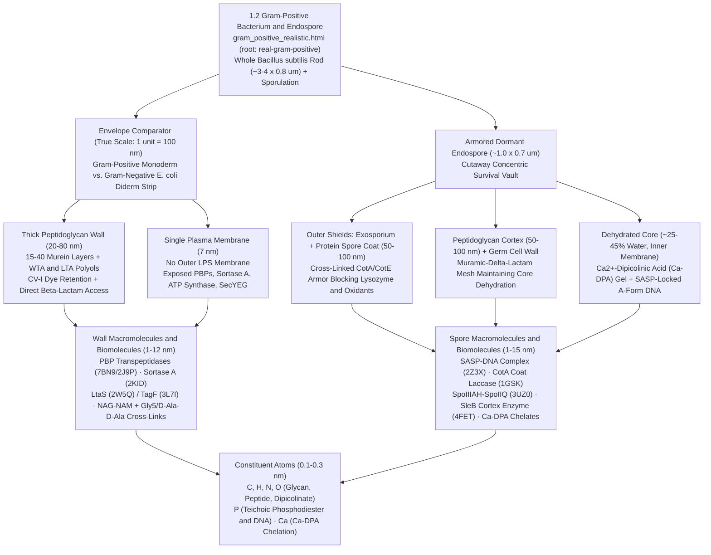

# 11 — Gram-Positive Bacteria & Armored Endospores: *Bacillus subtilis* Realistic 3D Model, Cell Wall Comparator & Guided Tour

**Iteration:** 11 (Standalone Realistic WebGL2 *Bacillus subtilis* Vegetative, Asymmetric Sporulation & Dormant Endospore Model, Side-by-Side Gram-Positive vs. Gram-Negative Wall Comparator, 3-Persona Guided Tour & GPU `.opus` Narration in `EN` & `ES`)  
**Status:** 📋 **Planned**  
**Parent Index:** [roadmap/README.md](./README.md)  
**Previous Step:** [10-archaea-third-domain-and-endosymbiosis.md](./10-archaea-third-domain-and-endosymbiosis.md)  
**Next Step:** [12-protists-and-eukaryotic-parasites.md](./12-protists-and-eukaryotic-parasites.md)

---

## 1. Executive Summary & Pedagogical Goals

In the current curriculum (`Stage 1 · Simple Cells — Prokaryotes`), learners inspect only one bacterial architecture: Gram-negative ***Escherichia coli*** (`1.1 · Bacterium`, [`prokaryote_cell_realistic.html`](../prokaryote_cell_realistic.html)), which wraps a wafer-thin `3 nm` peptidoglycan sheet between two lipid membranes (`diderm`). Without its architectural twin—a **Gram-positive (`monoderm`) bacterium**—and without bacterial **endospores**, three core microbiology concepts remain abstract or widely misunderstood:

1. **Why the Gram Stain Divides the Bacterial World:** Learners memorize "purple = Gram-positive, pink = Gram-negative" without ever seeing the physical geometry behind the test. Placing a `20–80 nm` multilayered **peptidoglycan wall** stitched with anionic **wall teichoic (`WTA`)** and **lipoteichoic (`LTA`)** acids directly beside *E. coli*'s outer LPS membrane + `3 nm` wall makes crystal-violet–iodine (`CV–I`) retention—and why Gram-positive walls leave **penicillin-binding proteins (`PBPs`)** directly exposed to β-lactam antibiotics and lysozyme—visually self-evident.
2. **How One Cell Survives Boiling, Desiccation, Radiation, and Millennia:** Students routinely confuse bacterial **endospores** (*Bacillus*, *Clostridium*) with reproductive fungal spores. Rendering asymmetric **sporulation** inside a living *Bacillus subtilis* mother cell alongside a cutaway **dormant endospore** proves that sporulation is not reproduction (`1` vegetative cell → `1` dormant vault → `1` germinated cell), but an extraordinary multi-layer architectural transformation replacing ~80% cytoplasmic water with vitrified **`Ca²⁺`-dipicolinic acid (`Ca-DPA`)** and **`SASP`-armored A-form DNA**.
3. **Completing `Stage 1 · Simple Cells — Prokaryotes`:** Together with Gram-negative ***E. coli*** (`1.1`), ***Archaea*** ([Phase 10](./10-archaea-third-domain-and-endosymbiosis.md)), and now Gram-positive ***Bacillus subtilis* & Endospores** (`Phase 11`), `Stage 1` delivers a complete comparative foundation of prokaryotic cell envelopes, antibiotic pharmacology, and survival physiology before learners move into protists and complex eukaryotes (`Stage 2`).

**Phase 11** introduces one flagship standalone realistic WebGL2 page, its Explorer zoom subtree, 4-mode reading lenses, a 3-persona bilingual Guided Tour, and sharded GPU `.opus` narration:

- **Realistic Standalone WebGL2 Model (`gram_positive_realistic.html`, `src/pages/gram_positive_realistic.ts`, `root: 'real-gram-positive'`):**
  - Built at true bacterial scale (`1 unit = 100 nm`, `NM = 0.01`, matching `prokaryote_cell_realistic.html`) with interactive state presets (**Vegetative Rod + Wall Comparator**, **Asymmetric Sporulation**, **Cutaway Armored Endospore**, and **Gram Stain / β-Lactam Overlay**).
  - Drills strictly **Whole → Tiniest**:
    1. **Whole Cell (`~3–4 × 0.8 µm`):** Cutaway ***Bacillus subtilis*** vegetative rod (`4.22 Mbp` circular dsDNA, `~4,100` genes) entering asymmetric **sporulation** (`FtsZ` polar septum, `SpoIIIE` DNA translocation, `SpoIIIAH–SpoIIQ` engulfment channel), flanked by a true-scale **Gram-Negative *E. coli* Envelope Comparison Strip** and a liberated cutaway **Armored Dormant Endospore (`~1.0 µm`)**.
    2. **Thick Multilayered Peptidoglycan Wall (`20–80 nm`) & Single Plasma Membrane:** `15–40` cross-linked murein strata anchored by **wall teichoic acids (`WTA`)** and membrane-tethered **lipoteichoic acids (`LTA`)**, with **no outer LPS membrane**, live crystal-violet–iodine (`CV–I`) retention visualization, and unimpeded **β-lactam** access to outer-leaflet `PBPs`.
    3. **Armored Dormant Endospore (`~1.0 µm`) Concentric Shields:** Cut open to reveal every concentric barrier—outermost **exosporium** (toggleable *Bacillus*-group paracrystalline/nap veil & crust), cross-linked protein **spore coat**, outer forespore membrane, thick modified **peptidoglycan cortex**, **germ cell wall**, compressed inner spore membrane (`GerA` receptors & `SpoVA` channels), and a dehydrated low-water **core** (`~25–45%` water) saturated with **`Ca²⁺`-dipicolinic acid (`Ca-DPA`)** and **small acid-soluble spore proteins (`SASPs`)** locking chromosomal DNA into radiation- and heat-resistant **A-form** geometry.
    4. **Macromolecules & Biomolecules (`1–25 nm`):** Coarse-grained PDB surfaces for **`PBP` transpeptidases**, **Sortase A (`SrtA`)**, **`LtaS`/`TagF` teichoic synthases**, **`α/β-SASP–DNA`**, **`CotA` coat protein**, and **`SleB` cortex lytic enzyme**, plus explicit molecular geometry for **`NAG–NAM` glycan strands**, **`D-Ala–D-Ala` / pentaglycine (`Gly₅`) tetrapeptide cross-links**, **teichoic phosphate polyols**, and **`Ca-DPA` chelates**.
    5. **Atoms (`0.1–0.3 nm`):** Element-resolved CPK atomic assemblies of **`C, H, N, O, P, Ca`** across the `D-Ala–D-Ala` transpeptidation bond, phosphodiester teichoic backbone, and `Ca²⁺` coordination pocket of dipicolinic acid.

---

## 2. Whole-to-Tiniest Drill-Down Architecture

Every visual transition in `gram_positive_realistic.html` and `cell_explorer.html` descends monotonically from the intact `~3.5 µm` bacterium down to individual `0.1–0.3 nm` atoms, keeping *E. coli* side-by-side at the envelope tier so learners immediately anchor every structural difference in real nanometres.



### Comparative Spec Sheet: Gram-Positive (*B. subtilis*) vs. Gram-Negative (*E. coli*) vs. Dormant Endospore

| Structural / Functional Trait | Gram-Positive Vegetative (*Bacillus subtilis*) | Gram-Negative Vegetative (*Escherichia coli* Ref.) | Armored Dormant Endospore (*B. subtilis* Spore) | Key PDB IDs & Dimensions |
| :--- | :--- | :--- | :--- | :--- |
| **Whole-Cell Dimensions** | `~3.0–4.0 × 0.8 µm` rod (`~20 atm` internal turgor) | `~2.0 × 0.9 µm` rod (`~2–5 atm` internal turgor) | `~1.0–1.2 × 0.7 µm` ovoid refractile body | Scale `1 unit = 100 nm` (`NM = 0.01`) |
| **Membrane Topology** | **Monoderm** (`1` phospholipid bilayer, `7 nm`) | **Diderm** (`2` bilayers: outer `LPS` membrane + inner bilayer) | **Dual engulfed membranes** (outer forespore remnant + compressed inner spore membrane) | `2OMF` (OmpF porin, *E. coli* strip); `6OQR` (ATP synthase, `23 nm`) |
| **Peptidoglycan Thickness & Chemistry** | **`20–80 nm`** (`15–40` cross-linked `NAG–NAM` layers; direct `mDAP` & canonical `Gly₅`/`D-Ala–D-Ala` cross-links) | **`2–7 nm`** (`1–3` layers in periplasmic space; tethered via Braun's lipoprotein) | **Two distinct layers:** thick `50–100 nm` low-crosslink **cortex** (muramic-δ-lactam) + thin **germ cell wall** | `7BN9` (*B. subtilis* PBP3, `8 nm`); `2J9P` (*B. subtilis* PBP4a + PG mimetic); `4FET` (`SleB` cortex lytic enzyme) |
| **Surface Anionic Polymers & Anchors** | **Wall Teichoic Acids (`WTA`)** on `NAM` C6 + **Lipoteichoic Acids (`LTA`)** anchored in plasma membrane; **Sortase A** anchors `LPXTG` wall proteins | **Lipopolysaccharide (`LPS`)** O-antigen + lipid A on outer leaflet (no teichoic acids; no Sortase A) | **Exosporium** (glycoprotein nap/crust) + cysteine-cross-linked **Protein Spore Coat** (`50–100 nm`, `>70` coat proteins) | `2W5Q` (`LtaS`, `5.5 nm`); `3L7I` (`TagF`, `6 nm`); `2KID` / `1T2P` (`Sortase A`, `4.5 nm`); `1GSK` (`CotA` coat laccase, `6.5 nm`) |
| **Gram Stain Behavior** | **Purple (Gram-positive):** ethanol dehydrates thick `PG` mesh, shrinking pores and trapping `CV–I` complexes | **Pink (Gram-negative):** ethanol dissolves outer `LPS` membrane and flushes `CV–I` out of thin `3 nm` wall; retains safranin | **Impermeable** to standard Gram stain (appears as unstained clear oval unless heat-driven with malachite green / Schaeffer–Fulton) | `CV–I` complex `~1.2–1.5 nm` vs. dehydrated `PG` pore `~1–2 nm` |
| **β-Lactam & Lysozyme Vulnerability** | **High accessibility:** penicillin & lysozyme diffuse directly through porous wall to outer-leaflet `PBPs` and `NAG–NAM` β-1,4 bonds (MRSA counters via low-affinity `PBP2a`, `1VQQ`) | **Barrier-gated:** outer `LPS` membrane blocks lysozyme and large antibiotics; small β-lactams must traverse `OmpF` porins and evade `AcrAB–TolC` efflux (`5O66`) | **Extreme resistance:** protein coat blocks lysozyme, disinfectants, and solvents; metabolically dormant (no active `PBP` synthesis) | `7BN9`, `2J9P`, `1VQQ` (PBP2a comparison); `5O66` (*E. coli* efflux, `33 nm`) |
| **Genome, Water Content & Metabolism** | `4.22 Mbp` circular B-form `dsDNA`; `~80%` water; active `70S` translation, `FtsZ` division & respiration | `4.64 Mbp` circular B-form `dsDNA`; `~80%` water; active `70S` translation & respiration | `4.22 Mbp` `dsDNA` locked in **A-form** by **`α/β-SASPs`**; **`~25–45%` water** vitrified with **`~10–15%` dry-weight `Ca-DPA`**; zero detectable metabolism until `GerA` germination | `2Z3X` (*B. subtilis* `SASP–DNA`, `4 nm`); `3J9W` (*B. subtilis* `70S` ribosome, `25 nm`); `2VXY` (`FtsZ`, `4.5 nm`); `3UZ0` (`SpoIIIAH–SpoIIQ` sporulation channel); `2IUU` (FtsK/SpoIIIE DNA motor) |
| **Atomic Signature (`0.1–0.3 nm`)** | **`C, H, N, O`** (`NAG–NAM` + tetrapeptide/`Gly₅`) + **`P`** (teichoic phosphodiesters, `ATP`) + surface **`Mg²⁺`/`Ca²⁺`** | **`C, H, N, O, P`** (phospholipids, `LPS` lipid A phosphates, `DNA`) | **`Ca`** (`Ca²⁺` 1:1 chelated with `C, H, N, O` dipicolinate pyridine-2,6-dicarboxylate) + **`P`** (A-form DNA backbone) | Van der Waals radii: `H` `1.2 Å`, `C` `1.7 Å`, `N` `1.55 Å`, `O` `1.52 Å`, `P` `1.8 Å`, `Ca²⁺` `1.0–1.14 Å` (ionic) |

### Whole → Tiniest 5-Tier Drill-Down Map (Explorer Node Hierarchy)

| Scale Tier | Size Range | Interactive `gram_positive_realistic.html` Parts & `cell_explorer.html` Nodes |
| :--- | :--- | :--- |
| **Tier 1 · Whole Cell & Lifecycle** | `1.0–4.0 µm` | `real-gram-positive` (cutaway vegetative + sporulating *B. subtilis*), `gram-wall-compare` (side-by-side *E. coli* strip), `asymmetric-septum` (`FtsZ` `2VXY` + `SpoIIIE` DNA pump `2IUU` + `SpoIIIAH–SpoIIQ` `3UZ0`), `dormant-endospore` (`~1.0 µm` cutaway) |
| **Tier 2 · Envelope & Spore Shields** | `7–100 nm` | `gram-pos-wall` (`20–80 nm` `PG`), `teichoic-acids` (`WTA` + `LTA`), `gram-pos-membrane` (`7 nm` monoderm bilayer), `spore-exosporium` (outer nap/crust), `spore-coat` (`50–100 nm` cross-linked protein armor), `spore-cortex` (`50–100 nm` modified `PG` + germ cell wall), `spore-core` (dehydrated `Ca-DPA` gel) |
| **Tier 3 · Macromolecular Machines** | `4–25 nm` | `pbp-transpeptidase` (`7BN9`/`2J9P`), `sortase-a` (`2KID`/`1T2P`), `teichoic-synthases` (`LtaS` `2W5Q`, `TagF` `3L7I`), `sasp-dna-complex` (`2Z3X`), `cota-coat-protein` (`1GSK`), `sleb-lytic-enzyme` (`4FET`), `bs-ribosome` (`3J9W`) |
| **Tier 4 · Biomolecules & Cross-Links** | `0.5–3 nm` | `nag-nam-glycan` (alternating β-1,4 sugars), `pg-crosslink` (`D-Ala–D-Ala` / `Gly₅` tetrapeptide bridge + β-lactam pocket), `teichoic-polyol` (glycerol/ribitol-phosphate chain), `ca-dpa-chelate` (1:1 `Ca²⁺`–dipicolinate complex) |
| **Tier 5 · Constituent Atoms** | `0.1–0.3 nm` | `atom-ca` (`Ca²⁺` divalent core chelator), `atom-p` (`P` teichoic/DNA phosphate), plus shared Explorer atomic nodes `atom-c`, `atom-h`, `atom-n`, `atom-o` |

---

## 3. Interactive Guided Tour / Tutorial Spec

### Tour Metadata & Architecture
- **Tour Script:** [`src/tours/gram_positive.ts`](../src/tours/gram_positive.ts) (`root: 'real-gram-positive'`, exported as `gram_positiveTour` and registered under `ALL_TOURS.gram_positive` and `TOUR_BY_ROOT['real-gram-positive']`).
- **Multi-Persona Scripts:** [`src/tours/personas_gram_positive.ts`](../src/tours/personas_gram_positive.ts) (`PERSONAS_GRAM_POSITIVE`, merged into `TOUR_PERSONA_REGISTRY` in [`src/tours/tour_personas.ts`](../src/tours/tour_personas.ts)).
- **Localization & Personas:** Full `EN` and `ES` scripts across all `3` personas (`pop` = *Everyday Guide*, `blueprint` = *Systems Engineer*, `scientific` = *Molecular Biologist*), **`62` timed cues** (`~5.5` minutes total runtime).
- **Hard Mechanical Constraints:**
  - Every cue across all `6` `(locale × persona)` tracks MUST be **`<= 110` plain characters** after stripping `[[label|part]]` markup (`stripRichLinks`).
  - **100% `[[label|part]]` Highlight Parity:** Every cue's target part key(s) (`|pg_wall`, `|teichoic`, `|ca_dpa`, `|sasp_dna`, etc.) must match identically across `en.pop`, `en.blueprint`, `en.scientific`, `es.pop`, `es.blueprint`, and `es.scientific`.

### Chapter-by-Chapter Whole → Tiniest Tour Progression (`6` Chapters, `62` Cues)

| Chapter | Focus & Camera Choreography | Cue Count | Key Interactive Highlights (`[[label\|part]]`) |
| :--- | :--- | :---: | :--- |
| **`ch0` · Two Bacterial Blueprints** | Wide orbit of cutaway *B. subtilis* (`~3.5 µm`) sliding beside the true-scale *E. coli* wall strip (`1 unit = 100 nm`); establishes `monoderm` vs. `diderm`. | `8` | `rod`, `pg_wall`, `pm`, `ecoli_strip` |
| **`ch1` · Thick Peptidoglycan, Teichoic Acids & the Gram Stain** | Zoom into `20–80 nm` wall cross-section; toggles live `CV–I` ethanol-decolorization flow and shows why Gram-positive walls retain violet dye while exposing `PBPs` to β-lactams. | `11` | `pg_wall`, `teichoic`, `pbp`, `sortase`, `ecoli_strip` |
| **`ch2` · Starvation Switch & Asymmetric Sporulation** | Transitions camera along the mother cell to the polar `FtsZ` septum, `SpoIIIE` pumping a replicated chromosome into the forespore, and `SpoIIIAH–SpoIIQ` engulfment feeding channels. | `10` | `septum`, `spoiiie`, `forespore`, `dna`, `ribosome` |
| **`ch3` · Concentric Armor of the Dormant Endospore** | Flies into the liberated cutaway `1.0 µm` endospore, peeling back **exosporium** → cross-linked **spore coat** → thick **peptidoglycan cortex** → **germ cell wall** → compressed inner membrane. | `11` | `exosporium`, `coat`, `cortex`, `germ_wall`, `spore_im` |
| **`ch4` · Inside the Dehydrated Core: `Ca-DPA` & `SASP`-Locked DNA** | Zooms deep into the low-water core (`~30%` water) to inspect `Ca²⁺`-dipicolinate stacks and `α/β-SASPs` (`2Z3X`) twisting DNA into UV- and heat-resistant A-form, then previews `GerA`/`SleB` germination. | `11` | `core`, `ca_dpa`, `sasp_dna`, `gera`, `sleb` |
| **`ch5` · Molecules & Atoms of Survival (`C, H, N, O, P, Ca`)** | Molecular-to-atomic zoom onto `NAG–NAM` glycan strands, `D-Ala–D-Ala` / `Gly₅` cross-links (and β-lactam blockade of `PBP`), teichoic phosphate polyols, and individual `C, H, N, O, P, Ca` atoms. | `11` | `nag_nam`, `crosslink`, `pbp`, `teichoic_mol`, `ca_dpa`, `atoms` |

### Strict `AGENTS.md` Rule 8 Analogy Restraint Specification

In strict compliance with [`AGENTS.md`](../AGENTS.md) **Rule 8**:
- **`> 95%` Direct, Distraction-Free Prose:** **`59` of the `62` cues (`95.2%`)** in `pop` (*Everyday Guide*), plus `100%` of Explorer descriptions outside the designated complex mechanisms, MUST use direct, clear, literal biological prose. Zero analogies on intros, dimensions, camera moves, UI prompts, simple shapes, or summaries.
- **Exact `2–3` Complex-Concept Analogies ONLY (`~1` every `1.8` minutes):** The `gram_positive` tour permits **exactly `3` purposeful analogies** (within the strict `2–3` ceiling), restricted exclusively to the three non-obvious physicochemical mechanisms:
  1. **Cue `gp_stain_01` (`ch1`, ~1:15) — Gram-Stain Crystal-Violet Retention:** Alcohol shrinks the thick dehydrated peptidoglycan wall like a **tightened mesh net** trapping large crystal-violet–iodine complexes inside, whereas dissolving *E. coli*'s outer lipid membrane lets dye wash straight through its thin single layer.
  2. **Cue `gp_core_02` (`ch4`, ~3:30) — Core Dehydration, `Ca-DPA` Vitrification & `SASP` DNA Locking:** Replacing free water with vitrified `Ca-DPA` and wrapping DNA in `SASP` sleeves turns the spore core into a sealed **biological time-capsule vault** that halts heat denaturation and UV damage for decades to millennia.
  3. **Cue `gp_pbp_03` (`ch5`, ~5:00) — β-Lactam Inhibition of `PBP` Transpeptidases:** Because penicillin mimics the `D-Ala–D-Ala` cross-link tip, it wedges covalently into an exposed `PBP` active site like a **jammed key snapping inside a lock**, halting wall repair while `20 atm` internal turgor ruptures the cell.

### Sample Bilingual 3-Persona Cues (`src/tours/personas_gram_positive.ts` Format)

All sample cues below are verified **`<= 110` plain characters** after `stripRichLinks` with **`100%` `[[label|part]]` highlight target parity** across all `6` tracks:

```ts
// gp_wall_02 — Direct prose (NO analogy); targets: ['pg_wall', 'teichoic']
gp_wall_02: {
  en: {
    pop: "Its [[peptidoglycan wall|pg_wall]] is ten times thicker than E. coli's and laced with [[teichoic acids|teichoic]].",
    blueprint: "A 20–80 nm [[murein load shell|pg_wall]] anchored by anionic [[teichoic tie-rods|teichoic]] resists ~20 atm turgor.",
    scientific: "Multilayered [[peptidoglycan (20–80 nm)|pg_wall]] covalently binds [[WTA/LTA polyols|teichoic]] via C6-NAM links."
  },
  es: {
    pop: "Su [[pared de peptidoglucano|pg_wall]] es diez veces más gruesa que en E. coli y lleva [[ácidos teicoicos|teichoic]].",
    blueprint: "Un [[armazón de mureína|pg_wall]] de 20–80 nm con [[anclajes teicoicos|teichoic]] soporta ~20 atm de turgencia.",
    scientific: "El [[peptidoglucano (20–80 nm)|pg_wall]] une [[WTA y LTA aniónicos|teichoic]] por enlaces fosfodiéster en NAM."
  }
},
// gp_stain_01 — Analogy #1 of 3 (crystal-violet trapping in thick mesh); targets: ['pg_wall', 'ecoli_strip']
gp_stain_01: {
  en: {
    pop: "Alcohol shrinks this [[thick mesh wall|pg_wall]] like a tight net trapping purple dye, while [[E. coli|ecoli_strip]] leaks it.",
    blueprint: "Ethanol dehydrates the [[40 nm pore matrix|pg_wall]] trapping CV-I complexes; [[Gram-negative strips|ecoli_strip]] flush clear.",
    scientific: "Dehydrated [[peptidoglycan|pg_wall]] retains CV-I complexes, whereas LPS loss in [[E. coli|ecoli_strip]] elutes crystal violet."
  },
  es: {
    pop: "El alcohol encoge esta [[gruesa red|pg_wall]] atrapando el tinte violeta, mientras [[E. coli|ecoli_strip]] lo deja escapar.",
    blueprint: "El etanol contrae la [[matriz de 40 nm|pg_wall]] reteniendo CV-I; el [[borde Gram-negativo|ecoli_strip]] pierde el tinte.",
    scientific: "El [[peptidoglucano|pg_wall]] deshidratado retiene CV-I; sin LPS externo, [[E. coli|ecoli_strip]] eluye el cristal violeta."
  }
},
// gp_core_02 — Analogy #2 of 3 (Ca-DPA vitrification as biological time-capsule vault); targets: ['ca_dpa', 'sasp_dna']
gp_core_02: {
  en: {
    pop: "Packed with [[Ca-DPA|ca_dpa]] and [[SASP shields|sasp_dna]], the dry core acts like a biological time-capsule vault.",
    blueprint: "Vitrified [[Ca-DPA gel|ca_dpa]] (10% dry mass) and [[SASP-locked DNA|sasp_dna]] halt hydrolysis and UV damage.",
    scientific: "1:1 [[Ca²⁺-dipicolinate|ca_dpa]] reduces core water to ~30%, while [[α/β-SASPs (2Z3X)|sasp_dna]] lock A-form DNA."
  },
  es: {
    pop: "Lleno de [[Ca-DPA|ca_dpa]] y [[escudos SASP|sasp_dna]], el núcleo seco actúa como una cápsula biológica del tiempo.",
    blueprint: "El gel [[Ca-DPA|ca_dpa]] vitrificado y el [[ADN bloqueado por SASP|sasp_dna]] frenan la hidrólisis y los rayos UV.",
    scientific: "[[Ca²⁺-dipicolinato|ca_dpa]] 1:1 baja el agua al ~30% y las [[α/β-SASP (2Z3X)|sasp_dna]] fijan el ADN en forma A."
  }
}
```

---

## 4. Implementation Steps & File Plan

### Step 1: Standalone Realistic WebGL2 Page & PDB Assets (`gram_positive_realistic.html`, `src/pages/gram_positive_realistic.ts`)
- Coarse-grain real RCSB structures via [`tools/embed_structures.py`](../tools/embed_structures.py) (`7BN9`, `2J9P`, `2KID`, `2W5Q`, `3L7I`, `2Z3X`, `1GSK`, `3UZ0`, `2IUU`, `4FET`, `3J9W`, `2VXY`, reusing `2OMF`, `5O66`, `6OQR` for the *E. coli* strip) on single-line data blocks (`AGENTS.md` Rule 4).
- Create [`gram_positive_realistic.html`](../gram_positive_realistic.html) + [`src/pages/gram_positive_realistic.ts`](../src/pages/gram_positive_realistic.ts) (`~22` inspectable parts, seeded RNG isolated per subsystem per Rule 3):
  - **Scene Composition (`1 unit = 100 nm`):**
    1. Cutaway ***Bacillus subtilis* vegetative/sporulating rod** (`3.6 × 0.8 µm`, quarter-wedge cutaway `x > 0, z > 0`) displaying a `40 nm` multilayered `NAG–NAM` peptidoglycan shell, protruding `WTA`/`LTA` polyol chains, single `7 nm` plasma membrane studded with `PBPs`, `Sortase A`, `LtaS`, `ATP` synthase, and `SecYEG`, cytoplasmic `4.22 Mbp` nucleoid + `70S` ribosomes, and a polar **asymmetric sporulation zone** (`FtsZ` ring, `SpoIIIE` DNA translocation pore, engulfed forespore with `SpoIIIAH–SpoIIQ` channels).
    2. **True-Scale Gram-Negative *E. coli* Envelope Comparator Strip** positioned parallel to the vegetative wall cut edge (`~0.6 µm` slab) so learners directly compare `40 nm PG + 1 membrane` vs. `outer LPS + OmpF + 3 nm PG + inner membrane` at identical magnification.
    3. **Liberated Cutaway Dormant Endospore (`1.0 × 0.7 µm`)** mounted adjacent to the mother pole with concentric radial depth layers: toggleable **exosporium**, cross-linked **spore coat (`CotA`/`CotE`)**, outer forespore membrane, thick **peptidoglycan cortex**, **germ cell wall**, compressed **inner membrane (`GerA`/`SpoVA`)**, and vitrified **`Ca-DPA` + `SASP`-bound A-form DNA core**.
    4. **Molecular & Atomic Inset Anchor:** True-scale explicit stick-and-ball patch on the cut face showing `NAG–NAM` chains, `D-Ala–D-Ala` / `Gly₅` cross-links, teichoic phosphodiesters, `Ca-DPA` coordination, and CPK atoms (`C, H, N, O, P, Ca`).
  - **Live Particle Flows & Interactive Overlays:** Toggleable **Gram-Stain Mode** (purple `CV–I` spheres retained inside the shrunk `40 nm` wall vs. washed out of the *E. coli* strip), **β-Lactam Mode** (penicillin molecules diffusing straight onto exposed `PBP` active sites), **`Ca-DPA` Core Packing / Germination Release** streams, plus vegetative `Lipid II` wall precursor export and `ATP`/`mRNA` flows.
  - **Full Embed & Debug API:** Implement `postMessage` (`to: 'realistic-cell'`, `from: 'realistic-cell'`; `track`, `fly`, `free`, `blink`, `ghost`, `set`, `arrived`, `focusOf`) and `window.__cell` (`shot`, `step`, `sites`, `procs`, `flows`, `views`, `pointsOf`).
- Register `gram_positive_realistic.html` in `HTML_PAGES` ([`tests/verify_all.ts`](../tests/verify_all.ts)), `STANDALONE_PAGE_PART_KEYS` ([`src/content/registry.ts`](../src/content/registry.ts)), `sitemap.xml`, [`README.md`](../README.md), and `esbuild` page compilation, and author [`docs/gram_positive_realistic_manual.md`](../docs/gram_positive_realistic_manual.md) (`AGENTS.md` Rule 7).

### Step 2: Explorer Subtrees (`NODES`), Curriculum Tree (`MENU_GROUPS`) & `COURSE_SEQUENCE`
- Update [`src/pages/cell_explorer.ts`](../src/pages/cell_explorer.ts):
  - Add `real-gram-positive` under `MENU_GROUPS` **`Stage 1 · Simple Cells — Prokaryotes`** alongside `1.1 · Bacterium (E. coli)` and Phase 10's Archaea module (e.g., `1.2 · Gram-positive bacterium & endospore (Bacillus subtilis)`), and wire `TOUR_BY_ROOT['real-gram-positive'] = window.TOURS?.gram_positive ?? null`.
  - Add `~15` zoomable Whole → Tiniest child nodes to `NODES` (`gram-wall-compare`, `gram-pos-wall`, `teichoic-acids`, `gram-pos-membrane`, `asymmetric-septum`, `dormant-endospore`, `spore-exosporium`, `spore-coat`, `spore-cortex`, `spore-core`, `pbp-transpeptidase`, `sortase-a`, `sasp-dna-complex`, `nag-nam-crosslink`, `ca-dpa-chelate`, `atom-ca`), reusing `partModel(...)`, `nest`, and `tagFrom` (`AGENTS.md` Rule 1) and linking down to existing Explorer atomic nodes (`atom-c`, `atom-h`, `atom-n`, `atom-o`, `atom-p`).
- Update `COURSE_SEQUENCE` in [`src/core/progress_service.ts`](../src/core/progress_service.ts) so Stage 1 flows sequentially through Gram-negative *E. coli* → Archaea (Phase 10) → **`real-gram-positive`** before advancing to Stage 2 Eukaryotes (`Next in Course →`).
- Add Spanish titles, tags, anchor labels, and UI phrases in [`src/core/locales/es_nodes.ts`](../src/core/locales/es_nodes.ts) and [`src/core/locales/es_phrases.ts`](../src/core/locales/es_phrases.ts).

### Step 3: 4-Mode Explanation Lenses (`src/content/lenses_gram_positive.ts`)
- Author [`src/content/lenses_gram_positive.ts`](../src/content/lenses_gram_positive.ts) exporting `GRAM_POSITIVE_NODE_LENSES` and `GRAM_POSITIVE_PART_LENSES`, registered in [`src/content/index.ts`](../src/content/index.ts).
- Provide complete, distinct `Simple`, `Story`, `Blueprint`, and `Scientific` explanations in both `EN` and `ES` for `real-gram-positive`, all `~15` new Explorer nodes, and all `~22` standalone hover parts in `gram_positive_realistic.html`, maintaining `100%` valid `[[Label|nodeId]]` supply-chain links and `> 95%` direct prose (`AGENTS.md` Rule 8).

### Step 4: Guided Tour & Multi-Persona Registration (`src/tours/`)
- Create [`src/tours/gram_positive.ts`](../src/tours/gram_positive.ts) (`6` chapters, `62` cues) and [`src/tours/personas_gram_positive.ts`](../src/tours/personas_gram_positive.ts) (`EN`/`ES` × `pop`/`blueprint`/`scientific`).
- Register `gram_positiveTour` in [`src/tours/index.ts`](../src/tours/index.ts), `PERSONAS_GRAM_POSITIVE` in [`src/tours/tour_personas.ts`](../src/tours/tour_personas.ts), and Spanish tour chapter/step titles in [`src/core/locales/es_tours.ts`](../src/core/locales/es_tours.ts).

### Step 5: Sharded `< 48 MB` GPU `.opus` Audio Packaging (`Makefile`, `Dockerfile`, `.github/workflows/deploy.yml`)
- Run `make export-cues` to emit the updated bilingual manifest (`dist/tour_cues_manifest.json`) including all `real-gram-positive` Tour cues (`62 × 3 personas × 2 langs`) and Explorer node/part lenses.
- Synthesize all new clips locally on RTX GPU using `GPT-SoVITS` (`EN` Public-Domain `CC0` voices `v1`, `v2`, `v3`) and `F5-Spanish` (`ES` `latam` + `spain/{blueprint,scientific}`) from `tools/voices/`.
- Pack Phase 11 narration into dedicated **`< 48 MB`** archives:
  - `audio_stage1_grampos_en.tar.gz` (`audio/en/*/real-gram-positive` + `audio/lenses/en/*/*/real-gram-positive*.opus` + Phase 11 Explorer node clips)
  - `audio_stage1_grampos_es.tar.gz` (`audio/es/latam/real-gram-positive` + `audio/es/spain/*/real-gram-positive` + `audio/lenses/es/*/*/real-gram-positive*.opus` + Phase 11 Explorer node clips)
- Wire both archives into `AUDIO_ARCHIVES`, `BASE_EXCLUDE`, `unpack-audio`, and `pack-audio` in [`Makefile`](../Makefile), as well as asset unpack steps in [`Dockerfile`](../Dockerfile) and [`.github/workflows/deploy.yml`](../.github/workflows/deploy.yml).

---

## 5. Verification Gates (`tests/verify_all.ts` & Visual Check)

1. **TypeScript Build & Static Integrity (`make typecheck && make build`):**
   - `tsc --noEmit` and `esbuild` pass cleanly with `dist/pages/gram_positive_realistic.js` emitted and zero unresolved imports or missing `STANDALONE_PAGE_PART_KEYS`.
2. **Standalone WebGL2 E2E & Interactive Part Verification (`make test`):**
   - Headless Chrome renders `gram_positive_realistic.html` (standalone and embedded via `cell_explorer.html#real-gram-positive`) with **`0` console/page errors**.
   - Asserts `100%` of declared hover parts (`pg_wall`, `teichoic`, `pm`, `ecoli_strip`, `pbp`, `sortase`, `septum`, `spoiiie`, `exosporium`, `coat`, `cortex`, `germ_wall`, `spore_im`, `core`, `ca_dpa`, `sasp_dna`, `gera`, `sleb`, `nag_nam`, `crosslink`, `atoms`), camera views, Gram-stain / β-lactam toggles, and live particle flows.
   - Asserts `MENU_GROUPS` renders `1.2 · Gram-positive bacterium & endospore` inside `Stage 1 · Simple Cells — Prokaryotes` in `EN` & `ES`, and `COURSE_SEQUENCE` transitions cleanly via **`Next in Course →`**.
3. **Multi-Persona Tour & Rule 8 Analogy-Restraint Validation (`tests/verify_all.ts`):**
   - Verifies all `62` `gram_positive` cues across `EN` & `ES` (`pop`, `blueprint`, `scientific`) satisfy `<= 110` plain characters after `stripRichLinks`, maintain `100%` `[[...|part]]` highlight target parity, and obey `AGENTS.md` Rule 8 (`> 95%` direct prose — `59/62` = `95.2%`; strictly `2–3` complex-concept analogies across the tour).
4. **4-Mode Lenses & Sharded `.opus` Integrity (`tests/verify_all.ts`):**
   - Verifies `100%` `[[Label|nodeId]]` resolution (including atomic nodes `atom-ca`, `atom-p`, `atom-c`, `atom-h`, `atom-n`, `atom-o`), 4-mode distinctness across `Simple`/`Story`/`Blueprint`/`Scientific` in `EN` & `ES`, valid `OggS` `.opus` headers for every new Tour cue and Explorer lens across all `5` voices, and strict **`< 48 MB`** archive size for `audio_stage1_grampos_en.tar.gz` and `audio_stage1_grampos_es.tar.gz`.
5. **Visual Eye-Check (`AGENTS.md` Rule 6):**
   - Serve locally with `python3 tools/serve.py "$(pwd)" 8765`, capture `__cell.shot(...)` renders for every view (whole *B. subtilis* rod, side-by-side Gram-positive vs. Gram-negative wall strip, Gram-stain `CV–I` retention overlay, asymmetric sporulation septum, cutaway concentric endospore, and `NAG–NAM` / `Ca-DPA` / `SASP–DNA` molecular close-up), confirm zero z-fighting between concentric spore shells, run metabolism/particle flows for `30` simulated seconds, verify frame-render timing, and inspect every new Explorer level to confirm all 3D tags are legible and unobstructed.
