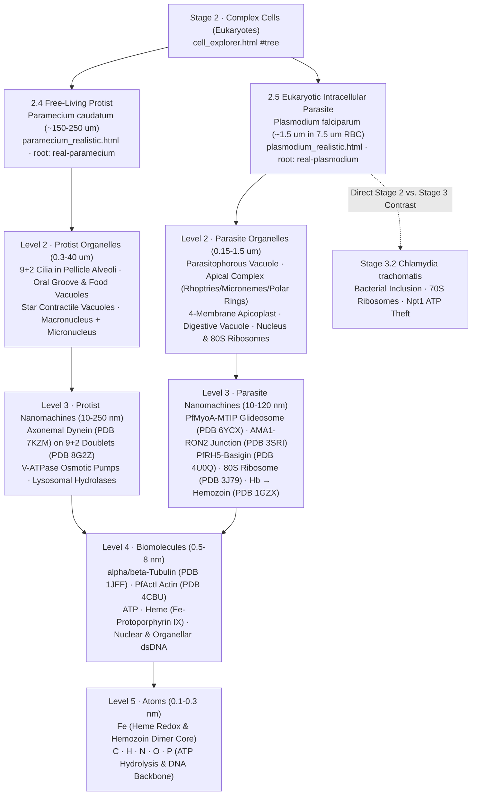

# 12 — Single-Celled Eukaryotes (Protists) & Eukaryotic Parasites: *Paramecium caudatum* & *Plasmodium falciparum*

**Iteration:** `12` (Two Standalone Realistic WebGL2 Protist & Eukaryotic-Parasite Scenes, Whole-to-Tiniest Molecular Cascades, 3-Persona Guided Tours & Sharded GPU `.opus` Narration in `EN` & `ES`)  
**Status:** 📋 **Planned**  
**Parent Index:** [`roadmap/README.md`](./README.md)  
**Previous Step:** [`11-gram-positive-bacteria-and-endospores.md`](./11-gram-positive-bacteria-and-endospores.md)  
**Next Step:** [`13-giant-viruses-viroids-and-prions.md`](./13-giant-viruses-viroids-and-prions.md)

---

## 1. Executive Summary & Pedagogical Goals

In `Stage 2 · Complex Cells (Eukaryotes)`, learners have so far explored budding yeast (a sessile fungus) alongside specialized animal and plant tissue cells that depend on multicellular bodies for food delivery, circulation, and defense. Meanwhile, `Stage 3 · Parasitic & Minimal Cells` ([Phase 08](./08-parasitic-and-minimal-cells-mycoplasma-chlamydia-rickettsia.md)) introduced obligate intracellular **bacteria** (*Chlamydia* and *Rickettsia*), which can leave newcomers with two persistent misconceptions:

1. **"Single-celled eukaryotes are simple stepping-stones."** In reality, free-living ciliate protists pack an entire predator's toolkit—locomotion, hunting, swallowing, acid digestion, osmotic water pumping, and sexual genome exchange—into **one autonomous cell** with zero organs or nervous system.
2. **"All intracellular parasites are bacteria or viruses."** In reality, some of humanity's most medically consequential intracellular pathogens—above all the malaria parasite ***Plasmodium falciparum***—are **full eukaryotes** hiding inside our own cells, equipped with a true nuclear envelope, `80S` cytosolic ribosomes, a mitochondrion, an **apical invasion complex**, and even a **4-membrane relict chloroplast (apicoplast)** inherited from an ancient engulfed red alga.

**Phase 12** closes both gaps by extending `Stage 2 · Complex Cells (Eukaryotes)` with two complementary realistic WebGL2 pages, Explorer subtrees, 4-mode lenses, and multi-persona Guided Tours—designed strictly **Whole → Tiniest** and contrasted directly against Stage 3 bacterial parasites (*Chlamydia* / *Rickettsia*):

1. **`2.4 · Free-Living Protist — Paramecium caudatum` (`paramecium_realistic.html`, `root: 'real-paramecium'`):**
   - A cutaway freshwater slipper-shaped ciliate (`~150–250 µm` long × `~55 µm` wide) operating as a complete single-celled predator:
     - **Pellicle Alveoli & `9+2` Motile Cilia:** Thousands of surface cilia anchored in basal bodies (**kinetosomes**) inside an armored alveolar pellicle, beating in coordinated **metachronal waves** powered by **axonemal dynein** arms walking along `9+2` microtubule doublets, interspersed with defensive **trichocysts**.
     - **Oral Groove → Phagocytic Food Vacuoles:** A ciliated funnel (**peristome** → **cytostome** → **cytopharynx**) sweeping live bacteria into budding **food vacuoles** that circulate along cytoskeletal tracks (**cyclosis**), fuse with acidic lysosomes, absorb digested monomers, and expel waste at the **cytoproct** (anal pore).
     - **Star-Shaped Contractile Vacuoles:** Paired anterior and posterior radial collecting canals (**ampullae + radiating arms**) lined with **V-ATPase** proton pumps and aquaporins actively bailing excess hypotonic freshwater out through rhythmic pores so the cell never bursts.
     - **Nuclear Dimorphism (Dual Nuclei):** A giant polyploid **macronucleus** (`~30 Mbp` somatic genome amplified to hundreds of copies) running nonstop daily mRNA transcription alongside a compact diploid **micronucleus** safeguarded as the germline archive for sexual exchange (**conjugation**).
2. **`2.5 · Eukaryotic Intracellular Parasite — Plasmodium falciparum` (`plasmodium_realistic.html`, `root: 'real-plasmodium'`):**
   - A cutaway **`~1.5 µm` merozoite** actively invading and remodeling a **`~7.5 µm` biconcave human red blood cell (erythrocyte)** inside a membrane-bound **parasitophorous vacuole (`PV` / `PVM`)**, directly contrasted with *Chlamydia*'s bacterial inclusion:
     - **True Eukaryotic Core:** Membrane-bound **nucleus** (`23.3 Mbp` across `14` linear chromosomes, `~5,300` genes), cytosolic **`80S` ribosomes** (PDB `3J79`), ER/Golgi secretory route, and a single branched **mitochondrion** (`6 kb` genome).
     - **Apical Complex & Glideosome:** Polar rings / apical polar assembly, tear-drop **rhoptries**, and cigar-shaped **micronemes** secreting adhesins (`PfRH5` binding host Basigin PDB `4U0Q`; `AMA1`–`RON2` forming the **moving junction** PDB `3SRI`) while the sub-pellicular **`PfMyoA`–`MTIP` glideosome** (PDB `6YCX`) walks along short **`PfActI` filaments** (PDB `4CBU`) between the plasma membrane and inner membrane complex (`IMC`) to drive invasion.
     - **The Apicoplast (`4`-Membrane Relict Chloroplast):** A non-photosynthetic plastid bounded by **four concentric lipid bilayers**—structural proof of **secondary endosymbiosis** (an ancestral protist engulfed a photosynthetic red alga that already held a 2-membrane chloroplast). Retaining its own **`35 kb` circular DNA** and bacterial-type **`70S` ribosomes**, it synthesizes essential isoprenoids (`MEP/DOXP`), fatty acids (`FAS-II`), and heme precursors—explaining why certain bacterial-ribosome antibiotics (e.g., doxycycline) kill *Plasmodium* only through a "delayed-death" hit on its apicoplast!
     - **Digestive Vacuole & Hemozoin Biocrystals:** Endocytosed human **hemoglobin** (PDB `1GZX`) is cleaved by acidic proteases (plasmepsins/falcipains) to harvest amino acids, releasing toxic free `Fe³⁺`-protoporphyrin IX (**heme**) that the parasite neutralizes by stacking into insoluble, dark **hemozoin** (`β`-hematin) crystals—the primary pharmacological target of quinoline antimalarials.

---

## 2. Whole-to-Tiniest Drill-Down Architecture

Both Phase 12 pages and their Explorer subtrees enforce a strict **Whole → Tiniest** inspection cascade, letting learners zoom smoothly from whole-cell behavior (`~200 µm` predator or `~7.5 µm` infected erythrocyte) down to organelles, macromolecular motors, biomolecules, and individual atoms (`Fe, C, H, N, O, P`).

### Comparative Spec Sheet: Free-Living Protist vs. Eukaryotic Parasite vs. Bacterial Parasite

| Feature | `2.4 Paramecium caudatum` (Free-Living Protist) | `2.5 Plasmodium falciparum` (Eukaryotic Parasite) | `3.2 Chlamydia trachomatis` (Bacterial Parasite, Phase 08) |
| :--- | :--- | :--- | :--- |
| **Domain & Taxon** | **Eukaryota** (Alveolata · Ciliophora) | **Eukaryota** (Alveolata · Apicomplexa) | **Bacteria** (Chlamydiota) |
| **Cell Dimensions** | `~150–250 × 45–65 µm` slipper-shaped cell (`1 unit = 10 µm` whole scene; `1 unit = 10 nm` axoneme inset) | Merozoite `~1.5 × 1.0 µm` inside `~7.5 × 2.0 µm` human RBC (`1 unit = 1 µm` invasion scene; `1 unit = 10 nm` glideosome/apicoplast inset) | `EB`: `~300 nm` sphere · `RB`: `~800–1,000 nm` dividing cell |
| **Genome Architecture** | **Dual nuclei**: polyploid **macronucleus** (`~30 Mbp` somatic, daily mRNA) + diploid **micronucleus** (germline sexual conjugation) | **Nuclear**: `23.3 Mbp` (`14` linear chromosomes, `~5,300` genes) + **Apicoplast** `35 kb` circular + **Mitochondrion** `6 kb` | Single circular bacterial **`1.04 Mbp`** `dsDNA` chromosome (`~895` genes; zero nucleus) |
| **Ribosomes** | Cytosolic **`80S`** + mitochondrial `55S`/`70S`-type | Cytosolic **`80S`** (PDB `3J79`) + relict apicoplast **`70S`** | Bacterial **`70S`** only (sensitive to macrolides/tetracyclines) |
| **Ecological Niche** | Autonomous freshwater predator hunting bacteria | Obligate intracellular parasite inside host RBC **parasitophorous vacuole** (`PVM`) | Obligate intracellular bacterium inside host epithelial **inclusion vacuole** |
| **Signature Envelope / Cortex** | **Pellicle alveoli** (flattened cortical sacs under plasma membrane) anchoring ciliary **kinetosomes** & **trichocysts** | **Inner Membrane Complex (`IMC`)** (homologous alveolar sacs!) beneath plasma membrane housing the glideosome | Disulfide-crosslinked `MOMP`/`OmcB` outer membrane (`EB`); fragile bilayer (`RB`) |
| **Motility & Entry Nanomachine** | **`9+2` motile cilia** (`~250 nm` diameter, `~10–12 µm` long) driven by **axonemal dynein** (PDB `7KZM` / `8G2Z`) on `αβ`-**tubulin** (PDB `1JFF`) | **Apical complex** (rhoptries, micronemes, polar rings), `PfRH5`–Basigin (PDB `4U0Q`), `AMA1`–`RON2` moving junction (PDB `3SRI`), and **`PfMyoA`–`MTIP` glideosome** (PDB `6YCX`) on **`PfActI`** (PDB `4CBU`) | Non-motile; **`T3SS`** injectisome needle secreting host-remodeling `Inc` effectors across inclusion membrane |
| **Water / Nutrient / Energy Strategy** | **Oral groove** → phagocytic **food vacuoles** + aerobic **mitochondria** + star **contractile vacuoles** (`V-ATPase` osmotic bilge pumping) | Endocytoses host **hemoglobin** (PDB `1GZX`) → **digestive vacuole** crystallizes toxic **heme** into **hemozoin**; glycolysis + apicoplast `MEP`/`FAS-II` + mitochondrion | Steals host cytosolic `ATP` via **`Npt1` ATP/ADP antiporters** (`Npt2` imports `GTP`/`CTP`/`UTP`) |
| **Pharmacological Insight** | Model organism for ciliary motility & osmoregulation | Immune to penicillin; **chloroquine/artemisinin** disrupt heme detoxification; **doxycycline** causes delayed death via apicoplast `70S` ribosomes | Treated with bacterial-ribosome antibiotics (azithromycin / doxycycline) targeting cytosolic `70S` ribosomes |

### Whole → Tiniest Molecular Scale & PDB Reference Sheet

| Cascade Tier | Physical Scale | *Paramecium caudatum* Targets | *Plasmodium falciparum* Targets | Verified PDB / Atomic Anchor |
| :--- | :--- | :--- | :--- | :--- |
| **1. Whole Cell / Host Scene** | `7.5–250 µm` | Full cutaway swimmer (`~200 µm`) in freshwater with bacterial prey | `~1.5 µm` merozoite docking & entering `~7.5 µm` RBC (`PV` formation) | Procedural + cryo-ET cutaway |
| **2. Organelles** | `0.2–40 µm` | Pellicle alveoli, oral groove, food vacuoles, star contractile vacuoles, macro/micronucleus | Apical complex (rhoptries, micronemes, polar rings/conoid), 4-membrane apicoplast, digestive vacuole, nucleus, mitochondrion | Cryo-ET / FIB-SEM ultrastructure |
| **3. Macromolecular Motors** | `10–250 nm` | `9+2` axoneme doublet repeat (`250 nm` Ø), outer **axonemal dynein**, vacuolar `V-ATPase` | **`PfMyoA`–`MTIP` glideosome**, `AMA1`–`RON2` moving junction, `PfRH5`–Basigin, **`80S` ribosome**, hemoglobin → hemozoin | `8G2Z`, `7KZM`, `6YCX`, `3SRI`, `4U0Q`, `3J79`, `1GZX` |
| **4. Biomolecules** | `0.5–8 nm` | `αβ`-**tubulin** heterodimer (`~8 nm`), **`ATP`**, phospholipids, `dsDNA` (`2 nm` Ø) | **`PfActI` actin** monomer (`~5.5 nm`), **`ATP`**, free **`heme`** (`Fe`-protoporphyrin IX), `β`-hematin dimer, `dsDNA` | `1JFF`, `4CBU`, `1GZX` (HEM ligand) |
| **5. Atoms** | `0.1–0.3 nm` | `C, H, N, O, P` (dynein `ATP → ADP + Pᵢ` cleavage & tubulin GTP hydrolysis) | **`Fe`** (heme iron center forming iron–propionate hemozoin links), `C, H, N, O, P` | Atomic radii & coordination bonds |

> [!NOTE]
> **Explicit Magnification Disclosure (`AGENTS.md` Rule 2):** Because *Paramecium* (`~200 µm`) spans `10,000×` the width of a microtubule (`25 nm`), whole-cell views render at `1 unit = 10 µm` (`Paramecium`) and `1 unit = 1 µm` (`Plasmodium` + RBC), while interactive molecular insets (`9+2` axoneme + dynein; glideosome + `AMA1`–`RON2`; 4-membrane apicoplast; hemoglobin → hemozoin) render at true macromolecular scale (`1 unit = 10 nm`) with an on-screen scale callout wherever magnified.

---

## 3. Interactive Guided Tour / Tutorial Specification

Phase 12 introduces two narrated, camera-choreographed Guided Tours (`src/tours/paramecium.ts` and `src/tours/plasmodium.ts`) plus their bilingual multi-persona script registry (`src/tours/personas_protists.ts`) wired into `TOUR_PERSONA_REGISTRY` (`src/tours/tour_personas.ts`) and `ALL_TOURS` (`src/tours/index.ts`).

### Strict Rules & Persona Parity (`AGENTS.md` Rule 8)
- **Languages & Personas:** Complete `EN` and `ES` narration for all `3` personas: `pop` (`Everyday Guide` — active in `Simple` & `Story`), `blueprint` (`Systems Engineer` — active in `Blueprint`), and `scientific` (`Molecular Biologist` — active in `Scientific`).
- **Cue Formatting:** Every cue across all `6` language × persona tracks stays **`<= 110` plain characters** (excluding `[[...|part]]` markup), maintains **`100%` `[[label|part]]` interactive mesh highlight parity**, and uses pure printable ASCII (`0x20..0x7E`) in English for clean `GPT-SoVITS` voice synthesis.
- **Strict Analogy Restraint (`> 95%` Direct Prose):** Zero analogies on welcomes, size comparisons, camera cutaways, UI directions, or recaps. Exactly **`2` analogies** in the *Paramecium* tour (`48 / 50 = 96.0%` direct prose) and **`3` analogies** in the *Plasmodium* tour (`59 / 62 = 95.2%` direct prose)—averaging ~1 every 2 minutes and strictly reserved for conceptually non-obvious mechanisms.

### Tour A — `Paramecium caudatum` (`src/tours/paramecium.ts`, `root: 'real-paramecium'`, `50` cues, ~6 min)

| Chapter | Whole → Tiniest Focus | Key `[[label\|part]]` Highlights | Permitted Analogy Cues (`2` total = `4.0%`) |
| :--- | :--- | :--- | :--- |
| **`ch0` · A Single-Celled Predator** (`7` cues) | Whole `200 µm` *Paramecium* cruising freshwater among bacteria; why one eukaryote needs no organs | `pellicle`, `cilia`, `oral_groove` | None (direct prose) |
| **`ch1` · Pellicle Alveoli & `9+2` Cilia** (`10` cues) | Metachronal swimming waves → zoom into `250 nm` `9+2` axoneme → **axonemal dynein** (`7KZM`) walking `αβ`-**tubulin** (`1JFF`) using **`ATP`** | `cilia`, `kinetosome`, `trichocyst`, `axoneme`, `dynein`, `tubulin` | None (direct mechanistic prose) |
| **`ch2` · Osmoregulation: Star Contractile Vacuoles** (`9` cues) | Hypotonic water influx → radial collecting canals filling via `V-ATPase` proton gradients → rhythmic pore expulsion | `contractile_vacuole`, `collecting_canals`, `vatpase` | **`para.ch2.s1.02`** — *Contractile vacuole as an automatic osmotic bilge pump bailing out freshwater flooding a salty hull* |
| **`ch3` · Oral Groove & Food Vacuole Cyclosis** (`9` cues) | Cilia sweeping bacteria down **oral groove** → **cytostome** → budding **phagocytic food vacuoles** → lysosomal digestion → **cytoproct** | `oral_groove`, `cytostome`, `food_vacuole`, `cytoproct` | None (direct prose) |
| **`ch4` · Dual Nuclei: Daily Engine & Germline Vault** (`9` cues) | Polyploid **macronucleus** transcribing `dsDNA` for `80S` ribosomes vs. diploid **micronucleus** reserved for sexual conjugation | `macronucleus`, `micronucleus`, `ribosome_80s`, `dna` | **`para.ch4.s0.02`** — *Macronucleus as open working copies on the factory floor while the micronucleus stays a locked master backup for conjugation* |
| **`ch5` · Atomic Fuel & Recap** (`6` cues) | `ATP → ADP + Pᵢ` (`C, H, N, O, P`) fueling dynein and pumps; summary contrasting autonomous protists with tissue cells | `atp`, `dynein`, `contractile_vacuole` | None (direct prose) |

### Tour B — `Plasmodium falciparum` (`src/tours/plasmodium.ts`, `root: 'real-plasmodium'`, `62` cues, ~7 min)

| Chapter | Whole → Tiniest Focus | Key `[[label\|part]]` Highlights | Permitted Analogy Cues (`3` total = `4.8%`) |
| :--- | :--- | :--- | :--- |
| **`ch0` · Eukaryote Inside a Human Cell** (`8` cues) | Cutaway `7.5 µm` red blood cell + `1.5 µm` merozoite inside its **parasitophorous vacuole**; immediate contrast with *Chlamydia* (nucleus + `80S` ribosomes vs. bacterial `70S`) | `rbc`, `pvm`, `nucleus`, `ribosome_80s` | None (direct prose) |
| **`ch1` · Apical Complex & Glideosome Invasion** (`12` cues) | **Polar rings/conoid**, **micronemes** (`PfRH5`–Basigin `4U0Q`), **rhoptries** (`AMA1`–`RON2` moving junction `3SRI`), and **`PfMyoA`–`MTIP` glideosome** (`6YCX`) pulling `PfActI` (`4CBU`) along the `IMC` | `apical_complex`, `rhoptries`, `micronemes`, `moving_junction`, `glideosome`, `actin` | **`plas.ch1.s1.02`** — *AMA1–RON2 moving junction + PfMyoA glideosome acting like a self-laid zipper ring pulling the parasite straight through the RBC membrane* |
| **`ch2` · True Eukaryotic Core (`23.3 Mbp` + `80S` + Mito)** (`10` cues) | `14`-chromosome linear nuclear `dsDNA`, `80S` ribosomes (`3J79`), secretory pathway remodeling RBC knobs, and single tubular `6 kb` mitochondrion | `nucleus`, `ribosome_80s`, `mitochondrion`, `imc` | None (direct prose) |
| **`ch3` · The 4-Membrane Apicoplast** (`11` cues) | Relict non-photosynthetic chloroplast with `4` membranes, `35 kb` circular `dsDNA`, and `70S` plastid ribosomes making isoprenoids & heme precursors; delayed-death antibiotic mechanism | `apicoplast`, `apicoplast_membranes`, `apicoplast_dna` | **`plas.ch3.s0.02`** — *Four concentric membranes as nested envelopes preserved from secondary endosymbiosis when an ancestor engulfed a red alga that already held a chloroplast* |
| **`ch4` · Hemoglobin Digestion & Hemozoin Crystals** (`13` cues) | Endocytosis of human **hemoglobin** (`1GZX`) into acidic **digestive vacuole** → amino acid harvest → toxic free `Fe³⁺`-**heme** crystallized into inert **hemozoin** → atomic `Fe` coordination center | `digestive_vacuole`, `hemoglobin`, `heme`, `hemozoin`, `iron_atom` | **`plas.ch4.s1.02`** — *Crystallizing toxic reactive heme into hemozoin like locking sharp iron-edged fragments into inert stacked bricks so they cannot shred parasite membranes* |
| **`ch5` · Eukaryotic vs. Bacterial Parasites Recap** (`8` cues) | Side-by-side summary contrasting *Plasmodium* (`80S`, nucleus, apical complex, apicoplast) against *Chlamydia* / *Rickettsia* (`70S`, `Npt1`/`Tlc1`) and viruses | `apical_complex`, `apicoplast`, `hemozoin`, `ribosome_80s` | None (direct prose) |

---

## 4. Implementation Steps & File Plan

### Step 1: Standalone Realistic 3D WebGL2 Pages & Bundles (`src/pages/`)
- Build two standalone HTML + TypeScript WebGL2 pages matching the `postMessage` tour protocol (`track`, `fly`, `free`, `blink`, `ghost`, `set`, `arrived`, `focusOf`), `window.__cell` debug hooks (`shot`, `step`, `sites`, `procs`, `flows`, `org`, `pointsOf`), seeded deterministic RNG streams (`AGENTS.md` Rule 3), and embedded coarse-grained PDB meshes (`tools/embed_structures.py`):
  1. [`paramecium_realistic.html`](../paramecium_realistic.html) + `src/pages/paramecium_realistic.ts`:
     - `18–20` inspectable parts: cutaway slipper pellicle with cortical alveoli, instanced metachronal cilia (`~1,200` animated filaments with traveling phase wave), basal kinetosomes, trichocysts, ciliated oral groove + cytostome + cytopharynx, moving phagocytic food vacuoles undergoing pH color transition along cyclosis tracks, anterior & posterior star-shaped contractile vacuoles pulsing in alternating diastole/systole cycles, macronucleus, micronucleus, mitochondria, `80S` ribosomes, cytoproct, plus a true-scale (`1 unit = 10 nm`) cutaway **`9+2` axoneme inset** showing `PDB 8G2Z` microtubule doublets, `PDB 7KZM` axonemal dynein arms stepping via glowing `ATP → ADP + Pᵢ` particles, and `PDB 1JFF` `αβ`-tubulin dimers.
  2. [`plasmodium_realistic.html`](../plasmodium_realistic.html) + `src/pages/plasmodium_realistic.ts`:
     - `20–22` inspectable parts: cutaway biconcave human red blood cell (`7.5 µm`) packed with translucent hemoglobin tetramers (`PDB 1GZX`), invading/intraerythrocytic `1.5 µm` *P. falciparum* merozoite wrapped in a forming **parasitophorous vacuole membrane (`PVM`)**, sub-pellicular **inner membrane complex (`IMC`)**, apical polar rings + tear-drop **rhoptries** + cigar-shaped **micronemes**, `PfRH5`–Basigin (`PDB 4U0Q`) & `AMA1`–`RON2` (`PDB 3SRI`) moving-junction ring, true-scale **`PfMyoA`–`MTIP` glideosome** (`PDB 6YCX`) stepping along short **`PfActI`** tracks (`PDB 4CBU`), true eukaryotic nucleus (`14` chromosomes), `80S` ribosomes (`PDB 3J79`), single tubular mitochondrion, cutaway **4-membrane apicoplast** showing all 4 bilayers + `35 kb` circular `dsDNA` + `70S` plastid ribosomes, and acidic **digestive vacuole** actively polymerizing free `Fe`-**heme** particles into stacked dark **hemozoin** crystals (down to the atomic `Fe–O` propionate coordination motif).
- Register both pages in `HTML_PAGES`, `sitemap.xml`, `README.md`, and `esbuild` bundles (`package.json`), and write page technical manuals (`docs/paramecium_realistic_manual.md`, `docs/plasmodium_realistic_manual.md`) per `AGENTS.md` Rule 7.

### Step 2: Explorer Subtrees (`NODES`), Curriculum Integration & 4-Mode Lenses (`src/content/`)
- Extend `Stage 2 · Complex Cells (Eukaryotes)` in [`src/pages/cell_explorer.ts`](../src/pages/cell_explorer.ts) (`MENU_GROUPS[2]`) to append:
  - `2.4 · Free-living protist (Paramecium)` (`root: 'real-paramecium'`)
  - `2.5 · Eukaryotic parasite (Plasmodium falciparum)` (`root: 'real-plasmodium'`) — with direct cross-reference links (`[[Chlamydia|real-chlamydia]]`, `[[Rickettsia|real-rickettsia]]`) bridging Stage 2 Eukaryotes into Stage 3 Bacterial Parasites.
- Add `~18–22` zoomable Whole → Tiniest child nodes in `NODES` (`real-para-cilia`, `real-para-axoneme`, `real-para-dynein`, `real-para-oral-groove`, `real-para-contractile-vacuole`, `real-para-macronucleus`, `real-para-micronucleus`, `real-plas-apical-complex`, `real-plas-glideosome`, `real-plas-moving-junction`, `real-plas-apicoplast`, `real-plas-digestive-vacuole`, `real-plas-hemozoin`, `real-plas-heme`, `real-plas-iron-atom`, etc.) reusing existing biomolecule/atom levels (`tubulin`, `actin`, `atp`, `dna`, `ribosome-80s`, `atom-fe`, `atom-c`, `atom-p`) via `partModel(id)` / `nest` (`AGENTS.md` Rule 1).
- Author `src/content/lenses_protists.ts` (registered in `src/content/index.ts`) with complete `EN` & `ES` 4-mode lenses (`simple`, `story`, `blueprint`, `scientific`) for all new Explorer nodes and standalone 3D hover parts (`~40` parts), enforcing `100%` `[[Label|nodeId]]` supply-chain link integrity, pure ASCII English, and `AGENTS.md` Rule 8 analogy restraint.
- Add full Spanish node/part/phrase translations in `src/core/locales/es_nodes.ts` and `src/core/locales/es_phrases.ts`.
- Update `COURSE_SEQUENCE` in [`src/core/progress_service.ts`](../src/core/progress_service.ts) so sequential **`Next in Course →`** progression flows cleanly from `2.3 Plant Cell → 2.4 Paramecium → 2.5 Plasmodium → 3.0 Parasitic & Minimal Cells Overview → 3.1 Mycoplasma → 3.2 Chlamydia → 3.3 Rickettsia`.

### Step 3: Multi-Persona Guided Tours (`src/tours/`)
- Create `src/tours/paramecium.ts` (`50` cues), `src/tours/plasmodium.ts` (`62` cues), and `src/tours/personas_protists.ts` (`EN` & `ES` × `pop`, `blueprint`, `scientific` = `672` persona cue strings).
- Register both tours in [`src/tours/index.ts`](../src/tours/index.ts) (`ALL_TOURS`), [`src/tours/tour_personas.ts`](../src/tours/tour_personas.ts) (`TOUR_PERSONA_REGISTRY`), and [`src/core/locales/es_tours.ts`](../src/core/locales/es_tours.ts).

### Step 4: Sharded `< 48 MB` GPU `.opus` Audio Packaging (`Makefile`, `Dockerfile`, `.github/workflows/deploy.yml`)
- Run `npm run export:cues` and synthesize all Phase 12 Tour (`EN` `v1`/`v2`/`v3`; `ES` `latam` + `spain/{blueprint,scientific}`) and Explorer Lens `.opus` clips locally on RTX GPU via `GPT-SoVITS` and `F5-Spanish` using the existing `CC0` studio voices in `tools/voices/`.
- Package Phase 12 audio into two dedicated `< 48 MB` archives (`audio_phase12_en.tar.gz`, `audio_phase12_es.tar.gz`), adding `PHASE12_EXCLUDE` exclusions to `BASE_EXCLUDE` and wiring both shards into `AUDIO_ARCHIVES`, `unpack-audio`, `pack-audio` ([`Makefile`](../Makefile)), `Dockerfile`, and `.github/workflows/deploy.yml`.

---

## 5. Verification Gates (`tests/verify_all.ts` & Visual Eye-Check)

All automated checks run via `make typecheck && make build && make test` (`AGENTS.md` Rule 9) and must pass at `100%` alongside manual visual inspection (`AGENTS.md` Rule 6):

1. **Standalone WebGL2 Rendering, Part Inventory & Flow Verification (`make test`):**
   - Headless Chrome WebGL2 E2E loads `paramecium_realistic.html` and `plasmodium_realistic.html` (both standalone and embedded `?embed` inside `cell_explorer.html`) with **`0` console or uncaught page errors**.
   - Asserts `100%` of declared inspectable parts, camera presets (`VIEWS`), `postMessage` tour commands (`fly`, `blink`, `ghost`, `focusOf`), and `30 s` simulated dynamic updates (`__cell.step(30)`): metachronal ciliary wave progression, contractile vacuole systole/diastole cycle, food vacuole cyclosis, merozoite moving-junction translation, and `hemoglobin → hemozoin` particle conversion counts.
2. **Multi-Persona Tour & `AGENTS.md` Rule 8 Analogy-Restraint Gate:**
   - Validates all `50` *Paramecium* cues and `62` *Plasmodium* cues across `EN` & `ES` (`pop`, `blueprint`, `scientific`): `<= 110` plain characters, `100%` `[[...|part]]` highlight target parity against rendered scene parts, `100%` printable ASCII for English strings, and verified analogy budget (`2` analogies in *Paramecium*, `3` analogies in *Plasmodium*; `> 95%` direct prose in both tours).
3. **Explorer Subtree, 4-Mode Lenses & `.opus` Shard Integrity:**
   - Verifies `MENU_GROUPS[2]` renders `2.4 Paramecium` and `2.5 Plasmodium` in both `EN` and `ES`, `COURSE_SEQUENCE` advances seamlessly into `Stage 3`, every `[[Label|nodeId]]` resolves to an existing `NODES` key, all `4` lens modes (`simple`, `story`, `blueprint`, `scientific`) are non-empty and distinct, every new Tour & Lens `.opus` clip begins with a valid `OggS` header across all `5` voices, and both `audio_phase12_en.tar.gz` and `audio_phase12_es.tar.gz` stay strictly **`< 48 MB`**.
4. **Visual Eye-Check (`AGENTS.md` Rule 6):**
   - Serve locally with `python3 tools/serve.py "$(pwd)" 8765`, capture `__cell.shot(...)` renders across every cutaway preset (whole *Paramecium* + oral groove, star contractile vacuole, `9+2` axoneme dynein inset; *Plasmodium* RBC invasion, apical complex + glideosome, 4-membrane apicoplast cross-section, digestive vacuole hemozoin crystal stack), verify zero z-fighting or clipped labels, confirm every Explorer tag renders clearly, and record frame-render timings in each page's manual.
