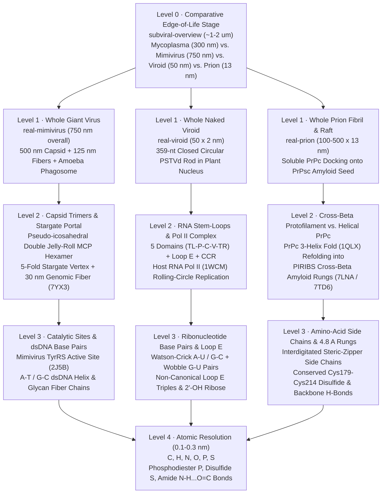

# 13 — Beyond Viruses: Giant Viruses, Viroids & Prions (The Edge of Life)

**Iteration:** 13 (3-Pedestal Comparative Edge-of-Life Stage, Three Standalone Realistic WebGL2 Subviral & Giant-Virus Models, Whole-to-Atomic Molecular Drill-Down, 3-Persona Guided Tours & Sharded GPU `.opus` Narration in `EN` & `ES`)  
**Status:** 📋 **Planned**  
**Parent Index:** [`roadmap/README.md`](./README.md)  
**Previous Step:** [`12-protists-and-eukaryotic-parasites.md`](./12-protists-and-eukaryotic-parasites.md)  
**Next Step:** [`14-cell-division-binary-fission-mitosis-and-meiosis.md`](./14-cell-division-binary-fission-mitosis-and-meiosis.md)

---

## 1. Executive Summary & Pedagogical Goals

In [Phase 07](./07-biology-introduction-stage-and-sequential-curriculum-tree.md) and [Phase 08](./08-parasitic-and-minimal-cells-mycoplasma-chlamydia-rickettsia.md), learners established the **4-Pillar Autonomy Test** (`Membrane · Genome · Ribosomes · Own ATP`) and compared minimal living bacteria (*Mycoplasma*, *Chlamydia*, *Rickettsia*) against canonical viruses (Phage T4, TMV, Adenovirus, SARS-CoV-2, HIV-1). Yet two deep misconceptions still persist after seeing standard viruses:
1. **"Size and genome length decide what is alive":** Learners assume anything bigger or richer in genes than a minimal bacterium must be a cell. Seeing ***Acanthamoeba polyphaga Mimivirus*** (`~750 nm`, `1.18 Mbp` dsDNA, `~1,000` genes) side-by-side with ***Mycoplasma genitalium*** (`~300 nm`, `580 kbp`, `~482` genes) shatters that myth—*Mimivirus* is physically **more than twice as wide** and carries **twice as many genes**, even encoding translation enzymes (aminoacyl-tRNA synthetases), yet still fails the ribosome and ATP pillars completely.
2. **"Infectious agents always require a protein capsid and nucleic-acid genes":** Learners assume viruses represent the rock bottom of biological replication. Moving *below* standard viruses exposes two stripped-down replicators that challenge our definition of information itself: **Viroids** (naked circular non-coding RNA with **zero protein coat and zero protein-coding genes**) and **Prions** (self-templating misfolded proteins with **zero DNA and zero RNA**).

**Phase 13** completes Stage 4's *"Where does life end?"* spectrum through a comparative 3-pedestal stage (`subviral-overview`) and **three standalone realistic WebGL2 molecular models** following a strict **Whole → Tiniest** zoom cascade:

1. **Comparative Stage — `4.7 · Edge of Life Overview` (`subviral-overview` in [`src/pages/cell_explorer.ts`](../src/pages/cell_explorer.ts)):**
   - Places three glowing pedestals side-by-side (`Giant Virus` · `Viroid` · `Prion`) beside a true-scale reference silhouette of **`300 nm` *Mycoplasma genitalium*** (smallest self-replicating cell) and **`100 nm` SARS-CoV-2**, with live **4-Pillar Autonomy Badges** stepping smoothly down from `4/4` autonomous cells to `0/4` zero-gene prions.
2. **Giant Virus — `4.8 · Acanthamoeba polyphaga Mimivirus` (`mimivirus_realistic.html`, `root: 'real-mimivirus'`):**
   - `~750 nm` overall diameter (`500 nm` pseudo-icosahedral double-jelly-roll capsid coated by a dense `125 nm` canopy of cross-linked glycosylated surface fibers on every side)—physically **larger than living *Mycoplasma* (`~300 nm`)**.
   - Encapsidates an internal lipid bilayer enclosing a `1.18 Mbp` (`1,181,549 bp`) linear dsDNA genome packaged inside a `~30 nm` helical nucleoprotein genomic fiber (cryo-EM PDB `7YX3` / `7YX4`), encoding `~1,000` genes including **aminoacyl-tRNA synthetases** (e.g., Mimivirus `TyrRS`, PDB `2J5B`), translation factors, mRNA capping enzymes, and DNA repair machinery.
   - Interactive cutaway highlights the unique 5-fold **stargate** vertex portal: five star-shaped seams unzip like petals inside an acidic *Acanthamoeba* phagosome so the internal viral membrane fuses with the vacuole and injects the nucleoprotein core into the cytoplasm to construct a giant **viral factory**—while visual autonomy counters prove it still has **`0` ribosomes** and **`0` ATP metabolism**.
3. **Viroid — `4.9 · Potato Spindle Tuber Viroid (PSTVd)` (`viroid_realistic.html`, `root: 'real-viroid'`):**
   - Only **`359` nucleotides** (`~50 nm` long × `~2 nm` wide) of naked, covalently closed circular ssRNA folded via extensive intramolecular Watson–Crick (`A–U`, `G–C`) and wobble (`G·U`) pairing into a rigid **rod-like secondary structure** of paired helical stems alternating with bulged internal loops across five functional domains (`T_L · P · C · V · T_R`), featuring the conserved non-canonical **Loop E** motif.
   - **Zero protein coat (no capsid, no lipid envelope)** and **zero protein-coding genes (`0` ORFs)**—pure structural non-coding RNA.
   - Animates nuclear entry in a plant cell where host **DNA-dependent RNA Polymerase II (`Pol II`, PDB `1WCM`)** assisted by transcription factor `TFIIIA-7ZF` executes asymmetric **rolling-circle replication**, generating multimeric `(-)` and `(+)` linear RNA strands cleaved at the Central Conserved Region (`CCR`) and circularized by host **DNA ligase 1**.
4. **Prion — `4.10 · PrPᶜ → PrPˢᶜ Amyloid Fibril` (`prion_realistic.html`, `root: 'real-prion'`):**
   - Infectious misfolded mammalian prion protein (**`~208` amino acids**, mature residues `23–230`, `~23 kDa` unglycosylated, bearing a C-terminal GPI anchor, two N-glycan chains, and one intramolecular `Cys179–Cys214` disulfide bridge)—carrying **zero DNA and zero RNA (`0` nucleotides)**.
   - Shows soluble, α-helix-rich cellular **`PrPᶜ`** (three α-helices `H1–H3` + short β-ribbon `β1–β2`, solution NMR PDB `1QLX`) detaching from a neuronal lipid raft, docking onto the exposed end of a pathogenic **cross-β-sheet `PrPˢᶜ` amyloid fibril seed** (near-atomic cryo-EM structures PDB `7LNA` 263K hamster and PDB `7TD6` mouse aRML), and refolding into stacked **parallel in-register intermolecular β-sheets (`PIRIBS`)** locked by dry steric zippers and backbone hydrogen bonds at the signature **`4.8 Å` (`0.48 nm`) inter-rung spacing**.

### Extended 4-Pillar Autonomy Matrix (From Autonomous Cells Down to 0-Gene Prions)

| Tier / Representative | Physical Size | Boundary | Genome & Genes | Ribosomes | Own ATP | Biological Status |
| :--- | :---: | :--- | :--- | :---: | :---: | :--- |
| **`1 · Prokaryote` (*E. coli*)** | `~2,000 × 800 nm` | Lipid + Peptidoglycan Wall | `4.6 Mbp` circular `dsDNA` (`~4,300` genes) | ✅ `70S` | ✅ Own ETC & ATP Synthase | **Alive & Autonomous** |
| **`3.1 · Minimal Cell` (*Mycoplasma genitalium*)** | **`~300 × 600 nm`** | Single cholesterol bilayer (no wall) | `580 kbp` circular `dsDNA` (`~482` genes) | ✅ `70S` | ⚠️ Glycolysis only (scavenges host) | **Smallest Living Cell** (all core life machinery intact) |
| **`4.8 · Giant Virus` (*Mimivirus*)** | **`~750 nm`** (`500 nm` capsid + `125 nm` fibers) | Glycosylated fibers + pseudo-icosahedral capsid + inner bilayer | `1.18 Mbp` linear `dsDNA` (`~1,000` genes; encodes `aaRS`) | ❌ **`0`** | ❌ **`0`** | **Not Alive** (larger than *Mycoplasma*, yet zero ribosomes/ATP) |
| **`4.5 · Canonical Virus` (SARS-CoV-2)** | `~100 nm` | Host-derived lipid envelope + Spike trimers | `29.9 kb` `(+)ssRNA` (`~14` ORFs / `29` proteins) | ❌ **`0`** | ❌ **`0`** | **Not Alive** (acellular RNA hijacker) |
| **`4.9 · Viroid` (*PSTVd*)** | **`~50 × 2 nm`** | **None (`0` capsid, `0` envelope)** | **`359 nt`** naked circular `ssRNA` (**`0` protein-coding genes**) | ❌ **`0`** | ❌ **`0`** | **Subviral Naked Code** (hijacks host plant `RNA Pol II`) |
| **`4.10 · Prion` (*PrPᶜ → PrPˢᶜ*)** | `~13 nm` fibril width (`4.8 Å`/rung) | **None** (self-assembled amyloid protofilament) | **None (`0` DNA, `0` RNA, `0` genes)**; `~208 aa` protein | ❌ **`0`** | ❌ **`0`** | **Infectious Misfolded Shape** (protein-only conformational propagation) |

---

## 2. Whole-to-Tiniest Drill-Down Architecture

Every model in Phase 13 enforces the project's strict **Whole → Tiniest** zoom progression: learners begin on the 3-tier comparative Edge-of-Life stage, zoom into a complete virion, naked RNA rod, or amyloid fibril, peel into multimeric supramolecular assemblies, resolve individual amino-acid side chains and ribonucleotide base pairs, and descend all the way to covalent and hydrogen-bonded atoms (`C, H, N, O, P, S`).

### Comparative Structural & Molecular Spec Sheet

| Specification | `3.1 Mycoplasma genitalium` (Living Benchmark) | `4.8 Mimivirus` (Giant Virus) | `4.5 SARS-CoV-2` (Canonical Virus) | `4.9 PSTVd` (Viroid) | `4.10 PrPᶜ → PrPˢᶜ` (Prion) |
| :--- | :--- | :--- | :--- | :--- | :--- |
| **Overall Dimensions** | `~300 × 600 nm` piriform cell | `~750 nm` (`500 nm` capsid + `2 × 125 nm` fibers) | `~100 nm` sphere (`~120 nm` with Spikes) | `~50 nm` long × `~2 nm` diameter rod | `PrPᶜ`: `~4 × 3 nm` monomer · `PrPˢᶜ`: `~13 nm` wide fibril (`4.8 Å` axial rung pitch) |
| **Scene Scale (`1 unit`)** | `1 unit = 10 nm` | `1 unit = 10 nm` (macro virion & amoeba factory; molecular insets annotated) | `1 unit = 10 nm` | `1 unit = 2 nm` (true molecular scale for `50 nm` rod & `Pol II`) | `1 unit = 2 nm` (molecular fibril & `PrPᶜ` docking; `4.8 Å = 0.24 u`) |
| **Nucleic Acid / Composition** | `580,076 bp` circular `dsDNA` (`~482` genes) | `1,181,549 bp` linear `dsDNA` (`~1,000` genes) | `29,903 nt` `(+)ssRNA` (`~14` ORFs) | **`359 nt`** covalently closed circular `ssRNA` (**`0` genes**) | **`0` DNA · `0` RNA** (`~208 aa` mature polypeptide, residues `23–230`) |
| **Outer Architecture** | Single cholesterol-rich lipid bilayer (zero cell wall) | Cross-linked glycosylated fiber coat + pseudo-icosahedral double jelly-roll `MCP` capsid + inner lipid bilayer | Host-stolen lipid envelope studded with trimeric `Spike` glycoproteins | **None** — naked self-paired RNA double-stranded stems & loops | **None** — naked protease-resistant cross-β amyloid protofilament |
| **Ribosomes & ATP** | ✅ `~150` `70S` ribosomes · Glycolysis ATP | ❌ `0` ribosomes · ❌ `0` ATP enzymes (encodes `aaRS` only) | ❌ `0` ribosomes · ❌ `0` ATP | ❌ `0` ribosomes · ❌ `0` ATP | ❌ `0` ribosomes · ❌ `0` ATP |
| **Replication Mechanism** | Autonomous binary fission on host airway cilia | Phagocytosis by *Acanthamoeba* → **stargate** opens → cytoplasmic **viral factory** builds virions using host ribosomes & ATP | ACE2 receptor entry → viral `RdRp` replicates RNA in double-membrane vesicles | Nuclear import → host plant **`RNA Pol II`** + `TFIIIA-7ZF` **rolling-circle replication** → RNase cleavage & `DNA ligase 1` circularization | Direct **templated conformational conversion**: soluble α-helical `PrPᶜ` docks onto `PrPˢᶜ` fibril tip and refolds into `PIRIBS` β-rungs; fibril fragmentation seeds new chains |
| **Signature Nanomachines** | `P140/P110` Nap adhesin + internal terminal rod | 5-fold **stargate** vertex portal, `~30 nm` helical genomic fiber, viral `TyrRS` | Trimeric `Spike` prefusion/postfusion machine + `RdRp` (`nsp12/7/8`) | Conserved **Loop E** motif, Central Conserved Region (`CCR`), hijacked host `Pol II` | Native 3-helix `PrPᶜ` domain, `PIRIBS` cross-β arch core, `Cys179–Cys214` disulfide, dry steric zippers |
| **Reference PDB IDs** | `6RUT` / `8PBX` (`P140–P110` Nap adhesin heterodimer) | `2J5B` (Mimivirus `TyrRS`), `7YX3` / `7YX4` (Mimivirus `30 nm` genomic fiber), `5J7O` (NCLDV double jelly-roll `MCP` structural homolog) | `6VXX` (Spike trimer), `7BV2` (SARS-CoV-2 `RdRp`) | `1WCM` (12-subunit eukaryotic `RNA Pol II`), `1S72` (conserved rRNA `Loop E` non-canonical motif template) | `1QLX` (human soluble `PrPᶜ` NMR), `7LNA` (hamster 263K `PrPˢᶜ` cryo-EM fibril), `7TD6` (mouse aRML `PrPˢᶜ` cryo-EM fibril) |

---

## 3. Interactive Guided Tour / Tutorial Spec

Phase 13 introduces a unified multi-chapter Guided Tour module ([`src/tours/edge_of_life.ts`](../src/tours/edge_of_life.ts)) and bilingual 3-persona script registry ([`src/tours/personas_edge_of_life.ts`](../src/tours/personas_edge_of_life.ts)) covering the comparative 3-pedestal overview (`edgeOfLifeTour`, `root: 'subviral-overview'`, `~28` cues) and the three realistic deep-dive scenes (`mimivirusTour`, `viroidTour`, `prionTour`, `~36–44` cues each).

### Narrative Arc & Chapter Structure (`src/tours/edge_of_life.ts`)

| Tour / Root | Chapters (`ch0` → `chN`) | Interactive Camera & Simulation Events |
| :--- | :--- | :--- |
| **`edgeOfLifeTour`** (`subviral-overview`, `~28` cues) | `ch0` *Where Does Life End?* · `ch1` *Mimivirus: Bigger Than a Living Cell* · `ch2` *Viroids: Code Without a Coat* · `ch3` *Prions: Shape Without Code* · `ch4` *The Full Autonomy Ladder* | Side-by-side pedestal sweep comparing `300 nm` *Mycoplasma* against `750 nm` *Mimivirus*, `50 nm` *PSTVd*, and `13 nm` *PrPˢᶜ*; live 4-Pillar badge countdown (`4/4 → 0/4`) |
| **`mimivirusTour`** (`real-mimivirus`, `~42` cues) | `ch0` *A Giant Among Viruses* · `ch1` *The 125 nm Fiber Coat & Capsid* · `ch2` *Opening the 5-Fold Stargate* · `ch3` *1.18 Mbp Genomic Fiber & Viral TyrRS* · `ch4` *Why 1,000 Genes Still Need Amoeba Ribosomes* | Ghosting fiber canopy (`ghost`), unzipping 5-fold stargate petals inside cutaway *Acanthamoeba* phagosome, streaming core into cytoplasmic viral factory, inspecting `7YX3` fiber & `2J5B` `TyrRS` |
| **`viroidTour`** (`real-viroid`, `~36` cues) | `ch0` *359 Nucleotides, Zero Protein* · `ch1` *The Self-Paired RNA Rod & Loop E* · `ch2` *Hijacking Host Plant RNA Pol II* · `ch3` *Asymmetric Rolling-Circle Copying* · `ch4` *Ribonucleotide Pairs to Atoms* | Rotating `50 nm` closed ssRNA rod, illuminating `T_L · P · C · V · T_R` domains & Loop E (`blink`), animating `Pol II` (`1WCM`) rolling-circle concatemer synthesis, zooming to `G·U` wobble & `2'-OH` atoms |
| **`prionTour`** (`real-prion`, `~40` cues) | `ch0` *Infection With Zero DNA or RNA* · `ch1` *Healthy α-Helical PrPᶜ on the Neuron* · `ch2` *The Cross-β PrPˢᶜ Amyloid Seed* · `ch3` *Templated Refolding Into 4.8 Å Rungs* · `ch4` *Steric Zippers, Disulfide & Atoms* | Highlighting `1QLX` `H1–H3` α-helices on a lipid raft, docking monomer onto `7LNA`/`7TD6` fibril tip, morphing α-helices into parallel in-register β-strands (`4.8 Å` pitch), zooming to amide H-bond atoms |

### Persona & Strict Analogy-Restraint Rules (`AGENTS.md` Rule 8)

All cues in [`src/tours/personas_edge_of_life.ts`](../src/tours/personas_edge_of_life.ts) enforce every Rule 8 invariant:
- **3 Personas × 2 Locales (`EN` & `ES`):** `pop` (`Everyday Guide` — active in `Simple` & `Story`), `blueprint` (`Systems Engineer` — active in `Blueprint`), and `scientific` (`Molecular Biologist` — active in `Scientific`).
- **Subtitle Length Ceiling:** Every cue stays strictly **`<= 110` plain characters** (measured after stripping `[[label|part]]` markup via `stripRichLinks`).
- **Highlight Parity:** 100% identical `[[...|part]]` mesh highlight target sets across `pop`, `blueprint`, and `scientific` in both `en` and `es`.
- **Strict Analogy Restraint (`> 95%` Direct Prose):** Zero analogies on introductions, scale dimensions, UI controls, camera cutaways, simple shapes, or summaries. Each tour uses **exact `2–3` purposeful analogies ONLY** (~1 every 1.5–2.5 minutes), reserved strictly for genuinely counterintuitive molecular mechanisms:
  1. **Prion templated misfolding (`PrPᶜ → PrPˢᶜ`):** A **domino crystallization cascade** — one misfolded cross-β seed forces each incoming healthy protein to snap into the exact same locked conformation without carrying a single gene.
  2. **Viroid (*PSTVd*) naked replication:** **Raw executable text with no envelope** — bare self-folding RNA code lacking any capsid or protein-coding genes, tricking host plant `RNA Pol II` into copying it directly.
  3. **Giant virus (*Mimivirus*) ribosome deficit:** A **shipping crate loaded with spare tools but zero factory floor** — encoding ~1,000 genes and even tRNA-charging enzymes, yet remaining inert until an amoeba supplies ribosomes and ATP.

### Verified Sample Cue Triplets (`EN` & `ES`, `<= 110` Plain Chars, 100% `[[label|part]]` Parity)

| Cue ID & Role | Locale | `pop` (`Everyday Guide`) | `blueprint` (`Systems Engineer`) | `scientific` (`Molecular Biologist`) |
| :--- | :---: | :--- | :--- | :--- |
| **`eol-04`** *(Direct prose — Mimivirus size paradox)* | `en` | `[[Mimivirus|mimivirus]] spans 750 nm—wider than living [[Mycoplasma|mycoplasma]]—yet owns zero ribosomes.` *(76 ch)* | `[[Mimivirus|mimivirus]] dwarfs [[Mycoplasma|mycoplasma]] at 750 nm, yet ships zero ribosome build units.` *(75 ch)* | `[[Mimivirus|mimivirus]] (750 nm; 1.18 Mbp) exceeds [[Mycoplasma|mycoplasma]] (300 nm) but lacks ribosomes.` *(77 ch)* |
| **`eol-04`** | `es` | `[[Mimivirus|mimivirus]] mide 750 nm—más que [[Mycoplasma|mycoplasma]]—pero carece de ribosomas.` *(66 ch)* | `[[Mimivirus|mimivirus]] supera a [[Mycoplasma|mycoplasma]] en 750 nm, sin ningún módulo ribosómico.` *(70 ch)* | `[[Mimivirus|mimivirus]] (750 nm; 1,18 Mpb) supera a [[Mycoplasma|mycoplasma]], pero carece de ribosomas.` *(75 ch)* |
| **`eol-14`** *(Analogy #1 — Viroid as raw executable text)* | `en` | `[[PSTVd|pstvd-rod]] is raw executable text with no envelope, tricking host [[Pol II|pol2]] into copying it.` *(84 ch)* | `[[PSTVd|pstvd-rod]] injects a bare 359-nt circular script directly into the plant [[Pol II|pol2]] copier.` *(82 ch)* | `Naked 359-nt [[PSTVd|pstvd-rod]] ssRNA recruits nuclear [[RNA Pol II|pol2]] for rolling-circle replication.` *(84 ch)* |
| **`eol-14`** | `es` | `[[PSTVd|pstvd-rod]] es texto ejecutable sin sobre que engaña a la [[Pol II|pol2]] vegetal para copiarse.` *(81 ch)* | `[[PSTVd|pstvd-rod]] inyecta un código circular de 359 nt directo en la [[Pol II|pol2]] de la planta.` *(77 ch)* | `El ARN desnudo [[PSTVd|pstvd-rod]] (359 nt) recluta a [[ARN Pol II|pol2]] para replicación rodante.` *(76 ch)* |
| **`eol-24`** *(Analogy #2 — Prion domino crystallization)* | `en` | `Each docked [[PrPᶜ|prp-c]] snaps onto [[PrPˢᶜ|prp-sc]] in a domino crystallization cascade—with zero DNA.` *(84 ch)* | `Template [[PrPˢᶜ|prp-sc]] refolds incoming [[PrPᶜ|prp-c]] monomers into locked 4.8 Å β-sheet rungs.` *(78 ch)* | `[[PrPˢᶜ|prp-sc]] (7LNA) templates α-helical [[PrPᶜ|prp-c]] into 4.8 Å PIRIBS cross-β amyloid rungs.` *(78 ch)* |
| **`eol-24`** | `es` | `Cada [[PrPᶜ|prp-c]] encaja sobre [[PrPˢᶜ|prp-sc]] en una cascada dominó de cristalización sin ADN.` *(77 ch)* | `La plantilla [[PrPˢᶜ|prp-sc]] repliega cada [[PrPᶜ|prp-c]] entrante en peldaños β de 4,8 Å.` *(70 ch)* | `[[PrPˢᶜ|prp-sc]] (7LNA) convierte [[PrPᶜ|prp-c]] α-helicoidal en láminas PIRIBS cross-β cada 4,8 Å.` *(78 ch)* |

---

## 4. Implementation Steps & File Plan

### Step 1: Comparative Stage (`subviral-overview`) & Three Standalone Realistic WebGL2 Pages (`src/pages/`)
- **Coarse-Grained PDB Assets (`tools/embed_structures.py`):** Download, coarse-grain, and embed verified structures (`2J5B`, `7YX3`, `5J7O`, `1WCM`, `1S72`, `1QLX`, `7LNA`, `7TD6`) on single-line data blocks per `AGENTS.md` Rule 4.
- **3-Pedestal Comparative Stage (`src/pages/cell_explorer.ts`):** Add `NODES['subviral-overview']` (`buildSubviralOverview`) following the `buildBiologyIntro` / `buildViruses` multi-pedestal pattern, displaying *Mimivirus*, *PSTVd*, and *PrPᶜ → PrPˢᶜ* beside a true-scale *Mycoplasma* (`300 nm`) reference ring with clickable 3D anchors (`A(...)`) and live 4-Pillar badges.
- **Three Standalone Realistic WebGL2 Pages:** Implement the full `postMessage` tour protocol (`track`, `fly`, `free`, `blink`, `ghost`, `set`, `arrived`, `focusOf`), `window.__cell` debug hooks (`shot`, `step`, `sites`, `procs`, `flows`), and seeded random streams (`AGENTS.md` Rule 3):
  1. `mimivirus_realistic.html` + `src/pages/mimivirus_realistic.ts` (`18–20` inspectable parts: `125 nm` glycosylated fiber canopy, pseudo-icosahedral double-jelly-roll `MCP` facets, 5-fold **stargate** portal with animated petal opening, inner lipid bilayer, `30 nm` helical genomic fiber `7YX3`, `1.18 Mbp` dsDNA, viral `TyrRS` `2J5B`, cutaway *Acanthamoeba* phagosome & cytoplasmic viral factory with host `80S` ribosomes and ATP streams).
  2. `viroid_realistic.html` + `src/pages/viroid_realistic.ts` (`16–18` inspectable parts: `359 nt` closed circular ssRNA rod showing all 5 domains `T_L · P · C · V · T_R`, paired Watson–Crick stems, `G·U` wobble pairs, bulged **Loop E** motif, `CCR` cleavage hairpin, host plant `RNA Pol II` `1WCM` + `TFIIIA-7ZF`, live rolling-circle `(-)` / `(+)` concatemer flow, host `DNA ligase 1`, and atomic close-up of `2'-OH` ribose & phosphodiester `P`).
  3. `prion_realistic.html` + `src/pages/prion_realistic.ts` (`18–20` inspectable parts: neuronal lipid raft with GPI-anchored `PrPᶜ`, native `H1/H2/H3` α-helices + `β1–β2` ribbon `1QLX`, conserved `Cys179–Cys214` disulfide bond, N-glycan trees, pathogenic `PrPˢᶜ` `PIRIBS` amyloid fibril core modeled from `7LNA` & `7TD6`, live animated docking & conformational conversion morph into `4.8 Å` axial cross-β rungs, steric-zipper side chains, and backbone amide `N–H···O=C` hydrogen-bond atoms).
- Register the 3 new pages in `HTML_PAGES` ([`tests/verify_all.ts`](../tests/verify_all.ts)), `sitemap.xml`, `README.md`, and `docs/edge_of_life_realistic_manual.md` (`npm run build` automatically bundles all `src/pages/*.ts` via `esbuild`).

### Step 2: Explorer Subtrees (`NODES`, `MENU_GROUPS`, `COURSE_SEQUENCE`) & 4-Mode Lenses (`src/content/`)
- Extend Stage 4 (`4 · Viruses & The Edge of Life`) in [`src/pages/cell_explorer.ts`](../src/pages/cell_explorer.ts) (`MENU_GROUPS[4]`):
  - `4.7 · Beyond viruses: Giant viruses, viroids & prions (3D overview)` (`root: 'subviral-overview'`)
  - `4.8 · Giant virus — Mimivirus (750 nm, 1.18 Mbp, 0 ribosomes)` (`root: 'real-mimivirus'`)
  - `4.9 · Viroid — PSTVd (359-nt naked circular RNA)` (`root: 'real-viroid'`)
  - `4.10 · Prion — PrPᶜ → PrPˢᶜ (0-gene misfolded amyloid)` (`root: 'real-prion'`)
- Add `~24` Whole → Tiniest zoomable molecular and atomic child nodes (`mimivirus-stargate`, `mimivirus-capsomer`, `mimivirus-genomic-fiber`, `mimivirus-tyrrs`, `pstvd-rod`, `pstvd-loop-e`, `pstvd-pol2-rolling-circle`, `ribonucleotide-wobble-pair`, `prp-cellular-helices`, `prp-sc-piribs-fibril`, `prp-steric-zipper`, `prp-disulfide-bond`, `edge-of-life-atoms`, etc.) reusing shared procedural/PDB builders (`partModel`, `nest`, `tagFrom` per `AGENTS.md` Rule 1).
- Author `src/content/lenses_edge_of_life.ts` (`EDGE_OF_LIFE_NODE_LENSES`, `EDGE_OF_LIFE_PART_LENSES`) registered in [`src/content/index.ts`](../src/content/index.ts), with complete `EN` & `ES` `Simple`, `Story`, `Blueprint`, and `Scientific` lenses, `100%` `[[Label|nodeId]]` supply-chain links, and localized node/UI strings in `src/core/locales/es_nodes.ts` and `src/core/locales/es_phrases.ts`.
- Append `'subviral-overview'`, `'real-mimivirus'`, `'real-viroid'`, `'real-prion'` to `COURSE_SEQUENCE` in [`src/core/progress_service.ts`](../src/core/progress_service.ts) right after `'real-hiv'`, bridging seamlessly into [Phase 14](./14-cell-division-binary-fission-mitosis-and-meiosis.md).

### Step 3: Guided Tours & Multi-Persona Scripts (`src/tours/`)
- Create `src/tours/edge_of_life.ts` (`edgeOfLifeTour`, `mimivirusTour`, `viroidTour`, `prionTour`) and `src/tours/personas_edge_of_life.ts` (`PERSONAS_EDGE_OF_LIFE`).
- Register all four tours in [`src/tours/index.ts`](../src/tours/index.ts), [`src/tours/tour_personas.ts`](../src/tours/tour_personas.ts), and `src/core/locales/es_tours.ts`.

### Step 4: Sharded `< 48 MB` GPU `.opus` Narration (`Makefile`, `Dockerfile`, `.github/workflows/deploy.yml`)
- Run `make export-cues` and synthesize all Phase 13 Tour (`EN` `v1`/`v2`/`v3`, `ES` `latam` + `spain/{blueprint,scientific}`) and Explorer/Part lens `.opus` clips locally on RTX GPU via `GPT-SoVITS` and `F5-Spanish` using Public-Domain (`CC0`) voices in `tools/voices/`.
- Package clips into dedicated `< 48 MB` archives (`audio_stage4_edge_en.tar.gz`, `audio_stage4_edge_es.tar.gz`), add exclusions (`STAGE4_EDGE_EXCLUDE`) to `BASE_EXCLUDE` and `AUDIO_ARCHIVES` in [`Makefile`](../Makefile), and mirror in `Dockerfile` and `.github/workflows/deploy.yml`.

---

## 5. Verification Gates (`tests/verify_all.ts` & Visual Eye-Check)

1. **TypeScript Build, Bundling & Deep-Link Compatibility (`make typecheck && make build`):**
   - Zero TypeScript errors (`tsc --noEmit`), clean `esbuild` bundles for `mimivirus_realistic.ts`, `viroid_realistic.ts`, `prion_realistic.ts`, and `cell_explorer.ts`, and 100% backward compatibility for all prior URL hashes (`#life-overview`, `#real-mycoplasma`, `#real-hiv`, etc.).
2. **Headless Chrome WebGL2 E2E Rendering & Simulation (`make test` / [`tests/verify_all.ts`](../tests/verify_all.ts)):**
   - Renders `subviral-overview` in `cell_explorer.html` plus standalone `mimivirus_realistic.html`, `viroid_realistic.html`, and `prion_realistic.html` with **`0` console/page errors**.
   - Confirms 100% of declared interactive parts, hover tags, `postMessage` tour actions (`fly`, `blink`, `ghost`, `set`), live kinetic flows (stargate core injection, `Pol II` rolling-circle RNA synthesis, `PrPᶜ → PrPˢᶜ` fibril elongation), and `COURSE_SEQUENCE` `Next in Course →` navigation.
3. **Multi-Persona Tour & Rule 8 Analogy-Restraint Automated Checks:**
   - Asserts every cue in `edgeOfLifeTour`, `mimivirusTour`, `viroidTour`, and `prionTour` across `EN` & `ES` (`pop`, `blueprint`, `scientific`) stays `<= 110` plain characters, maintains `100%` `[[...|part]]` highlight target parity, keeps `> 95%` direct prose, and stays strictly within the `2–3` complex-concept analogies bound per tour.
4. **4-Mode Lenses, Link Integrity & `.opus` Audio Shards:**
   - Asserts 4-mode lens distinctness (`Simple`, `Story`, `Blueprint`, `Scientific`) in `EN` & `ES`, `100%` valid `[[Label|nodeId]]` resolution across all new Explorer nodes and standalone parts, valid `OggS` `.opus` headers across all `5` studio voices, and strict `< 48 MB` limits on `audio_stage4_edge_en.tar.gz` and `audio_stage4_edge_es.tar.gz`.
5. **Visual Eye-Check Gate (`AGENTS.md` Rule 6):**
   - Serve via `python3 tools/serve.py "$(pwd)" 8765`, capture `__cell.shot(...)` renders across every key view (3-pedestal *Mycoplasma* vs. *Mimivirus* scale comparison, open/closed 5-fold stargate, *PSTVd* `Loop E` & `Pol II` rolling circle, and `PrPᶜ` α-helices refolding into `4.8 Å` `PIRIBS` β-rungs), run `30` simulated seconds verifying recipe/conversion counters and frame timing, and visually inspect every Explorer level to confirm zero clipped geometry, clean translucency/cutaways, and unobstructed 3D labels.
