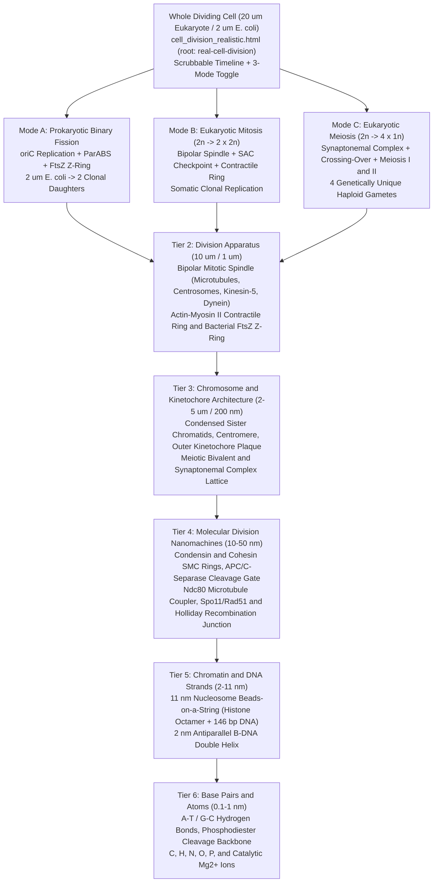

# 14 — Cell Division: Binary Fission, Mitosis & Meiosis

**Iteration:** `14` (Interactive Animated WebGL2 Cell Division Stage with Scrubbable Phase Timeline, 3-Mechanism Toggle, Whole-to-Tiniest Molecular Drill-Down, 3-Persona Guided Tour & GPU `.opus` Narration in `EN` & `ES`)  
**Status:** 📋 **Planned**  
**Parent Index:** [`roadmap/README.md`](./README.md)  
**Previous Step:** [`13-giant-viruses-viroids-and-prions.md`](./13-giant-viruses-viroids-and-prions.md)  
**Next Step:** [`15-central-dogma-pipeline-and-molecular-evolution.md`](./15-central-dogma-pipeline-and-molecular-evolution.md)

---

## 1. Executive Summary & Pedagogical Goals

Up through Phases 01–13, learners inspect static and metabolically active cells across every domain of life—prokaryotes, archaea, fungi, animals, plants, parasitic minimal cells, and acellular infectious agents. Yet the single defining engine that propagates every cellular lineage across generations is **cell division**: copying an entire genome faithfully and partitioning it into daughter cells without tearing, tangling, or losing a single chromosome.

In traditional textbooks, **Binary Fission**, **Mitosis**, and **Meiosis** are taught as disconnected 2D cartoon worksheets—leaving learners with three persistent misconceptions:
1. **Treating Binary Fission as "simple pinching" without molecular motors:** Students rarely see that *E. coli* actively replicates from a single circular origin (`oriC`), partitions sister origins to opposite poles via **`ParABS` / `MukBEF`** machinery, and cinches its envelope using a GTP-powered **`FtsZ` Z-ring** (the bacterial ancestor of eukaryotic tubulin) that tracks septal peptidoglycan synthesis.
2. **Memorizing `PMAT` phase names without understanding the mechanical checkpoint:** Without seeing **`condensin`** rings reel meters of DNA into compact rods, **`Ndc80`** outer kinetochores gripping dynamic microtubule tips, and the **Spindle Assembly Checkpoint (`SAC`)** waiting for bipolar tension before **`APC/C`** activates **`separase`** to cleave **`cohesin`** rings, Mitosis feels like magic rather than deterministic physical mechanics.
3. **Confusing Mitosis (`2n → 2 × 2n`) with Meiosis (`2n → 4 × 1n`):** Unless learners scrub side-by-side through the same diploid chromosomes—watching **homologous chromosomes** zip together along the **synaptonemal complex**, physically swap DNA segments at **chiasmata** (**Holliday junctions** catalyzed by **`Spo11`** & **`Rad51`**), segregate *homologs* in Meiosis I, and only split *sister chromatids* in Meiosis II—the origin of genetic diversity remains abstract.

**Phase 14** delivers an interactive, animated, strictly **Whole → Tiniest** WebGL2 division simulator and Explorer drill-down subtree:

1. **Interactive Animated WebGL2 Stage (`cell_division_realistic.html`, `src/pages/cell_division_realistic.ts`, `root: 'real-cell-division'`):**
   - Features a **scrubbable phase timeline (`t ∈ [0, 1]`)** with play/pause, speed control, and discrete phase detents (`Interphase → Prophase → Metaphase → Anaphase → Telophase → Cytokinesis`, plus `Meiosis I → Meiosis II` dual-round scrub bar when in Meiosis mode).
   - Features a live **3-Mechanism Mode Toggle** comparing all three strategies inside the same 3D viewport:
     - **Mode A — Prokaryotic Binary Fission (*E. coli*, `2 µm`):** Bidirectional circular chromosome replication from `oriC` to `ter`, `ParABS` origin partitioning (`ParB` clamps binding *parS* DNA), cell elongation, and mid-cell **`FtsZ` Z-ring** treadmilling coupled to septal peptidoglycan (`FtsW`/`PBP3`) constriction.
     - **Mode B — Eukaryotic Mitosis (`2n → 2 × 2n` somatic cloning, `20 µm`):** Centrosome duplication & bipolar **mitotic spindle** assembly (`kinesin-5` / `Eg5` sliding antiparallel microtubules apart), nuclear envelope breakdown (lamin phosphorylation), chromosome condensation by **`condensin`** SMC rings, **`Ndc80` kinetochore** capture & alignment at the metaphase plate, **Spindle Assembly Checkpoint (`APC/C` → `separase` cleaving `cohesin` rings)**, poleward sister-chromatid transport via depolymerizing kinetochore microtubules + **dynein**, nuclear reassembly, and **actin–myosin II contractile ring** cleavage furrow cytokinesis.
     - **Mode C — Eukaryotic Meiosis (`2n → 4 × 1n` genetic diversity, `20 µm`):** Homologous chromosome pairing along the **synaptonemal complex** (`SYCP1` transverse filaments + `SYCP3` lateral elements), programmed DNA double-strand breaks (`Spo11`) and strand invasion (`Rad51`) creating physical **crossing-over** (**chiasmata** / **Holliday junctions** visible as color-swapped maternal/paternal arms), **independent assortment** of bivalents in Meiosis I (homolog separation while centromeric cohesin stays protected by shugoshin), followed by equational sister-chromatid separation in Meiosis II producing **4 genetically unique haploid gametes**.
2. **Seamless Whole → Tiniest Molecular Drill-Down (`20 µm → 0.1 nm`):**
   - From any phase of the animated cell, learners zoom across six true-scale structural tiers—from the whole dividing `20 µm` cell, into the `10 µm` bipolar spindle and contractile ring, onto a `2–5 µm` condensed mitotic chromosome and `200 nm` centromere/kinetochore plaque, down to `10–50 nm` cohesin/condensin SMC rings, `Ndc80` microtubule couplers, and four-way Holliday junctions, into `2–11 nm` nucleosomes and B-DNA double helices, and finally to `0.1–1 nm` Watson–Crick base pairs, phosphodiester bonds, and individual atoms (`C, H, N, O, P, Mg²⁺`).

---

## 2. Whole-to-Tiniest Drill-Down Architecture

Every node in Phase 14 follows the repository's strict **Whole → Tiniest** zoom hierarchy (`cell_division_realistic.html` embedded at `root: 'real-cell-division'` inside `cell_explorer.html`, backed by reusable molecular sub-nodes and instanced PDB meshes).

### Whole → Tiniest Scale Cascade & Structural PDB Reference

| Zoom Tier | Scale Range | Primary Structures Rendered | Representative RCSB PDB IDs | Interactive Mechanics |
| :--- | :--- | :--- | :--- | :--- |
| **1 · Whole Dividing Cell** | `20 µm` (eukaryote) / `2 µm` (*E. coli*) | Cutaway animal cell (`Interphase → Cytokinesis`) or elongating *E. coli* rod | Procedural envelope + embedded organelles (`real-cell`, `real-bacterium`) | Scrubbable `t ∈ [0, 1]` timeline, 3-mechanism toggle, cutaway/x-ray slider |
| **2 · Spindle & Cytokinesis Rings** | `1–10 µm` | Bipolar microtubule spindle, centrosomes (`γ-TuRC`), antiparallel `kinesin-5` (`Eg5`), astral `dynein`, `actin–myosin II` ring, bacterial `FtsZ` Z-ring | `6UNX` (*E. coli* FtsZ–GTP), `1II6` (Kinesin-5 Eg5), `3VKH` (Dynein), `6BIH` (F-actin–Myosin II) | Pole separation, microtubule depolymerization flux, furrow/septum constriction |
| **3 · Condensed Chromosome & Kinetochore** | `2–5 µm` arm · `200 nm` plaque | Paired sister chromatids, centromeric heterochromatin, trilaminar kinetochore, meiotic bivalent & `SYCP1`/`SYCP3` synaptonemal zipper | `6F5X` (SYCP1 transverse filament), `4CPC` (SYCP3 lateral element), `6T1F` (ParB–*parS*) | Chromatin compaction animation, bivalent pairing, metaphase alignment |
| **4 · Division Nanomachines** | `10–50 nm` | `Condensin` & `Cohesin` SMC rings, `APC/C` ubiquitin ligase, `Separase–Securin`, `Ndc80` kinetochore coupler, `Rad51` filament & 4-way **Holliday junction** | `6YVU` / `7QEN` (Condensin), `6QPW` / `5F0N` (Cohesin), `5A31` (APC/C), `7NJ1` (Separase–Securin), `3IZ0` (Ndc80–MT), `5H1B` (RAD51), `1C7M` (Holliday junction) | Tension-triggered `SAC` release, kleisin cleavage snap, strand exchange & chiasma resolution |
| **5 · Chromatin & B-DNA** | `2–11 nm` | `11 nm` nucleosome core particle (`146 bp` wrapped `1.65` turns) unwinding into `2.0 nm` B-DNA duplex | `1AOI` (Nucleosome core particle), `1BNA` (B-DNA dodecamer) | Live zoom bridge reusing existing Explorer `nucleosome` & `dna` models (`partModel`) |
| **6 · Base Pairs & Atoms** | `0.1–1.0 nm` (`1–10 Å`) | `A=T` / `G≡C` base pairs (`0.34 nm` rise), sugar-phosphate cleavage site (`Spo11` tyrosine–DNA bond), `C, H, N, O, P, Mg²⁺` atoms | `1BNA` atomic coordinates + `Mg²⁺` catalytic ion centers | Hydrogen-bond snapping during recombination & atomic element inspection |

### Comparative Mechanism Spec Sheet: Binary Fission vs. Mitosis vs. Meiosis

| Biological Dimension | Mode A · Prokaryotic Binary Fission (*E. coli*) | Mode B · Eukaryotic Mitosis (Somatic Cell) | Mode C · Eukaryotic Meiosis (Germline Cell) |
| :--- | :--- | :--- | :--- |
| **Domain & Cell Scale** | Bacteria (`~1 × 2–4 µm`, elongating before fission) | Eukaryotes (`~15–25 µm` mammalian cutaway cell) | Eukaryotes (`~15–25 µm` germline meiocyte) |
| **Genome Organization** | Single circular `4.6 Mbp` dsDNA (`oriC` → `ter`) | `2n` linear nuclear chromosomes (modeled as `2n = 4` color-coded homologous pairs for visual clarity) | `2n` linear nuclear chromosomes (`2n = 4` maternal/paternal pairs showing live recombinant chimeras) |
| **Rounds & Daughter Output** | `1` replication + `1` fission → **`2` genetically identical clones** (`1n` circular) | `1` S-phase + `1` division → **`2` genetically identical diploid clones** (`2n → 2 × 2n`) | `1` S-phase + **`2` sequential divisions** → **`4` genetically unique haploid gametes** (`2n → 4 × 1n`) |
| **DNA Compaction & Pairing** | Supercoiling (`DNA gyrase`) + `MukBEF` / `HU` nucleoid structuring; no nuclear envelope | Nuclear envelope breakdown + **`Condensin` (`6YVU`/`7QEN`)** loop extrusion + **`Cohesin` (`6QPW`)** sister tethering | Homolog zipping via **Synaptonemal Complex (`SYCP1` `6F5X`, `SYCP3` `4CPC`)** + centromeric cohesin protection in Meiosis I |
| **Genetic Recombination** | None during standard division (clonal replication) | None (sister chromatids remain identical) | **Crossing-over (`chiasmata`)** via **`Spo11`** DSBs, **`RAD51` (`5H1B`)** strand invasion & **Holliday junctions (`1C7M`)** + independent assortment |
| **Segregation Engine & Checkpoint** | **`ParABS` (`6T1F`)** origin partitioning + nucleoid occlusion (`SlmA`) & `MinCDE` mid-cell positioning | Bipolar spindle (`kinesin-5` `1II6`, `dynein` `3VKH`), **`Ndc80` (`3IZ0`)** kinetochore capture, **`SAC` → `APC/C` (`5A31`) → `Separase` (`7NJ1`)** cleaving `cohesin` | **Meiosis I:** Co-oriented sister kinetochores separate *homologs* (arm cohesin cleaved first). **Meiosis II:** Bi-oriented kinetochores separate *sister chromatids* |
| **Cytokinesis Machinery** | **`FtsZ` Z-ring (`6UNX`)** treadmilling + inward septal peptidoglycan synthesis (`FtsW`/`PBP3`) | **Actin–Myosin II (`6BIH`)** cortical contractile ring pinching a cleavage furrow (plus plant phragmoplast comparison callout) | Two successive **Actin–Myosin II (`6BIH`)** cytokinesis cleavages yielding `4` separate haploid cells |

---

## 3. Interactive Guided Tour / Tutorial Spec

### Tour Architecture (`src/tours/cell_division.ts` & `src/tours/personas_cell_division.ts`)

- **Tour Root:** `real-cell-division` (`6` chapters, `20` steps, `64` timed bilingual subtitle cues, ~7.5 minutes total runtime).
- **Camera & Timeline Choreography:** Each step sends structured `postMessage` directives (`set` mode `fission | mitosis | meiosis`, `set` phase `t ∈ [0, 1]`, `fly`, `track`, `blink`, `ghost`) so the viewer watches each molecular transition play live in 3D before zooming straight down into the active nanomachine.
- **Chapter Flow (Whole → Tiniest across all 3 mechanisms):**
  - `ch0` (*Why Cells Divide — Whole-Cell Overview*, `8` cues): Frames the `20 µm` dividing cell and `2 µm` *E. coli* side by side; introduces the core problem of copying and partitioning DNA without loss or breakage.
  - `ch1` (*Prokaryotic Binary Fission — E. coli in Action*, `10` cues): Switches to Mode A; follows `oriC` bidirectional replication, `ParB`–*parS* (`6T1F`) segregation to opposite poles, and mid-cell **`FtsZ` Z-ring** (`6UNX`) constriction + septal peptidoglycan synthesis.
  - `ch2` (*Mitosis Part 1 — Condensing DNA & Building the Spindle*, `11` cues): Switches to Mode B (`Interphase → Prophase → Metaphase`); shows centrosome separation via **`kinesin-5` (`Eg5`)**, nuclear envelope disassembly, **`condensin` (`7QEN`)** loop extrusion packing chromatin into visible sister chromatids, and **`Ndc80` (`3IZ0`)** kinetochore capture at the metaphase plate.
  - `ch3` (*Mitosis Part 2 — The Tension Checkpoint, Anaphase & Cytokinesis*, `11` cues): Scrubs `Metaphase → Anaphase → Telophase → Cytokinesis`; showcases the **Spindle Assembly Checkpoint (`SAC`)**, **`APC/C` (`5A31`)** destroying securin so **`separase` (`7NJ1`)** snaps **`cohesin` (`6QPW`)** rings, depolymerizing microtubules + **dynein** pulling sisters poleward, and the **actin–myosin II (`6BIH`)** contractile ring pinching two identical `2n` daughters.
  - `ch4` (*Meiosis — Crossing-Over & Genetic Diversity*, `14` cues): Switches to Mode C; zooms into **Prophase I** homolog pairing along the **synaptonemal complex (`SYCP1` `6F5X`)**, programmed **`Spo11`** breaks, **`Rad51` (`5H1B`)** strand invasion, and physical **crossing-over** at **chiasmata / Holliday junctions (`1C7M`)**, then scrubs **Meiosis I** (independent assortment of recombinant homologs) and **Meiosis II** (splitting sister chromatids into `4` unique `1n` gametes).
  - `ch5` (*From Chromosomes Down to Base Pairs & Atoms*, `10` cues): Executes the final continuous **Whole → Tiniest** zoom from a recombinant mitotic/meiotic chromosome (`2–5 µm`) → `11 nm` nucleosome (`1AOI`) → `2 nm` B-DNA (`1BNA`) → `0.34 nm` base pairs & atoms (`C, H, N, O, P, Mg²⁺`), concluding with a clean recap comparing `Binary Fission`, `Mitosis`, and `Meiosis` and advancing via **`Next in Course →`**.

### Multi-Persona & Strict Analogy Restraint Spec (`AGENTS.md` Rule 8)

- **Three Bilingual Personas (`EN` & `ES`):** Every one of the `64` cues ships in `src/tours/personas_cell_division.ts` across:
  - `pop` (`Everyday Guide` — active in `Simple` & `Story` lenses)
  - `blueprint` (`Systems Engineer` — active in `Blueprint` lens)
  - `scientific` (`Molecular Biologist` — active in `Scientific` lens)
- **Strict Length & Highlight Parity:** Every cue text across all `6` `(locale × persona)` variants stays strictly **`<= 110` plain characters** (measured after stripping `[[label|part]]` markup to `label`) and preserves **100% identical `[[...|part]]` highlight target keys** across `EN`/`ES` and all `3` personas.
- **Strict Analogy Restraint (`> 95%` Direct Prose):** Exactly **`61` of `64` cues (`95.3%`)** in `pop` (`Everyday Guide`) use clean, direct, distraction-free biological prose—zero decorative jokes, zero analogies on introductions, scales, UI guidance, camera movements, or recaps. Exactly **`3` complex-concept cues** (spaced ~2–2.5 minutes apart) carry grounded everyday mental models:
  1. **`div.ch2.s1.03` — Condensin DNA Loop Extrusion (`SMC` Rings):** Explains how `~2 m` of thread-thin DNA compacts 10,000-fold into sturdy transport rods without knotting (like reeling loose climbing rope through a motorized cinch into tidy stacked loops before hauling).
  2. **`div.ch3.s1.03` — Mitotic Kinetochore Tension Checkpoint (`SAC` → `APC/C` → `Separase` / `Cohesin`):** Explains why sister chromatids never split prematurely—every pair must feel balanced opposite pull before separase cuts cohesin (like opposite winches testing taut cables before releasing the coupling bolts).
  3. **`div.ch4.s1.02` — Meiotic Crossing-Over (`Spo11` / `Rad51` / Holliday Junction):** Explains how homologous maternal and paternal chromosomes physically exchange matching genetic segments (like cutting two matched decks at the exact same spot and swapping runs before dealing).

### Representative Bilingual 3-Persona Cue Matrix (Verified `<= 110` Plain Chars & 100% `[[...|part]]` Parity)

| Cue ID & Type | Locale | `pop` (`Everyday Guide`) | `blueprint` (`Systems Engineer`) | `scientific` (`Molecular Biologist`) |
| :--- | :---: | :--- | :--- | :--- |
| **`div.ch1.s1.02`** *(Direct prose — FtsZ Z-ring)* | `EN` | `Inside E. coli, [[FtsZ|ftsz]] filaments assemble a mid-cell Z-ring that cinches the envelope in two.` *(91 ch)* | `GTP-driven [[FtsZ|ftsz]] treadmilling constricts the septum while directing peptidoglycan wall synthesis.` *(96 ch)* | `GTPase [[FtsZ|ftsz]] protofilaments (PDB 6UNX) treadmill at mid-cell to guide FtsW/PBP3 septal synthesis.` *(96 ch)* |
| **`div.ch1.s1.02`** | `ES` | `En E. coli, los filamentos de [[FtsZ|ftsz]] forman un anillo Z central que estrecha la envoltura en dos.` *(95 ch)* | `El avance de [[FtsZ|ftsz]] con GTP constriñe el septo mientras guía la síntesis de peptidoglicano.` *(89 ch)* | `Protofilamentos GTPasa de [[FtsZ|ftsz]] (PDB 6UNX) guían la síntesis septal de FtsW/PBP3 en el centro.` *(93 ch)* |
| **`div.ch3.s1.03`** *(Analogy #2 — Kinetochore tension & cohesin cleavage)* | `EN` | `Like opposite winches testing taut cables, [[kinetochores|kinetochore]] pause [[cohesin|cohesin]] cleavage until balanced.` *(94 ch)* | `Bi-oriented [[kinetochore|kinetochore]] tension silences the checkpoint, freeing APC/C to cut [[cohesin|cohesin]].` *(86 ch)* | `Amphitelic [[Ndc80|kinetochore]] tension satisfies SAC, activating APC/C-separase to cleave [[cohesin|cohesin]].` *(84 ch)* |
| **`div.ch3.s1.03`** | `ES` | `Como cuerdas tensas desde ambos polos, el [[cinetocoro|kinetochore]] frena cortar [[cohesina|cohesin]] sin equilibrio.` *(90 ch)* | `La tensión en [[cinetocoros|kinetochore]] apaga el retén y activa APC/C para cortar la [[cohesina|cohesin]].` *(80 ch)* | `La tensión anfitélica en [[Ndc80|kinetochore]] apaga el SAC y activa APC/C-separasa sobre [[cohesina|cohesin]].` *(83 ch)* |
| **`div.ch4.s1.02`** *(Analogy #3 — Meiotic crossing-over & Holliday junction)* | `EN` | `Like cutting two decks at the same spot to swap cards, [[chiasmata|chiasma]] trade DNA at [[Holliday junctions|holliday]].` *(97 ch)* | `Spo11 breaks and Rad51 strand invasion form [[chiasmata|chiasma]] and [[Holliday junctions|holliday]] to swap alleles.` *(93 ch)* | `Spo11 DSBs and RAD51 (5H1B) invade homologs, resolving [[chiasmata|chiasma]] via [[Holliday junctions|holliday]].` *(88 ch)* |
| **`div.ch4.s1.02`** | `ES` | `Como cortar dos barajas iguales e intercambiar tramos, [[quiasmas|chiasma]] cruzan ADN en [[uniones Holliday|holliday]].` *(95 ch)* | `Cortes Spo11 e invasión Rad51 arman [[quiasmas|chiasma]] y [[uniones Holliday|holliday]] para cruzar alelos.` *(83 ch)* | `Roturas Spo11 y RAD51 (5H1B) invaden homólogos resolviendo [[quiasmas|chiasma]] vía [[uniones Holliday|holliday]].` *(89 ch)* |

---

## 4. Implementation Steps & File Plan

### Step 1: Standalone Animated WebGL2 Page & Bundles (`cell_division_realistic.html` & `src/pages/cell_division_realistic.ts`)
- Create [`cell_division_realistic.html`](../cell_division_realistic.html) + [`src/pages/cell_division_realistic.ts`](../src/pages/cell_division_realistic.ts) built on the shared Effect-TS v4 + Three.js WebGL2 engine (`SimulationState`, `CameraService`, seeded `RandomService` per `AGENTS.md` Rule 3):
  - **Interactive HUD Controls (standalone & embedded modes):**
    - 3-mechanism selector pill bar: `Binary Fission (E. coli)` · `Mitosis (2n → 2×2n)` · `Meiosis (2n → 4×1n)`.
    - Scrubbable phase timeline slider (`t ∈ [0, 1]`) with labeled phase detents (`Interphase`, `Prophase`, `Metaphase`, `Anaphase`, `Telophase`, `Cytokinesis`; dual `Meiosis I` / `Meiosis II` timeline ticks in Meiosis mode), Play/Pause toggle, and live ploidy / chromosome-count telemetry badge (`2n=4 · 8 chromatids` → `4 × 1n=2`).
  - **Inspectable 3D Parts (`24` interactive tagged parts with instanced PDB coarse-grained surfaces from `tools/embed_structures.py`):**
    - *Prokaryotic Fission:* `oric`, `parabs` (`6T1F`), `ftsz` (`6UNX`), `septal-pg`.
    - *Spindle & Cytokinesis:* `centrosome`, `spindle-mt`, `kinesin5` (`1II6`), `dynein` (`3VKH`), `contractile-ring` (`6BIH`), `nuclear-envelope`.
    - *Chromosomes & Checkpoint:* `sister-chromatids`, `condensin` (`7QEN`), `cohesin` (`6QPW`), `centromere`, `kinetochore` (`3IZ0`), `apcc` (`5A31`), `separase` (`7NJ1`).
    - *Meiosis & Recombination:* `bivalent`, `synaptonemal` (`6F5X`/`4CPC`), `spo11`, `rad51` (`5H1B`), `chiasma`, `holliday` (`1C7M`), `gametes`.
  - **Full `postMessage` & Debug API Parity:** Implements `track`, `fly`, `free`, `blink`, `ghost`, `set` (supporting both visual toggles and programmatic `mode` / `phase` scrubbing during Guided Tours), `arrived`, and `focusOf`, plus `window.__cell` (`shot`, `step`, `sites`, `procs`, `flows`, `org`, `pointsOf`, `setMode`, `setPhase`).
- Register `cell_division_realistic.html` in `HTML_PAGES` (`tests/verify_all.ts`), `sitemap.xml`, and `package.json` `esbuild` bundle pipeline (`dist/pages/cell_division_realistic.js`).

### Step 2: Explorer Subtree (`NODES`), 4-Mode Lenses & Bilingual Locales
- Wire `real-cell-division` into [`src/pages/cell_explorer.ts`](../src/pages/cell_explorer.ts) (`NODES`, `MENU_GROUPS`) along with `~16` zoomable Whole → Tiniest Explorer child nodes (`binary-fission-zring`, `parabs-segregation`, `mitotic-spindle`, `condensin-ring`, `cohesin-ring`, `kinetochore-ndc80`, `spindle-checkpoint-apcc`, `separase-cleavage`, `contractile-ring-myosin`, `synaptonemal-complex`, `crossing-over-chiasma`, `holliday-junction`, `meiosis-gametes`) that reuse (`partModel` / `nest` / `tagFrom` per `AGENTS.md` Rule 1) the existing `nucleosome`, `dna`, `base-pair`, and atomic nodes at the bottom of the drill-down cascade.
- Author [`src/content/lenses_cell_division.ts`](../src/content/lenses_cell_division.ts) and register `CELL_DIVISION_NODE_LENSES` + `CELL_DIVISION_PART_LENSES` in [`src/content/index.ts`](../src/content/index.ts), providing complete `EN` & `ES` `Simple`, `Story`, `Blueprint`, and `Scientific` reading lenses with 100% valid `[[Label|nodeId]]` supply-chain cross-links and distraction-free prose.
- Add Spanish translations for all new Explorer nodes, 3D tags, phase labels, and tour titles/phrases in [`src/core/locales/es_nodes.ts`](../src/core/locales/es_nodes.ts), [`src/core/locales/es_tours.ts`](../src/core/locales/es_tours.ts), and [`src/core/locales/es_phrases.ts`](../src/core/locales/es_phrases.ts).
- Append `'real-cell-division'` into `COURSE_SEQUENCE` in [`src/core/progress_service.ts`](../src/core/progress_service.ts) so learners flow seamlessly from Phase 13 into Phase 14 and onward via **`Next in Course →`** into Phase 15.

### Step 3: Multi-Persona Guided Tour (`src/tours/`)
- Create [`src/tours/cell_division.ts`](../src/tours/cell_division.ts) (`6` chapters, `20` steps, `64` cues, `root: 'real-cell-division'`) and [`src/tours/personas_cell_division.ts`](../src/tours/personas_cell_division.ts) (`EN` & `ES` × `pop`, `blueprint`, `scientific`, strictly `<= 110` plain chars and exactly `3` complex-concept analogies out of `64` cues).
- Register `cell_division: cell_divisionTour` in [`src/tours/index.ts`](../src/tours/index.ts) and merge `PERSONAS_CELL_DIVISION` into `TOUR_PERSONA_REGISTRY` in [`src/tours/tour_personas.ts`](../src/tours/tour_personas.ts).

### Step 4: Sharded `< 48 MB` GPU `.opus` Audio Pipeline (`Makefile`, `Dockerfile`, `.github/workflows/deploy.yml`)
- Run `make export-cues` to update `dist/tour_cues_manifest.json` with all `64` new cues across `5` Public-Domain (`CC0`) voices (`EN` `v1`/`v2`/`v3` via `GPT-SoVITS` + `ES` `latam` and `spain/{blueprint,scientific}` via `F5-Spanish`) plus Explorer lens clips for all new Phase 14 nodes and standalone hover parts.
- Package Phase 14 audio into dedicated `< 48 MB` shards (`audio_phase14_en.tar.gz`, `audio_phase14_es.tar.gz`) wired into `AUDIO_ARCHIVES`, `BASE_EXCLUDE`, `unpack-audio`, and `pack-audio` in [`Makefile`](../Makefile), [`Dockerfile`](../Dockerfile), and [`.github/workflows/deploy.yml`](../.github/workflows/deploy.yml).

### Step 5: Technical Manual & Index Registration (`AGENTS.md` Rule 7)
- Author `docs/cell_division_realistic_manual.md` documenting exact coordinate scales (`1 unit = 1 µm` in eukaryotic Mitosis/Meiosis modes, `1 unit = 100 nm` in *E. coli* Binary Fission close-up), timeline interpolation curves, PDB embeddings, and known visual pitfalls.
- Update [`AGENTS.md`](../AGENTS.md) page table and [`roadmap/README.md`](./README.md) status entry upon completion.

---

## 5. Verification Gates (`tests/verify_all.ts` & Visual Eye-Check)

1. **TypeScript Build & Static Asset Integrity (`make typecheck && make build`):**
   - `tsc --noEmit` passes with `0` errors across `src/pages/cell_division_realistic.ts`, `src/tours/cell_division.ts`, `src/tours/personas_cell_division.ts`, and `src/content/lenses_cell_division.ts`.
   - `esbuild` emits `dist/pages/cell_division_realistic.js` cleanly with zero missing imports or broken relative links.
2. **Automated Unit, Persona & Analogy-Restraint Checks (`make test` / `tests/verify_all.ts`):**
   - Verifies all `64` cues in `cell_division` across `EN` & `ES` × `{pop, blueprint, scientific}` satisfy `<= 110` plain characters, non-empty text, and **100% `[[label|part]]` highlight target parity** matching registered parts in `cell_division_realistic.ts`.
   - Verifies `AGENTS.md` Rule 8 analogy restraint (`> 95%` direct prose; strictly `3` designated complex-concept analogy cues in `pop`).
   - Verifies 4-mode lens distinctness (`Simple`, `Story`, `Blueprint`, `Scientific`), 100% resolvable `[[Label|nodeId]]` links across all Phase 14 Explorer nodes and standalone parts, and `COURSE_SEQUENCE` continuity.
   - Verifies valid `OggS` `.opus` file headers for every Phase 14 tour cue and Explorer lens across all `5` voices and asserts every `audio*.tar.gz` shard stays strictly **`< 48 MB`**.
3. **Headless Chrome WebGL2 E2E Suite (`tests/verify_all.ts`):**
   - Loads `cell_division_realistic.html` directly and embedded inside `cell_explorer.html#real-cell-division` with `0` console/page errors.
   - Programmatically switches all 3 division modes (`fission`, `mitosis`, `meiosis`), scrubs timeline `t` through `0.0 → 0.25 → 0.50 → 0.75 → 1.0`, verifies phase state transitions, chromosome/daughter counts, `postMessage` tour handshakes, and confirms all `24` interactive parts respond to `focusOf`, `blink`, and hover inspection.
   - Verifies deep-zoom traversal down the full Whole → Tiniest chain (`real-cell-division → kinetochore-ndc80 / holliday-junction → nucleosome → dna → base-pair`).
4. **Visual Eye-Check (`AGENTS.md` Rule 6):**
   - Serve locally (`python3 tools/serve.py "$(pwd)" 8765`), capture `__cell.shot(...)` renders across all 3 modes and key timeline keyframes (*E. coli* `FtsZ` Z-ring constriction, Mitosis metaphase plate + kinetochore alignment, Mitosis anaphase cohesin cleavage, Meiosis I `SYCP1` synapsis + recombinant color-swapped chiasmata, Meiosis II 4 haploid gametes, and `10–50 nm` nanomachine close-ups), inspect every image visually for clipping, z-fighting, label legibility, and frame-time budgets (`< 16 ms`/frame at 60 FPS), and confirm every Explorer level displays all tags cleanly.
