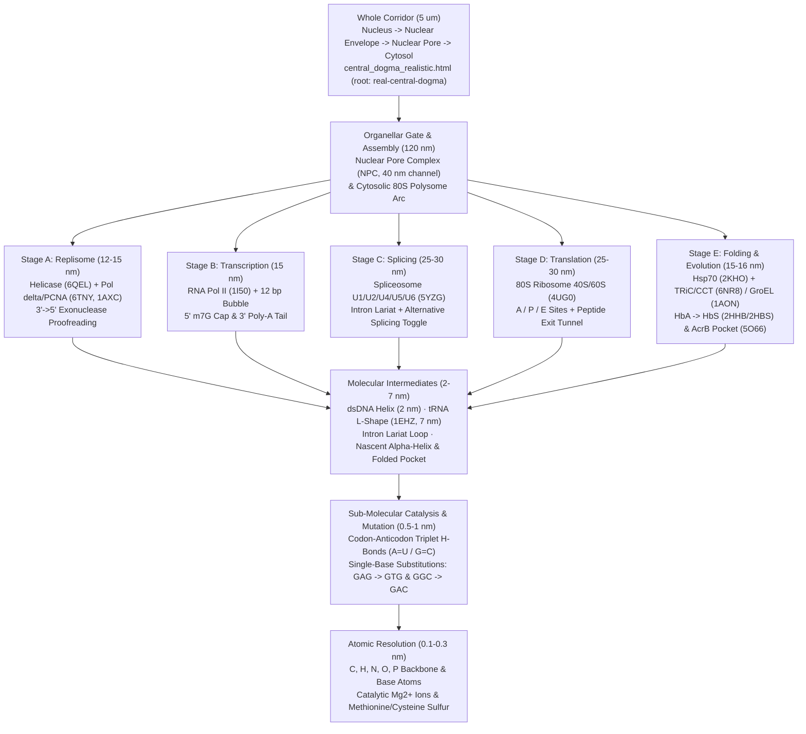

# 15 — End-to-End Central Dogma, mRNA Splicing & Molecular Evolution

**Iteration:** `15` (Continuous Nucleus-to-Cytosol WebGL2 Central Dogma Pipeline, Spliceosome Alternative Splicing, Live Point-Mutation & Natural-Selection Explorer, 3-Persona Guided Tour & GPU `.opus` Narration in `EN` & `ES`)  
**Status:** ✅ **Completed**  
**Parent Index:** [`roadmap/README.md`](./README.md)  
**Previous Step:** [`14-cell-division-binary-fission-mitosis-and-meiosis.md`](./14-cell-division-binary-fission-mitosis-and-meiosis.md)  
**Next Step:** [`16-bioenergetics-photosynthesis-respiration-and-membrane-transport.md`](./16-bioenergetics-photosynthesis-respiration-and-membrane-transport.md)

---

## 1. Executive Summary & Pedagogical Goals

Most introductory biology courses slice genetic information flow into disconnected chapters—DNA replication in one week, transcription and RNA processing in another, translation in a third, protein folding in biochemistry, and evolution at the end of the term. Learners memorize isolated enzyme names without ever seeing how **one continuous molecular pipeline** converts nuclear DNA into working cellular machinery—or how **one single-letter base change** ripples upward from an atomic hydrogen bond to protein structure, cell phenotype, and natural selection.

**Phase 15** bridges that gap by building a single continuous, interactive WebGL2 molecular corridor—[`central_dogma_realistic.html`](../central_dogma_realistic.html) (`src/pages/central_dogma_realistic.ts`, `root: 'real-central-dogma'`)—spanning **Nucleus → Nuclear Pore Complex → Cytosol**, strictly navigable from **Whole → Tiniest** (`5 µm` corridor down to `0.1 nm` atoms). Learners trace **one real eukaryotic gene** (human *HBB* β-globin: 3 exons, 2 introns, 146-residue mature polypeptide) across five linked molecular stations and test live **single-nucleotide mutations** (comparing human β-globin sickle-cell polymerization against an adaptive bacterial efflux-pocket mutation under antibiotic pressure):

1. **Stage A — DNA Replication & Proofreading (Nucleus):**
   - A hexameric replicative helicase (`MCM2–7` / `DnaB`, PDB `6QEL`) unzips double-stranded euchromatin (`dsDNA`) at the replication fork while single-strand binding proteins (`RPA` / `SSB`, PDB `1EYG`) stabilize exposed templates.
   - Processive **`DNA Pol δ` + `PCNA` sliding clamp** (PDB `6TNY` / `1AXC`, paired with bacterial `DNA Pol III` + β-clamp PDB `5FKV` comparison) synthesizes complementary DNA `5' → 3'`, pausing when an erroneous base enters the catalytic palm so the **`3' → 5'` exonuclease proofreading domain** excises the mismatch before elongation resumes.
2. **Stage B — Transcription (`RNA Pol II`, Nucleus):**
   - Twelve-subunit **`RNA Polymerase II`** (PDB `1I50`) opens a `~12–14 bp` transcription bubble along the opened chromatin gene locus, reading the `3' → 5'` template strand to synthesize complementary `5' → 3'` **pre-mRNA**.
   - Co-transcriptional capping machinery attaches an inverted **`7`-methylguanosine (`m⁷G`) `5'` cap** immediately as the nascent transcript exits the RNA exit channel, followed by cleavage and **`3'` poly-A tail** polymerization (`~150–250` adenosines) that licenses nuclear export and stabilizes cytosolic half-life.
3. **Stage C — Eukaryotic mRNA Splicing (`Spliceosome`, Nucleus):**
   - The megadalton **`Spliceosome`** ribonucleoprotein complex (`U1/U2/U4/U5/U6` snRNPs; human catalytic C complex, PDB `5YZG`) recognizes `5' GU`, branch-point adenosine (`A`), and `3' AG` intronic motifs.
   - Two Mg²⁺-catalyzed transesterification reactions loop out each non-coding **intron** as a covalently closed **`2'–5'` lariat** and stitch adjacent **exons** seamlessly into mature coding mRNA.
   - **Interactive Alternative Splicing Toggle (`Isoform A` ↔ `Isoform B`):** Learners toggle cassette-exon inclusion versus skipping in real time, watching the spliceosome re-route exon ligation so **one single gene produces two structurally and functionally distinct proteins**.
4. **Stage D — Nuclear Export & Translation (`80S Ribosome` + `tRNA` + `A/P/E` Sites, Cytosol):**
   - Mature capped, spliced, polyadenylated mRNA threads through the `~120 nm` **Nuclear Pore Complex (`NPC`)** into a cytosolic **polysome** arc where multiple eukaryotic **`80S` ribosomes** (`40S` decoding + `60S` peptidyl-transferase subunits, PDB `4UG0`) translate the transcript simultaneously.
   - Inside the active decoding center, `~76 nt` L-shaped aminoacyl-**`tRNAs`** (PDB `1EHZ`, delivered in ternary complexes analogous to `EF-Tu·GTP·tRNA`, PDB `1TTT`) pair their `3`-base anticodons to `3`-base mRNA codons, stepping sequentially through **`A` (Aminoacyl) → `P` (Peptidyl) → `E` (Exit)** sites as the `60S` rRNA ribozyme forges peptide bonds and extrudes the nascent polypeptide through the `~10 nm` exit tunnel.
5. **Stage E — Protein Folding & Live Point-Mutation / Natural-Selection Explorer (Cytosol):**
   - Emerging hydrophobic segments are shielded by **`Hsp70`** (PDB `2KHO`) and enclosed inside the ATP-gated barrel of eukaryotic **`TRiC`/`CCT`** (PDB `6NR8`; compared alongside prokaryotic **`GroEL`/`GroES`**, PDB `1AON`) so the chain collapses into its native 3D tertiary/quaternary fold without aggregating.
   - **Live Point-Mutation Toggle (`Wild-Type` ↔ `Single-Base Variant`):**
     - **Human β-Globin Missense (`GAG → GTG`, `Glu6 → Val6`; PDB `2HHB` → `2HBS`):** Flipping a single `A → T` base in codon 6 swaps a negatively charged, water-soluble glutamate for nonpolar hydrophobic valine. Under low oxygen, that exposed hydrophobic patch locks into an adjacent β-globin pocket (`Phe85`/`Leu88`), driving self-assembly of rigid **sickle-cell HbS fibers**—visually grounding both recessive pathology and heterozygous malaria resistance (**balancing selection**).
     - **Adaptive Bacterial Mutation Under Selection (`AcrB` Efflux Pocket `GGC → GAC`, `Gly288 → Asp288`; PDB `5O66`):** Switching the live mutation bench to *E. coli*'s `AcrAB–TolC` multidrug efflux pump shows how a single nucleotide substitution reshapes the distal binding pocket's width and polarity, boosting fluoroquinolone extrusion under antibiotic pressure so mutant cells survive and sweep the population.

### Core Pedagogical Goals
- **One Unbroken Causal Chain:** Show learners that DNA replication, transcription, splicing, nuclear export, ribosomal decoding, and chaperonin folding form one spatially continuous production corridor inside the cell.
- **Splicing as Eukaryotic Combinatorial Power:** Explain visually why ~20,000 human protein-coding genes generate `> 100,000` distinct protein isoforms without adding genome length.
- **Evolution Without Hand-Waving:** Prove at atomic resolution how a single nucleotide misincorporation (`0.5 nm`) changes one codon, swaps one amino-acid side chain, alters 3D folding or binding-pocket geometry (`5–10 nm`), and shifts organismal survival under selective pressure.

---

## 2. Whole-to-Tiniest Drill-Down Architecture

Every camera preset, clickable Explorer child node, and guided tour transition in Phase 15 enforces a strict **Whole → Tiniest** hierarchy spanning **4.5 orders of magnitude** (`5 µm` → `0.1 nm`), reusing the shared WebGL2 instanced PDB + Effect v4 engine from Phases 01–08.

### Pipeline Nanomachines & Scale Spec Sheet

| Stage & Scale Tier | Biological Machine / Structure | Real Dimensions | Structural Source (PDB) | Primary Input → Output | Interactive WebGL2 Behavior |
| :--- | :--- | :--- | :--- | :--- | :--- |
| **Whole Corridor (`5 µm`)** | Cutaway Nucleus + Nuclear Envelope + Cytosol Lane | `5.0 × 3.2 × 2.8 µm` cutaway | Procedural membrane + `1KX5` nucleosomes | Euchromatin gene locus → Folded cytosolic proteins | Smooth camera rails tracking one labeled transcript from chromatin to folded protein |
| **Export & Polysome (`120 nm`)** | Nuclear Pore Complex (`NPC`) & Polysome Arc | NPC: `120 nm` OD, `40 nm` pore; Polysome: `100–150 nm` | Procedural 8-fold NPC ring + instanced `4UG0` | Export-licensed mRNP → Multi-ribosome translation wave | Directional mRNA snake gliding through FG-repeat meshwork into cytosolic rosettes |
| **Stage A (`12–15 nm`)** | Replicative Helicase + `DNA Pol δ`/`PCNA` (+ `Pol III`) | Helicase: `~13 nm`; `Pol δ–PCNA`: `~12 × 15 nm` | `6QEL` (DnaB), `6TNY` (Pol δ–PCNA), `1AXC` (PCNA), `5FKV` (Pol III) | Parental `dsDNA` + `dNTPs` → 2 semiconservative `dsDNA` copies | Live unzipping fork; simulated mismatch stalls palm, triggers `3' → 5'` exo excision pulse |
| **Stage B (`15 nm`)** | Eukaryotic `RNA Polymerase II` + Capping / Poly-A | `~15 × 13 × 11 nm` (`~550 kDa`, 12 subunits) | `1I50` (already in repo) | Template DNA + `rNTPs` → `5'`-capped, `3'`-poly-A `pre-mRNA` | Animated `12–14 bp` transcription bubble with `rNTP` stream and glowing `m⁷G` cap docking |
| **Stage C (`25–30 nm`)** | Eukaryotic **Spliceosome** (`U1/U2/U4/U5/U6` snRNPs) | `~27 × 24 × 20 nm` (`~2.5–3.0 MDa`) | **`5YZG`** (human catalytic C complex) | `pre-mRNA` (exons + introns) → Mature spliced `mRNA` + excised intron lariat | Live lariat loop formation (`2'–5'` branch) + **Alternative Splicing Toggle** (`Isoform A/B`) |
| **Stage D (`25–30 nm`)** | Eukaryotic **`80S` Ribosome** (`40S` + `60S`) + `tRNA` | `80S`: `~28–30 nm` (`4.3 MDa`); `tRNA`: `~7 × 6 × 2 nm` | **`4UG0`** (`80S`), **`1EHZ`** (`tRNA`), `1TTT` (ternary), `4YBB` (`70S` compare) | Mature `mRNA` + `aa-tRNA` + `GTP` → Nascent polypeptide chain | Synchronized `A → P → E` tRNA ratcheting, live `3`-base codon readout, growing peptide exit |
| **Stage E (`15–16 nm`)** | **`Hsp70`** & **`TRiC`/`CCT`** (vs. **`GroEL`/`GroES`**) | `Hsp70`: `~8 nm`; `TRiC`/`GroEL`: `~15 × 16 nm` barrel | **`2KHO`** (`Hsp70`), **`6NR8`** (`TRiC`), `1AON` (`GroEL`, in repo) | Unfolded hydrophobic chain + `ATP` → Active folded 3D protein | Hydrophobic patch shielding, ATP-driven chamber capping/release, native fold pop-out |
| **Codon & Atom (`0.1–1.0 nm`)** | Codon–Anticodon Triplet & Mutated Nucleotide | Base pair: `1.08 nm`; H-bond: `0.28–0.30 nm`; Atoms: `0.1–0.3 nm` | Procedural atomic ball-and-stick (`src/molecules/dna.ts`, `rna.ts`) | `3`-letter codon (`GAG`/`GTG` or `GGC`/`GAC`) → Amino acid identity | Interactive atomic zoom highlighting exact H-bond donor/acceptor switch (`A=T` → `T=A`) |

### Live Splicing & Point-Mutation Outcomes Matrix

| Interactive Toggle | DNA Coding Codon → mRNA Codon | Amino-Acid / Isoform Change | 3D Structural Effect (PDB) | Cellular Phenotype & Evolutionary Selection |
| :--- | :--- | :--- | :--- | :--- |
| **Alternative Splicing: `Isoform A` (Default)** | Exon 1 + Cassette Exon 2 + Exon 3 retained | Full-length canonical domain (`100%` exons) | Complete globular fold with regulatory loop intact | Standard cellular localization & substrate specificity |
| **Alternative Splicing: `Isoform B` (Exon Skip)** | Exon 1 ligated directly to Exon 3 (Exon 2 excised in lariat) | Shorter isoform missing central cassette motif | Compact folded isoform exposing an alternate binding interface | Two distinct tissue-specific proteins encoded by **one** gene |
| **β-Globin Wild-Type (`HbA`)** | `GAG` → `GAG` (Codon 6, *HBB* Exon 1) | **Glutamate (`Glu6`)** — polar, negatively charged (`-COO⁻`) | Soluble deoxyhemoglobin tetramer (`2HHB`); surface remains hydrophilic | Smooth biconcave erythrocytes carry O₂ freely through capillaries |
| **β-Globin Point Mutation (`HbS`)** | `GTG` → `GUG` (Single `A → T` transversion) | **Valine (`Val6`)** — nonpolar, hydrophobic isopropyl chain | Exposed hydrophobic bump docks into adjacent β-chain pocket (`2HBS`) → rigid helical fibers | Homozygotes (`HbS/HbS`) suffer sickle-cell vaso-occlusion; heterozygotes (`HbA/HbS`) resist severe *Plasmodium* malaria (**balancing selection**) |
| **Bacterial `AcrB` Wild-Type** | `GGC` → `GGC` (Codon 288, *E. coli* `acrB`) | **Glycine (`Gly288`)** — minimal H side chain in distal pocket | Baseline hydrophobic distal binding pocket inside `AcrAB–TolC` (`5O66`) | Standard multidrug efflux rate; susceptible to high fluoroquinolone dose |
| **Bacterial `AcrB` Adaptive Variant** | `GAC` → `GAC` (Single `G → A` transition) | **Aspartate (`Asp288`)** — reshapes pocket geometry & H-bond network | Remodeled distal efflux cavity alters fluoroquinolone orientation & export rate (`5O66` variant) | Beneficial under antibiotic stress: carriers pump out drug faster and dominate via **directional natural selection** |

---

## 3. Interactive Guided Tour & Multi-Persona Specification

Phase 15 introduces a unified narrated Guided Tour—[`src/tours/central_dogma.ts`](../src/tours/central_dogma.ts) (`root: 'real-central-dogma'`)—paired with full bilingual multi-persona scripts in [`src/tours/personas_central_dogma.ts`](../src/tours/personas_central_dogma.ts) (`EN` & `ES` × `pop`, `blueprint`, `scientific`).

### Tour Chapter Structure (`6` Chapters, `54` Timed Cues, `~6.5 min`)
- **`ch0` — The Whole Information Corridor (`6` cues):** Frames the `5 µm` cutaway Nucleus → Nuclear Pore → Cytosol corridor and introduces the single *HBB* gene learners will follow from DNA to folded protein.
- **`ch1` — Stage A · DNA Replication & Proofreading (`9` cues):** Flies to the replication fork (`[[helicase|helicase]]`, `[[DNA Pol δ|pol_delta]]`, `[[PCNA clamp|pcna]]`), watches leading/lagging synthesis, and pauses on a live mismatch excised by the `3' → 5'` exonuclease site (explaining why mutations are rare—yet never zero).
- **`ch2` — Stage B · Transcription (`RNA Pol II`) (`8` cues):** Tracks `[[RNA Pol II|rna_pol2]]` opening the transcription bubble, assembling `[[pre-mRNA|pre_mrna]]`, and adding the protective `[[5' cap and poly-A tail|cap_poly_a]]`.
- **`ch3` — Stage C · Spliceosome & Alternative Splicing (`9` cues):** Zooms into the `27 nm` `[[spliceosome|spliceosome]]` (`5YZG`) looping out an `[[intron lariat|intron_lariat]]`, fusing `[[exons|exon_junction]]`, and triggering the live **`Isoform A ↔ Isoform B`** toggle.
- **`ch4` — Stage D · Nuclear Export & `80S` Translation (`11` cues):** Follows `[[mature mRNA|mature_mrna]]` through the `[[nuclear pore|npc]]` into a `[[polysome|polysome]]`, stepping down to `[[80S ribosome|ribosome_80s]]` `A/P/E` sites (`[[tRNA|trna_ape]]`) and zooming to `0.5 nm` `[[codon–anticodon hydrogen bonds|codon_hbonds]]`.
- **`ch5` — Stage E · Chaperonin Folding, Point Mutations & Selection (`11` cues):** Follows the nascent `[[polypeptide|polypeptide]]` into `[[Hsp70|hsp70]]` and `[[TRiC/GroEL chaperonin|tric_groel]]`, flips the live **`GAG → GTG`** toggle (`[[wild-type HbA|hb_wildtype]]` → `[[sickle-cell HbS fibers|hb_sickle_fiber]]`), and switches to the `[[AcrB efflux pocket|acrb_pocket]]` (`GGC → GAC`) to visualize natural selection in real time.

### Strict `AGENTS.md` Rule 8 Compliance & Analogy Budget
- **Length & Highlight Parity:** Every cue across all `6` persona×locale variants (`54 × 6 = 324` cue strings) MUST stay strictly **`<= 110` plain characters** (after stripping `[[label|part]]` markup) and preserve **100% identical `[[...|part]]` highlight target IDs**.
- **Strict Analogy Restraint (`> 95%` Direct Prose):** At least `51` of `54` `Everyday Guide` (`pop`) cues use direct, concrete, distraction-free biological explanation—zero analogies on intros, dimensions, UI buttons, camera cutaways, or recaps.
- **Exact `2–3` Complex-Concept Analogies ONLY (`~1` every `2` minutes):**
  1. **`cd.ch3.s1.02` (Alternative mRNA Splicing):** Explains how the spliceosome edits one raw script into two different cuts by keeping or cutting specific exons while removing intron outtakes.
  2. **`cd.ch4.s1.02` (Genetic Code Triplet Lookup):** Explains how each `tRNA` reads a 3-letter codon like looking up a three-character code in a fixed lookup table that assigns one amino acid.
  3. **`cd.ch5.s1.02` (Single-Base Mutation → 3D Aggregation):** Explains how swapping charged `Glu6` for hydrophobic `Val6` turns a water-friendly surface peg into a Velcro-like patch that locks hemoglobin tetramers into rigid fibers.

### Representative Cue Parity Examples (Verified `<= 110` Plain Chars)

- **`cd.ch3.s1.02` *(Analogy 1/3 — Alternative Splicing)***
  - `pop` (`EN`): `Like editing one raw script into two cuts, the [[spliceosome|spliceosome]] stitches different [[exons|exon_junction]].`
  - `pop` (`ES`): `Como editar un guion en dos versiones, el [[espliceosoma|spliceosome]] une distintos [[exones|exon_junction]].`
  - `blueprint` (`EN`): `Selective exon routing in the [[spliceosome|spliceosome]] compiles multiple protein outputs from one [[locus|exon_junction]].`
  - `blueprint` (`ES`): `El enrutado selectivo en el [[espliceosoma|spliceosome]] compila múltiples proteínas desde un solo [[gen|exon_junction]].`
  - `scientific` (`EN`): `Alternative splicing by the [[spliceosome|spliceosome]] joins distinct [[exon combinations|exon_junction]] per tissue.`
  - `scientific` (`ES`): `El empalme alternativo del [[espliceosoma|spliceosome]] combina distintos [[exones|exon_junction]] según el tejido.`
- **`cd.ch4.s1.02` *(Analogy 2/3 — Genetic Code Triplet Lookup)***
  - `pop` (`EN`): `Each [[tRNA|trna_ape]] works like a fixed code table, matching three [[mRNA bases|codon_hbonds]] to one amino acid.`
  - `pop` (`ES`): `Cada [[ARNt|trna_ape]] actúa como una tabla fija que traduce tres [[bases de ARNm|codon_hbonds]] en un aminoácido.`
  - `blueprint` (`EN`): `Charged [[tRNA adaptors|trna_ape]] execute a 64-entry triplet lookup across [[mRNA codons|codon_hbonds]] in order.`
  - `blueprint` (`ES`): `Los adaptadores [[ARNt|trna_ape]] ejecutan una tabla de 64 tripletes sobre cada [[codón de ARNm|codon_hbonds]].`
  - `scientific` (`EN`): `Aminoacyl-[[tRNA|trna_ape]] anticodons base-pair with [[mRNA codons|codon_hbonds]] in the 40S decoding center.`
  - `scientific` (`ES`): `Los anticodones del [[ARNt|trna_ape]] se aparean con [[codones de ARNm|codon_hbonds]] en el centro decodificador 40S.`
- **`cd.ch5.s2.01` *(Direct Prose — Single-Base Point Mutation)***
  - `pop` (`EN`): `Flip one [[A to T|mutated_base]] in GAG to GTG, and [[beta-globin|hb_sickle_fiber]] swaps glutamate for valine.`
  - `pop` (`ES`): `Cambia una [[A por T|mutated_base]] de GAG a GTG, y la [[beta-globina|hb_sickle_fiber]] cambia glutamato por valina.`
  - `blueprint` (`EN`): `One [[A-to-T bit flip|mutated_base]] shifts codon 6 from GAG to GTG, mutating [[beta-globin|hb_sickle_fiber]] to Val6.`
  - `blueprint` (`ES`): `Un cambio [[A por T|mutated_base]] altera el codón 6 de GAG a GTG y muta la [[beta-globina|hb_sickle_fiber]] a Val6.`
  - `scientific` (`EN`): `A single [[A-to-T transversion|mutated_base]] converts GAG to GTG, substituting Glu6Val in [[HbS|hb_sickle_fiber]].`
  - `scientific` (`ES`): `Una transversión [[A a T|mutated_base]] convierte GAG en GTG y produce la variante Glu6Val en [[HbS|hb_sickle_fiber]].`

---

## 4. Implementation Steps & File Plan

### Step 1: PDB Coarse-Graining & Reusable Molecular Builders (`tools/` & `src/molecules/`)
- Extend [`tools/fetch_structures.sh`](../tools/fetch_structures.sh) to download the new Phase 15 structures (`5YZG`, `6TNY`, `6NR8`, `2KHO`, `2HHB`, `2HBS` as `.pdb`/`.cif` plus `4UG0.cif` for the human `80S` ribosome) while reusing existing repo downloads (`1KX5`, `1I50`, `1AXC`, `5FKV`, `6QEL`, `1EYG`, `1EHZ`, `1TTT`, `1AON`, `4YBB`, `5O66`).
- Create `tools/coarse_central_dogma.py` following `tools/README.md` conventions (`0.1 Å` `Int16` beads + `k`-means reduced balls, `group * 4 + part` kind encoding) emitting `structures/build/central_dogma.js` and `structures/build/central_dogma.explorer.json`, and register `central_dogma_realistic.html` in [`tools/embed_structures.py`](../tools/embed_structures.py).
- Reuse [`src/molecules/dna.ts`](../src/molecules/dna.ts) (`emitDNA`, `chromosome`), [`src/molecules/rna.ts`](../src/molecules/rna.ts) (`rnaAlong`, `rnaFold`), [`src/molecules/ribosome.ts`](../src/molecules/ribosome.ts), and [`src/molecules/pdb.ts`](../src/molecules/pdb.ts) for synchronized nucleic-acid strands, intron lariats, and atomic base-pair overlays.

### Step 2: Standalone Continuous Pipeline WebGL2 Page (`central_dogma_realistic.html` & `src/pages/central_dogma_realistic.ts`)
- Create [`central_dogma_realistic.html`](../central_dogma_realistic.html) and `src/pages/central_dogma_realistic.ts` (`root: 'real-central-dogma'`) on the shared Effect v4 + Three.js WebGL2 engine (`1 unit = 100 nm` corridor scale with true-scale molecular close-up sub-stages at `1 unit = 10 nm` and atomic codon inset at `1 unit = 1 nm`, explicitly annotated per `AGENTS.md` Rule 2).
- Implement all `22–26` inspectable parts across Stages A–E (`chromatin`, `helicase`, `pol_delta`, `pcna`, `rna_pol2`, `pre_mrna`, `cap_poly_a`, `spliceosome`, `intron_lariat`, `exon_junction`, `npc`, `mature_mrna`, `ribosome_80s`, `trna_ape`, `polypeptide`, `polysome`, `hsp70`, `tric_groel`, `hb_wildtype`, `hb_sickle_fiber`, `acrb_pocket`, `codon_hbonds`, `mutated_base`), complete `postMessage` tour protocol (`track`, `fly`, `free`, `blink`, `ghost`, `set`, `arrived`, `focusOf`), and `window.__cell` debug hooks (`shot`, `step`, `sites`, `procs`, `flows`, `pointsOf`, `focusOf`, `flyTo`, `ghost`, `blink`).
- Add focused, bilingual (`EN`/`ES`) interactive pipeline controls:
  - **Stage Selector (`A`–`E` + Continuous Play):** Fly smoothly along the transcript or pause at any enzymatic checkpoint.
  - **Alternative Splicing Toggle (`Isoform A` ↔ `Isoform B`):** Re-routes spliceosome exon ligation live and updates downstream ribosome polypeptide length and folded domain.
  - **Live Point-Mutation & Selection Toggle:** Switches between `Wild-Type HbA (GAG → Glu6)` vs. `Sickle HbS (GTG → Val6)` (showing atomic H-bond shift, hydrophobic surface patch, and HbS fiber polymerization) and `Wild-Type AcrB (GGC → Gly288)` vs. `Resistant AcrB (GAC → Asp288)` (showing pocket remodeling and live antibiotic efflux/survival bar under selection).
- Register `central_dogma_realistic.html` in `HTML_PAGES` (`tests/verify_all.ts`), `sitemap.xml`, `README.md`, and write `docs/central_dogma_realistic_manual.md` per `AGENTS.md` Rule 7.

### Step 3: Explorer Subtrees (`NODES`), Curriculum Tree & 4-Mode Lenses (`src/content/lenses_central_dogma.ts`)
- Add `NODES['real-central-dogma']` and `~20` Whole → Tiniest zoomable molecular child nodes (`replication-fork`, `dna-pol-delta-pcna`, `rna-pol-ii-bubble`, `spliceosome-5yzg`, `alternative-splicing`, `nuclear-pore-export`, `ribosome-80s-ape`, `trna-anticodon-triplet`, `chaperonin-tric-groel`, `hb-sickle-mutation`, `acrb-efflux-evolution`, `mutated-nucleotide-atom`, etc.) to [`src/pages/cell_explorer.ts`](../src/pages/cell_explorer.ts).
- Author `src/content/lenses_central_dogma.ts` with complete `EN` & `ES` `Simple`, `Story`, `Blueprint`, and `Scientific` reading lenses for every new Explorer node and standalone 3D hover part, preserving `100%` valid `[[Label|nodeId]]` supply-chain links and `AGENTS.md` Rule 8 prose restraint; register in [`src/content/registry.ts`](../src/content/registry.ts), [`src/content/index.ts`](../src/content/index.ts), and `src/core/locales/es_nodes.ts`.
- Wire `real-central-dogma` into `MENU_GROUPS` (`src/pages/cell_explorer.ts`) and `COURSE_SEQUENCE` ([`src/core/progress_service.ts`](../src/core/progress_service.ts)) directly between Phase 14 (`real-cell-division`) and Phase 16 (`real-bioenergetics`).

### Step 4: Guided Tour, Multi-Persona Scripts & Sharded `< 48 MB` GPU `.opus` Audio
- Create `src/tours/central_dogma.ts` (`6` chapters, `54` cues) and `src/tours/personas_central_dogma.ts` (`EN`/`ES` × `pop`, `blueprint`, `scientific`), registering them in [`src/tours/index.ts`](../src/tours/index.ts), [`src/tours/tour_personas.ts`](../src/tours/tour_personas.ts), `src/core/locales/es_tours.ts`, and [`scripts/export_tour_cues.ts`](../scripts/export_tour_cues.ts).
- Run `npm run export:cues` and synthesize all new Tour and Explorer Lens clips locally on GPU via [`tools/generate_narration_gptsovits.py`](../tools/generate_narration_gptsovits.py) (`EN` `v1`/`v2`/`v3`) and [`tools/generate_narration_f5_es.py`](../tools/generate_narration_f5_es.py) (`ES` `latam` + `spain/{blueprint,scientific}`) using `CC0` voices in `tools/voices/`.
- Package Phase 15 narration into dedicated `< 48 MB` archives (`audio_phase15_en.tar.gz`, `audio_phase15_es.tar.gz`) with `PHASE15_EXCLUDE` wired cleanly into [`Makefile`](../Makefile), `Dockerfile`, and `.github/workflows/deploy.yml`.

---

## 5. Verification Gates (`tests/verify_all.ts` & Visual Eye-Check)

1. **TypeScript Build & Standalone WebGL2 E2E (`make typecheck && make build && make test`):**
   - Compiles cleanly with zero `tsc --noEmit` or `esbuild` errors.
   - Headless Chrome WebGL2 E2E loads `central_dogma_realistic.html` (standalone and embedded via `cell_explorer.html#real-central-dogma`) with `0` console/page errors, verifying all `22–26` inspectable parts, camera `focusOf`/`flyTo` targets, `postMessage` tour hooks, and `30 s` simulated pipeline throughput (`window.__cell.step(...)`).
2. **Interactive Splicing & Live Point-Mutation Verification:**
   - Automated E2E toggles `Isoform A ↔ Isoform B` and asserts spliceosome lariat excision, exon junction change, and updated folded isoform mesh visibility.
   - Automated E2E toggles `GAG → GTG` (`HbA → HbS`) and `GGC → GAC` (`AcrB` wild-type → adaptive efflux pocket) and asserts codon label update, atomic base-pair highlight change, `HbS` fiber polymerization / `AcrB` drug-efflux shift, and zero `NaN` vertex/matrix values.
3. **Multi-Persona Tour & `AGENTS.md` Rule 8 Analogy-Restraint Checks:**
   - Verifies all `54` cues across `EN` & `ES` × (`pop`, `blueprint`, `scientific`) stay strictly `<= 110` plain characters, preserve `100%` `[[label|part]]` highlight parity, and enforce `> 95%` direct prose with exact `2–3` complex-concept analogies only.
4. **Explorer 4-Mode Lenses, Link Integrity & `< 48 MB` `.opus` Audio Shards:**
   - Verifies `100%` valid `[[Label|nodeId]]` references, 4-mode distinctness (`Simple`, `Story`, `Blueprint`, `Scientific`), valid `OggS` `.opus` headers for every new Tour cue and Explorer node across all `5` voices, and strict `< 48 MB` limits on `audio_phase15_en.tar.gz` and `audio_phase15_es.tar.gz`.
5. **Visual Eye-Check (`AGENTS.md` Rule 6):**
   - Serve locally (`python3 tools/serve.py "$(pwd)" 8765`), render `__cell.shot(...)` views for all key scales (Whole Corridor, Replisome Proofreading, Spliceosome `5YZG` Lariat & Alternative Splicing, `80S` `A/P/E` Decoding, `HbS` Fiber vs. `HbA`, `AcrB` Pocket Variant, and `0.5 nm` Codon Base-Pair Inset), and visually inspect every PNG in `renders/` to confirm clean lighting, readable non-overlapping tags, accurate membrane/nuclear-envelope sidedness, and zero clipping or z-fighting.
