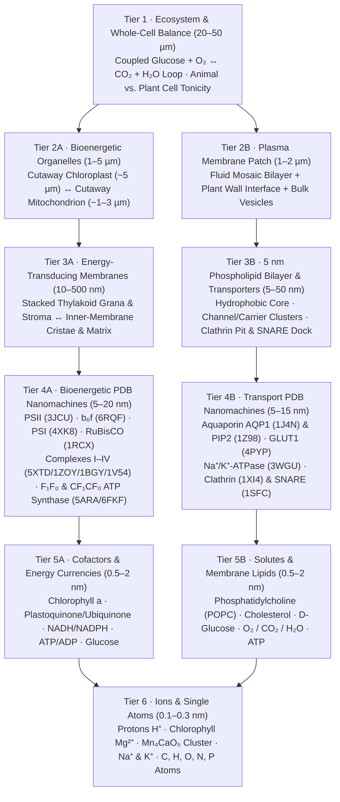

# 16 — Bioenergetics (Photosynthesis ↔ Cellular Respiration) & Membrane Transport / Osmosis

**Iteration:** 16  
**Status:** ✅ **Completed**  
**Parent Index:** [roadmap/README.md](./README.md)  
**Previous Step:** [15-central-dogma-pipeline-and-molecular-evolution.md](./15-central-dogma-pipeline-and-molecular-evolution.md)  
**Next Step:** [17-specialized-human-cells-and-cell-differentiation.md](./17-specialized-human-cells-and-cell-differentiation.md)

---

## 1. Executive Summary & Pedagogical Goals

In [Phase 15](./15-central-dogma-pipeline-and-molecular-evolution.md), learners watched genetic instructions flow from DNA to folded proteins. Every step of that pipeline—unwinding DNA, polymerizing RNA, translating peptides, maintaining cell volume, and moving cargo—runs on chemical energy and strictly controlled transmembrane gradients. Yet introductory biology courses routinely teach **Photosynthesis**, **Cellular Respiration**, and **Membrane Transport / Osmosis** as disconnected textbook chapters of memorized formulas, hiding the single physical principle uniting them all: **selective membranes convert concentration gradients into cellular work**.

**Phase 16** bridges energy capture, energy release, and membrane selectivity through **two tightly connected interactive WebGL2 simulation chambers**, built strictly **Whole → Tiniest** (`50 µm` ecosystem/whole-cell balance → `1–5 µm` organelles & membrane patches → `10–500 nm` thylakoid grana, mitochondrial cristae & bilayer arrays → `5–20 nm` PDB nanomachines → `0.5–2 nm` cofactors, glucose, ATP & phospholipids → `0.1–0.3 nm` protons, ions & atoms):

1. **Photosynthesis ↔ Cellular Respiration Loop (`bioenergetics_realistic.html`, `root: 'real-bioenergetics'`):**
   - Places a cutaway **Plant Chloroplast** and a cutaway **Animal Mitochondrion** side-by-side inside one live WebGL2 chamber, linked by continuous cycling streams of **`Glucose (C₆H₁₂O₆) + 6 O₂ ↔ 6 CO₂ + 6 H₂O`** (`6 CO₂ + 6 H₂O + light ⇌ C₆H₁₂O₆ + 6 O₂`).
   - **Chloroplast Chamber (Light Energy → Chemical Bonds):**
     - Live photons (`680 nm` & `700 nm`) excite chlorophyll antennas in **Photosystem II (`PSII–LHCII`)**, splitting water at the `Mn₄CaO₅` oxygen-evolving complex (`2 H₂O → O₂ + 4 H⁺ + 4 e⁻`).
     - Excited electrons travel via hydrophobic **plastoquinone (`PQ → PQH₂`)** to **Cytochrome `b₆f`** (pumping additional `H⁺` into the thylakoid lumen), through luminal **plastocyanin (`PC`)** to **Photosystem I (`PSI–LHCI`)**, and onto ferredoxin/`FNR` to reduce `NADP⁺ + H⁺ → NADPH`.
     - Protons accumulating in the thylakoid lumen rush back into the stroma through rotary **`CF₁CF₀` ATP synthase**, generating `ATP` that joins `NADPH` to power the stromal **Calvin Cycle (`RuBisCO`)** fixing `CO₂` into `G3P` and **`Glucose`**.
     - Interactive **Light Intensity** and **`CO₂` Supply** toggles let learners observe photolysis, proton-gradient buildup, and carbon fixation throttle dynamically in real time.
   - **Mitochondrion Chamber (Chemical Bonds → Universal ATP Currency):**
     - Cytosolic **Glycolysis** splits **`Glucose → 2 Pyruvate + 2 net ATP + 2 NADH`**, followed by mitochondrial pyruvate import and oxidation (`2 Pyruvate → 2 Acetyl-CoA + 2 CO₂ + 2 NADH`).
     - Matrix **Krebs / Citric Acid Cycle** completes carbon oxidation (`4 CO₂` released; `6 CO₂` total per glucose), yielding `2 GTP/ATP` while charging high-energy electron shuttles (`6 NADH`, `2 FADH₂`; `10 NADH + 2 FADH₂` total per glucose).
     - Inner-membrane cristae **Electron Transport Chain Complexes I–IV** strip electrons from `NADH` and `FADH₂`, pumping `H⁺` from the matrix into the intermembrane space while reducing terminal electron acceptor `½ O₂ + 2 H⁺ + 2 e⁻ → H₂O` at Complex IV.
     - Protons flow back through the rotary **`F₁F₀` ATP Synthase** `c`-ring and `γ`-stalk, phosphorylating **`~30–32 ATP` per glucose**!
     - An interactive **Oxygen (`O₂`) Toggle** switches live between **Aerobic Respiration (`~30–32 ATP`)** and **Anaerobic Fermentation (`2 ATP` via glycolysis alone)**, visually halting Complexes I–IV and demonstrating why oxygen deprivation collapses eukaryotic ATP output.
2. **Membrane Transport & Osmosis Lab (`membrane_transport_realistic.html`, `root: 'real-membrane-transport'`):**
   - **Whole-Cell Tonicity Comparator (Animal Cell vs. Walled Plant Cell):** An interactive 3-state tonicity switch (**Hypotonic** · **Isotonic** · **Hypertonic**) runs side-by-side physics on a wall-less **Animal Cell** (erythrocyte / mammalian cell) and a cellulose-walled **Plant Cell**:
     - **Hypotonic** (low external solute / high free water): Net `H₂O` influx swells the animal cell to **osmotic lysis** (membrane rupture), while the plant cell becomes firm and **turgid** as its rigid cellulose cell wall counters internal turgor pressure.
     - **Isotonic** (balanced solute): Equal bidirectional `H₂O` movement (`J_net = 0`) maintains a stable animal cell and a **flaccid** plant cell with zero net turgor.
     - **Hypertonic** (high external solute / low free water): Net `H₂O` efflux shrivels the animal cell (**crenation**) and pulls the plant plasma membrane away from its stationary cellulose wall (**plasmolysis**) as the central vacuole collapses.
   - **Continuous Zoom into the `5 nm` Phospholipid Bilayer:** Seamlessly transitions from whole-cell osmotic deformation down into a molecular bilayer patch displaying all five cellular transport classes simultaneously alongside live concentration bars and membrane voltage (`V_m ≈ -70 mV`):
     1. **Simple Diffusion (Passive):** Nonpolar **`O₂`** and **`CO₂`** slipping directly across the hydrophobic fatty-acyl core down their concentration gradients.
     2. **Osmosis & Water Channel Transport (Passive):** Single-file **`H₂O`** chains streaming rapidly through **Aquaporin (`AQP1` / `PIP2`)** hourglass pores while the central `NPA` motif excludes protons (`H⁺`) and ions.
     3. **Facilitated Diffusion (Passive Carrier):** **`GLUT1`** alternating-access rocker (`outward-open ⇌ occluded ⇌ inward-open`) shuttling polar **`Glucose`** down its gradient with zero ATP cost.
     4. **Primary Active Transport (ATP-Driven):** The electrogenic **`3 Na⁺ out / 2 K⁺ in` Sodium–Potassium Pump (`Na⁺/K⁺`-ATPase)** hydrolyzing `1 ATP → ADP + Pᵢ` per cycle to drive ions uphill, sustaining both resting membrane potential and animal osmotic homeostasis.
     5. **Bulk Vesicular Transport (ATP + Cytoskeleton):** Clathrin-coated **Endocytosis** (pit invagination + dynamin scission) and SNARE-driven **Exocytosis** (vesicle docking + bilayer fusion).

### Core Pedagogical Outcomes

- **Unify Photosynthesis & Respiration as Reversed Redox Mirrors:** Learners see identical architectural motifs—membrane-bound electron transport chains, quinone/protein shuttles, proton pumping, and rotary `F₁F₀`/`CF₁CF₀` ATP turbines—operating in opposite carbon directions (`CO₂ → Glucose` vs. `Glucose → CO₂`).
- **Explain Chemiosmosis Without Hand-Waving:** Watching protons accumulate inside the thylakoid lumen and mitochondrial intermembrane space makes it immediately intuitive why membrane integrity is mandatory for ATP synthesis.
- **Connect Osmosis to Structural Biology:** Contrasting animal cell lysis/crenation against plant turgor/plasmolysis clarifies the mechanical purpose of cellulose walls and central vacuoles, while zooming into `AQP1`, `GLUT1`, and `Na⁺/K⁺`-ATPase connects whole-cell water balance directly to single transmembrane proteins.

---

## 2. Whole-to-Tiniest Drill-Down Architecture

Every clickable tag, camera preset, and Explorer subtree in Phase 16 enforces the **Whole → Tiniest** zoom ladder across six spatial tiers (`50 µm → 0.1 nm`), reusing real coarse-grained PDB/OPM structures from `tools/` alongside new mitochondrial and vesicular complexes.

### Bioenergetics Pathway Stoichiometry & PDB Spec Sheet (`bioenergetics_realistic.html`)

| Pathway Stage | Subcellular Location | Key PDB Nanomachines (ID · Asset Status) | Inputs (per `1 Glucose` / `6 CO₂` Equiv.) | Outputs & Proton / ATP Yield | Live 3D Visual Signature |
| :--- | :--- | :--- | :--- | :--- | :--- |
| **Light-Dependent Reactions (Linear Z-Scheme)** | Chloroplast **Thylakoid Membrane** (`~5 nm` bilayer, grana stacks) | `PSII–LHCII` (**`3JCU`**, existing OPM), `LHCII` (**`1RWT`**, existing OPM), `Cyt b₆f` (**`6RQF`**, existing OPM), `Plastocyanin` (**`1AG6`**, existing), `PSI–LHCI` (**`4XK8`**, existing OPM), `CF₁CF₀` ATP Synthase (**`6FKF`**, existing OPM) | `12 H₂O` + `~48–54 photons` + `12 NADP⁺` + `18 ADP + 18 Pᵢ` | `6 O₂` (released), `12 NADPH`, `18 ATP` (lumen `pH ≈ 5.5` vs. stroma `pH ≈ 8.0`; `14` `c`-subunits ≈ `4.67 H⁺/ATP`) | Golden photon pulses hitting `Mg²⁺` chlorophylls; `O₂` bubbles rising from PSII; glowing `H⁺` beads pumping into thylakoid lumen and spinning `CF₁CF₀` rotors |
| **Calvin–Benson Cycle (Carbon Fixation)** | Chloroplast **Stroma** (aqueous lumen surrounding grana) | `RuBisCO` `L₈S₈` hexadecamer (**`1RCX`**, existing assembly) | `6 CO₂` + `18 ATP` + `12 NADPH` | `2 G3P` → **`1 Glucose (C₆H₁₂O₆)`** + `18 ADP + 18 Pᵢ` + `12 NADP⁺` | Stromal `CO₂` stream docking at `RuBisCO` active sites; hexagonal `Glucose` molecules exiting chloroplast toward the mitochondrion |
| **Glycolysis** | **Cytosol** (outside mitochondrion) | `GAPDH` tetramer (**`1U8F`**, existing), procedural Hexokinase / PFK-1 / Pyruvate Kinase corridor | `1 Glucose` + `2 ATP` (invested) + `2 NAD⁺` + `4 ADP + 2 Pᵢ` | `2 Pyruvate` + **`2 net ATP`** (substrate-level) + `2 NADH` + `2 H₂O` | Hexagonal `Glucose` cleaved mid-corridor into twin 3-carbon `Pyruvate` molecules; `2` amber `ATP` bursts + `2` cyan `NADH` carriers |
| **Pyruvate Oxidation & Krebs (Citric Acid) Cycle** | Mitochondrial **Matrix** | `Citrate Synthase` (**`1CTS`**, new RCSB) + `Complex II / Succinate Dehydrogenase` (**`1ZOY`**, new RCSB/OPM) | `2 Pyruvate` (`→ 2 Acetyl-CoA`) + `8 NAD⁺` + `2 FAD` + `2 GDP/ADP + 2 Pᵢ` | `6 CO₂` (exhaled back to chloroplast), **`2 GTP/ATP`**, `8 NADH` (`2` PDH + `6` Krebs), `2 FADH₂` | Circular luminous matrix reaction ring releasing `CO₂` streams back to chloroplast while dispatching `NADH` & `FADH₂` to cristae |
| **Oxidative Phosphorylation (ETC + Chemiosmosis)** | Mitochondrial **Inner Membrane (Cristae)** | `Complex I` (**`5XTD`** mammalian / **`7NYR`** existing OPM), `Complex II` (**`1ZOY`**, new), `Complex III bc₁` (**`1BGY`**, new), `Cytochrome c` (**`1HRC`**, existing), `Complex IV` (**`1V54`**, new / **`1FFT`** existing OPM), `F₁F₀` ATP Synthase (**`5ARA`** new + **`1BMF`**/`6OQR` existing) | `10 NADH` + `2 FADH₂` + `6 O₂` + `~26–28 ADP + Pᵢ` | `12 H₂O` (net `6 H₂O` overall) + **`~26–28 ATP`** (`10 H⁺` pumped per `NADH`: `4` at I, `4` at III, `2` at IV; `6 H⁺` per `FADH₂`; `~3.7–4 H⁺/ATP` including `Pᵢ` symport) → **`~30–32 total ATP / Glucose`** | Electron sparks hopping `I → Q → III → Cyt c → IV`; dense `H⁺` halo in intermembrane space surging through spinning `F₁F₀` `c₈`-ring turbines; `O₂` toggle cleanly cuts output to `2 ATP` |

### Membrane Transport & Osmosis Spec Sheet (`membrane_transport_realistic.html`)

| Transport Mechanism | Energy & Gradient | Key PDB Structure (ID · Asset Status) | Cargo & Stoichiometry | Membrane Side & Selectivity Detail | Live 3D Visual Signature |
| :--- | :--- | :--- | :--- | :--- | :--- |
| **Simple Diffusion** | **Passive** (`0 ATP`, down `ΔC`) | `5 nm` fluid **Phospholipid Bilayer** (`POPC` + Cholesterol procedural molecular array) | Small nonpolar gases **`O₂`**, **`CO₂`** | Direct partition across hydrophobic fatty-acyl core (`~3 nm` thick); blocked for charged ions (`Na⁺`, `K⁺`, `Cl⁻`) and polar sugars | Rapid unobstructed gas trajectories weaving between oscillating acyl tails along concentration gradient |
| **Osmosis / Water Channel** | **Passive** (`0 ATP`, down water potential `ΔΨ_w`) | Human/Bovine **`AQP1`** (**`1J4N`**, existing) & Plant **`PIP2;1`** (**`1Z98`**, existing OPM) | **`H₂O`** (`~10⁹ molecules/s` per tetramer pore) | Hourglass pore with central **`NPA` (`Asn-Pro-Ala`)** dipole reorientation & `ar/R` filter that permits single-file `H₂O` while blocking `H⁺` proton-wire leakage | Single-file blue `H₂O` dipole chain flipping `180°` at the `NPA` waist; flux direction reverses instantly with tonicity switch |
| **Facilitated Diffusion (Uniporter)** | **Passive** (`0 ATP`, down `ΔC`) | Human **`GLUT1`** (`SLC2A1`, **`4PYP`**, existing) | Polar **D-Glucose (`C₆H₁₂O₆`)** (`1:1` uniporter) | Alternating-access rocker-switch (`outward-open ⇌ occluded ⇌ inward-open`); never opens a continuous pore across both leaflets | `GLUT1` two-lobe transmembrane bundle rocking smoothly as each glucose hexose docks, occludes, and releases into cytosol |
| **Primary Active Transport (Ion Pump)** | **Active** (`1 ATP → ADP + Pᵢ`, **against** gradient) | Porcine **`Na⁺/K⁺`-ATPase** (`αβγ`, **`3WGU`**, existing); optional plant **`AHA2` `H⁺`-ATPase** (**`5KSD`**, existing OPM) | **`3 Na⁺ out / 2 K⁺ in`** per `1 ATP` hydrolyzed | `E₁` (cytosolic high-`Na⁺` affinity) → `Asp` autophosphorylation (`E₁~P`) → `E₂~P` (extracellular release of `3 Na⁺`, binding of `2 K⁺`) → dephosphorylation (`E₂ → E₁`); electrogenic (`-1` net charge inside, contributing to `V_m ≈ -70 mV`) | Distinct amber `Na⁺` (`0.102 nm`) and violet `K⁺` (`0.138 nm`) spheres cycling in opposite directions synced to cytosolic `ATP → ADP + Pᵢ` cleavage flashes |
| **Bulk Vesicular Transport** | **Active** (`ATP` / `GTP` + cytoskeleton) | **`Clathrin`** coat (**`1XI4`**, new RCSB) & **`SNARE`** fusion bundle (**`1SFC`**, new RCSB) | Macromolecules, receptors, secreted proteins | **Endocytosis:** inward membrane budding via clathrin lattice + dynamin pinch; **Exocytosis:** vesicle tethering and SNARE zippering fusing vesicle membrane into plasma bilayer | Mesoscale patch deformation showing inward coated-pit pinch-off on one flank and outward secretory vesicle burst on the other |

#### Whole-Cell Tonicity Response Matrix (Interactive Toggle in `membrane_transport_realistic.html`)

| External Solution | Extracellular vs. Cytosolic Solute | Net `H₂O` Flux | Animal Cell (No Cell Wall) | Plant Cell (Cellulose Wall + Central Vacuole) |
| :--- | :--- | :--- | :--- | :--- |
| **Hypotonic** | Lower solute outside (`[Solute]_out < [Solute]_in`) | **Inward (`H₂O` enters)** | Swells past elastic limit → **Osmotic Lysis** (membrane ruptures; rescued only partially by `Na⁺/K⁺` pump balance) | Central vacuole fills; plasma membrane presses tight against cellulose wall → **Turgid** (healthy optimal plant state; high turgor pressure) |
| **Isotonic** | Equal solute (`[Solute]_out = [Solute]_in`) | **Net Zero (`H₂O` in = out)** | Stable normal volume & biconcave/rounded profile (**Homeostasis**) | Water enters and leaves equally with zero wall pressure → **Flaccid** (soft, wilted stem posture) |
| **Hypertonic** | Higher solute outside (`[Solute]_out > [Solute]_in`) | **Outward (`H₂O` exits)** | Loses volume and develops spiked shriveled contour → **Crenation** | Central vacuole shrinks; plasma membrane detaches inward from rigid wall → **Plasmolysis** |

---

## 3. Interactive Guided Tour / Tutorial Spec

Phase 16 delivers **two narrated bilingual Guided Tours** (`src/tours/bioenergetics.ts` and `src/tours/membrane_transport.ts`) backed by a unified multi-persona script registry (`src/tours/personas_bioenergetics.ts`) supporting all `6` audience-language combinations (`EN` & `ES` × `pop` Everyday Guide, `blueprint` Systems Engineer, `scientific` Molecular Biologist).

### Structural & Rule 8 Compliance Rules

- **Cue Length & Interactive Highlighting:** Every cue in every persona and language stays strictly **`<= 110` plain characters** (after stripping `[[label|part]]` markup) and preserves **`100%` `[[label|part]]` highlight target parity** with the base tour script.
- **Strict Analogy Restraint (`AGENTS.md` Rule 8):**
  - Keep **`> 95%` of cues (`>= 48/50` in Tour 1 and `>= 46/48` in Tour 2) in direct, crisp, distraction-free prose**—zero analogies on introductions, dimensions, camera moves, UI prompts, simple shapes, or summaries.
  - Reserve **exactly `2` purposeful analogies per tour** (strictly within the `2–3` complex-concept budget, spaced `~2–2.5` minutes apart) **only** for conceptually non-obvious biophysical mechanisms:
    1. **Tour 1 — `real-bioenergetics` (`5` chapters, `50` cues; `48/50 = 96.0%` direct prose, exactly `2` analogies):**
       - `ch0` *(One Planetary Loop — Chloroplast ↔ Mitochondrion, 8 cues):* Macro `Glucose + O₂ ↔ CO₂ + H₂O` cycle linking plant and animal chambers (direct prose).
       - `ch1` *(Capturing Sunlight — Photosystem II, Water Splitting & Z-Scheme, 11 cues):* Photons exciting chlorophyll `Mg²⁺` in `PSII`, splitting `2 H₂O → O₂ + 4 H⁺ + 4 e⁻`, `PQ → Cyt b₆f → PC → PSI → NADPH` (direct prose; **Analogy #1** at `bio.ch1.s2.02` comparing high-energy electron carriers `NADPH`/`NADH` vs. `ATP` to **rechargeable power packs feeding electrons to the grid vs. single-use energy coins** spent directly at enzymes).
       - `ch2` *(Building Sugar — Thylakoid ATP Synthase & Calvin Cycle, 9 cues):* Lumen-to-stroma proton flow through `CF₁CF₀` and carbon fixation by `RuBisCO` into `Glucose` (direct prose).
       - `ch3` *(Breaking Sugar — Cytosolic Glycolysis & Matrix Krebs Cycle, 10 cues):* `Glucose → 2 Pyruvate + 2 ATP` in cytosol → matrix Krebs Cycle exhaling `6 CO₂` and loading `10 NADH + 2 FADH₂` (direct prose).
       - `ch4` *(The Proton Gradient & Rotary ATP Synthase, 12 cues):* Inner-membrane Complexes I–IV pumping `H⁺` and reducing `O₂ → H₂O`, culminating in rotary `F₁F₀` ATP synthase generating `~30–32 ATP` + live `O₂` toggle check (**Analogy #2** at `bio.ch4.s1.02` framing the chemiosmotic proton-motive force as **water trapped behind a hydroelectric dam rushing through the ATP synthase turbine**).
    2. **Tour 2 — `real-membrane-transport` (`5` chapters, `48` cues; `46/48 = 95.8%` direct prose, exactly `2` analogies):**
       - `ch0` *(Whole-Cell Tonicity — Animal vs. Plant Cell, 10 cues):* Interactive tour of Hypotonic (lysis vs. turgid), Isotonic (stable vs. flaccid), and Hypertonic (crenation vs. plasmolysis) responses (direct prose).
       - `ch1` *(Zooming into the 5 nm Bilayer — Simple Diffusion & Aquaporins, 10 cues):* Hydrophobic acyl barrier admitting nonpolar `O₂`/`CO₂` while `AQP1`/`PIP2` streams single-file `H₂O` (**Analogy #1** at `mem.ch1.s1.02` explaining osmosis as **water balancing its concentration across a fine semipermeable sieve** that lets water pass while holding back dissolved solutes).
       - `ch2` *(Facilitated Diffusion — GLUT1 Glucose Transport, 8 cues):* Polar glucose crossing down its gradient via `GLUT1` alternating-access rocking with zero ATP spent (direct prose).
       - `ch3` *(Uphill Active Transport — The 3 Na⁺ / 2 K⁺ Pump, 11 cues):* `Na⁺/K⁺`-ATPase hydrolyzing `1 ATP` per cycle to export `3 Na⁺` and import `2 K⁺`, setting resting `-70 mV` voltage and protecting animal cells from swelling (**Analogy #2** at `mem.ch3.s1.02` contrasting passive `GLUT1` as a **free-spinning revolving door** moving with the crowd against the `Na⁺/K⁺` pump as a **powered turnstile** pushing ions uphill).
       - `ch4` *(Bulk Cargo & Atomic Selectivity — Vesicles Down to Ions, 9 cues):* Clathrin endocytosis and SNARE exocytosis zooming all the way down to phospholipid heads, `H₂O` dipoles, and `Na⁺`/`K⁺` ionic radii (`0.102 nm` vs. `0.138 nm`) (direct prose).

### Representative Bilingual 3-Persona Cue Matrix (`src/tours/personas_bioenergetics.ts`)

| Cue ID & Type | Lang | `pop` (`Everyday Guide`) | `blueprint` (`Systems Engineer`) | `scientific` (`Molecular Biologist`) |
| :--- | :---: | :--- | :--- | :--- |
| **`bio.ch0.s0.01`** *(Direct prose)* | `en` | `Every breath links [[plant chloroplasts\|chloroplast]] and [[animal mitochondria\|mitochondrion]] in one loop.` | `Coupled bioenergetic loop: [[chloroplasts\|chloroplast]] fix carbon while [[mitochondria\|mitochondrion]] oxidize it.` | `Oxygenic photosynthesis in [[chloroplasts\|chloroplast]] balances aerobic respiration in [[mitochondria\|mitochondrion]].` |
| **`bio.ch0.s0.01`** *(Direct prose)* | `es` | `Cada respiro une a los [[cloroplastos\|chloroplast]] vegetales con las [[mitocondrias\|mitochondrion]] animales.` | `Bucle bioenergético acoplado: [[cloroplastos\|chloroplast]] fijan carbono y [[mitocondrias\|mitochondrion]] lo oxidan.` | `La fotosíntesis en [[cloroplastos\|chloroplast]] equilibra la respiración aerobia en [[mitocondrias\|mitochondrion]].` |
| **`bio.ch4.s1.02`** *(Analogy #2 · Dam/Turbine)* | `en` | `Trapped [[protons\|proton_grad]] pile up like water behind a dam, rushing through [[ATP synthase\|atp_synthase]] to spin its turbine.` | `Electrochemical [[proton pressure\|proton_grad]] drives [[F1F0 ATP synthase\|atp_synthase]] as a rotary molecular turbine.` | `Chemiosmotic [[proton-motive force\|proton_grad]] powers c-ring rotation in [[F1F0 ATP synthase\|atp_synthase]] to forge ATP.` |
| **`bio.ch4.s1.02`** *(Analogy #2 · Dam/Turbine)* | `es` | `Los [[protones\|proton_grad]] se acumulan como agua en una presa y giran la turbina de la [[ATP sintasa\|atp_synthase]].` | `La [[presión protónica\|proton_grad]] impulsa a la [[ATP sintasa F1F0\|atp_synthase]] como turbina rotatoria molecular.` | `La [[fuerza protón-motriz\|proton_grad]] rota el anillo c de la [[ATP sintasa F1F0\|atp_synthase]] para sintetizar ATP.` |
| **`mem.ch1.s1.02`** *(Analogy #1 · Osmosis Sieve)* | `en` | `Like water evening out across a fine sieve, [[water\|water_flow]] crosses [[aquaporins\|aquaporin]] toward denser solutes.` | `Passive [[solvent flux\|water_flow]] routes single-file through [[AQP1 channels\|aquaporin]] to equalize osmotic potential.` | `Osmotic [[H2O diffusion\|water_flow]] traverses [[AQP1 tetramers\|aquaporin]] down its chemical potential gradient.` |
| **`mem.ch1.s1.02`** *(Analogy #1 · Osmosis Sieve)* | `es` | `Como agua nivelándose en un tamiz fino, el [[agua\|water_flow]] cruza las [[acuaporinas\|aquaporin]] hacia más solutos.` | `El [[flujo pasivo de agua\|water_flow]] cruza en fila india por [[canales AQP1\|aquaporin]] equilibrando presión osmótica.` | `La [[difusión osmótica de H2O\|water_flow]] atraviesa [[tetrámeros AQP1\|aquaporin]] a favor de potencial hídrico.` |
| **`mem.ch3.s0.01`** *(Direct prose)* | `en` | `Splitting one [[ATP\|atp_hydrolysis]], the [[sodium-potassium pump\|nak_pump]] exports three Na+ and imports two K+.` | `Hydrolyzing [[1 ATP\|atp_hydrolysis]], the [[Na+/K+ ATPase\|nak_pump]] drives 3 Na+ out and 2 K+ in against gradient.` | `Primary active [[ATP hydrolysis\|atp_hydrolysis]] powers [[Na+/K+-ATPase\|nak_pump]] electrogenic 3 Na+ out / 2 K+ in cycling.` |
| **`mem.ch3.s0.01`** *(Direct prose)* | `es` | `Al romper un [[ATP\|atp_hydrolysis]], la [[bomba sodio-potasio\|nak_pump]] saca tres Na+ y mete dos K+.` | `Hidrolizando [[1 ATP\|atp_hydrolysis]], la [[ATPasa Na+/K+\|nak_pump]] bombea 3 Na+ fuera y 2 K+ dentro cuesta arriba.` | `La [[hidrólisis de ATP\|atp_hydrolysis]] impulsa el ciclo electrogénico 3 Na+ fuera / 2 K+ dentro de [[Na+/K+-ATPasa\|nak_pump]].` |

---

## 4. Implementation Steps & File Plan

### Step 1: Structural Coarse-Graining & Reusable PDB Assets (`tools/`)
- Reuse already-embedded structures from `tools/coarse_plant.py`, `tools/coarse_molecules.py`, and `tools/coarse_bacterium_more.py` (`3JCU`, `1RWT`, `6RQF`, `4XK8`, `6FKF`, `1RCX`, `1AG6`, `1Z98`, `5KSD`, `1U8F`, `1HRC`, `1BMF`, `6OQR`, `7NYR`, `1FFT`, `1J4N`, `4PYP`, `3WGU`)—never re-draw simplified primitives where a coarse-grained PDB exists (`AGENTS.md` Rule 1).
- Extend `tools/fetch_structures.sh`, add `tools/coarse_bioenergetics.py`, and wire `tools/embed_structures.py` to coarse-grain and embed the remaining Phase 16 complexes (`5XTD` Complex I, `1ZOY` Complex II, `1BGY` Complex III, `1V54` Complex IV, `5ARA` intact mitochondrial `F₁F₀` ATP synthase, `1CTS` Citrate Synthase, `1XI4` Clathrin triskelion, `1SFC` SNARE bundle) on single data lines (`const PDB = ...`) plus Explorer full-bead entries (`BPDB`).

### Step 2: Two Standalone Realistic WebGL2 Pages & Interactive Controls (`src/pages/`)
- Create both standalone HTML + TypeScript WebGL2 pages implementing deterministic seeded RNG isolation (`AGENTS.md` Rule 3), `window.__cell` debug hooks (`shot`, `step`, `sites`, `procs`, `flows`, `focusOf`, `flyTo`, `ghost`, `blink`), and the full `postMessage` tour protocol (`to: 'realistic-cell'`, `from: 'realistic-cell'`):
  1. **`bioenergetics_realistic.html` + `src/pages/bioenergetics_realistic.ts`** (`root: 'real-bioenergetics'`, `22–24` inspectable parts):
     - Dual cutaway Chloroplast + Mitochondrion chamber connected by live animated `Glucose`, `O₂`, `CO₂`, and `H₂O` particle loops.
     - True-size molecular close-up presets for the thylakoid Z-scheme (`PSII → PQ → b₆f → PC → PSI → CF₁CF₀` + stromal `RuBisCO`) and mitochondrial cristae (`Glycolysis → Krebs → Complexes I–IV → rotary F₁F₀ ATP synthase`).
     - Live interactive HUD controls: **Sunlight Intensity** slider (`0–100%`), **`CO₂` Supply** toggle, and **`O₂` Aerobic ↔ Anaerobic** switch updating live `ATP / Glucose` (`~30–32` vs. `2`), `ΔpH`, and `NADH`/`NADPH` readouts.
  2. **`membrane_transport_realistic.html` + `src/pages/membrane_transport_realistic.ts`** (`root: 'real-membrane-transport'`, `20–22` inspectable parts):
     - Side-by-side **Animal Cell vs. Walled Plant Cell** tonicity chamber with live **Hypotonic / Isotonic / Hypertonic** selector animating cell volume, vacuole turgor, lysis/crenation, and plasmolysis in real time.
     - Continuous camera zoom straight into the `5 nm` phospholipid bilayer exposing **Simple Diffusion (`O₂`/`CO₂`)**, **Aquaporin (`AQP1`/`PIP2`)** single-file `H₂O`, **`GLUT1`** alternating-access glucose uniporter, **`Na⁺/K⁺`-ATPase** (`3 Na⁺ out / 2 K⁺ in`) with live `ATP → ADP + Pᵢ` cleavage, and **Clathrin Endocytosis / SNARE Exocytosis**, paired with live `V_m` (`-70 mV`) and `[Na⁺]`/`[K⁺]`/`[Glucose]` meters.
- Register both pages in `HTML_PAGES` (`tests/verify_all.ts`), `sitemap.xml`, `README.md`, and `esbuild` entrypoints (`package.json`), and write matching architecture manuals (`docs/bioenergetics_realistic_manual.md`, `docs/membrane_transport_realistic_manual.md`) per `AGENTS.md` Rule 7.

### Step 3: Explorer Subtrees (`NODES`), Curriculum Tree & 4-Mode Lenses (`src/content/`)
- Add Phase 16 roots and `~28` Whole → Tiniest zoomable molecular child nodes in [`src/pages/cell_explorer.ts`](../src/pages/cell_explorer.ts) (`NODES` & `MENU_GROUPS`), including:
  - `real-bioenergetics` → `chloroplast-chamber`, `mitochondrion-chamber`, `thylakoid-z-scheme`, `psii-oec`, `cytochrome-b6f`, `psi-fnr`, `calvin-rubisco`, `glycolysis-corridor`, `krebs-cycle`, `mito-etc-complexes`, `f1f0-atp-synthase`, `chlorophyll-a`, `nadh-nadph-carriers`, `atp-adp-currency`, `glucose-ring`, `proton-gradient-h`.
  - `real-membrane-transport` → `tonicity-comparator`, `phospholipid-bilayer-5nm`, `simple-diffusion-gases`, `aquaporin-aqp1-pip2`, `glut1-uniporter`, `na-k-atpase-pump`, `endocytosis-exocytosis`, `phospholipid-popc`, `na-k-ions`.
- Author `src/content/lenses_bioenergetics.ts` with complete `EN` & `ES` 4-mode lenses (`Simple`, `Story`, `Blueprint`, `Scientific`) for every new Explorer node and standalone 3D hover part, preserving `100%` `[[Label|nodeId]]` supply-chain links and Rule 8 prose discipline.
- Update `COURSE_SEQUENCE` in [`src/core/progress_service.ts`](../src/core/progress_service.ts) to place `'real-bioenergetics'` and `'real-membrane-transport'` sequentially after Phase 15 (`'real-central-dogma'`) and immediately before Phase 17 (`'specialized-cells-overview'`).

### Step 4: Bilingual 3-Persona Guided Tours (`src/tours/`)
- Author `src/tours/bioenergetics.ts` (`5` chapters, `50` cues), `src/tours/membrane_transport.ts` (`5` chapters, `48` cues), and `src/tours/personas_bioenergetics.ts` (`EN` & `ES` × `pop`, `blueprint`, `scientific`).
- Wire both tours into [`src/tours/index.ts`](../src/tours/index.ts), `src/tours/tour_personas.ts`, and `src/core/locales/es_tours.ts` / `es_nodes.ts`.

### Step 5: Sharded `< 48 MB` GPU `.opus` Packaging (`Makefile`, `Dockerfile`, `.github/workflows/deploy.yml`)
- Export the updated cue/lens manifest (`make export-cues`) and synthesize all new Tour (`EN` `v1`/`v2`/`v3`, `ES` `latam` + `spain/{blueprint,scientific}`) and Explorer Lens `.opus` clips locally on GPU via `GPT-SoVITS` and `F5-Spanish` using Public-Domain (`CC0`) voices in `tools/voices/`.
- Package Phase 16 audio into dedicated `< 48 MB` archives (`audio_phase16_en.tar.gz`, `audio_phase16_es.tar.gz`; splitting per chamber if either exceeds `44 MB`) and register them in `AUDIO_ARCHIVES`, `BASE_EXCLUDE`, `unpack-audio`, and `pack-audio` in [`Makefile`](../Makefile), [`Dockerfile`](../Dockerfile), and [`.github/workflows/deploy.yml`](../.github/workflows/deploy.yml).

---

## 5. Verification Gates (`tests/verify_all.ts` & Visual Inspection)

1. **Typecheck, Build & Headless Chrome WebGL2 E2E (`make typecheck && make build && make test`):**
   - Renders `bioenergetics_realistic.html` and `membrane_transport_realistic.html` (standalone and embedded inside `cell_explorer.html`) with **`0` console/page errors**, verifying `100%` of declared interactive parts, `focusOf` cameras, `postMessage` tour commands, and responsive toggle states (`Sunlight`, `CO₂`, `O₂ Aerobic/Anaerobic`, `Hypotonic`/`Isotonic`/`Hypertonic`).
2. **Stoichiometric & Biophysical Simulation Assertions (`__cell.step(dt, n)`):**
   - Runs `30` simulated seconds via `window.__cell.step(1, 30)` and asserts non-zero, stoichiometrically accurate recipe counts:
     - `bioenergetics_realistic.html`: `O₂` evolved by PSII matches water split (`1 O₂ : 2 H₂O`), Calvin fixation consumes `ATP`/`NADPH` to emit `Glucose`, aerobic respiration yields `~30–32 ATP / Glucose`, and toggling `O₂ = off` drops ATP production to `2 ATP / Glucose` (glycolysis only).
     - `membrane_transport_realistic.html`: `Na⁺/K⁺`-ATPase maintains exact `3 Na⁺ out : 2 K⁺ in : 1 ATP` ratios, `AQP1` reverses net `H₂O` flux cleanly across Hypotonic (`J_in > 0`), Isotonic (`J_net ≈ 0`), and Hypertonic (`J_out > 0`) modes, and Animal vs. Plant cell volume/turgor state transitions (`lysis`/`turgid`, `stable`/`flaccid`, `crenation`/`plasmolysis`) fire deterministically.
3. **Whole-to-Tiniest Explorer Subtree & 4-Mode Lens Integrity:**
   - Asserts `100%` `[[Label|nodeId]]` link resolution across all Phase 16 nodes and hover parts, 4-mode (`Simple`/`Story`/`Blueprint`/`Scientific`) distinctness in `EN` & `ES`, and unbroken drill-down paths from `50 µm` macro chambers down to `0.1 nm` ions and atoms.
4. **Multi-Persona Tour & Rule 8 Analogy-Restraint Validation:**
   - Asserts every cue in `bioenergetics.ts` (`50` cues) and `membrane_transport.ts` (`48` cues) across `EN` & `ES` (`pop`, `blueprint`, `scientific`) stays `<= 110` plain chars, preserves `100%` `[[...|part]]` highlight parity, and obeys `AGENTS.md` Rule 8 (`> 95%` direct prose; strictly `2–3` complex-concept analogies per tour).
5. **`.opus` Audio Integrity & `< 48 MB` Shard Compliance:**
   - Verifies valid `OggS` `.opus` headers for every Phase 16 Tour cue and Explorer lens across all `5` voices (`v1`, `v2`, `v3`, `latam`, `spain`) and confirms every `audio*.tar.gz` shard remains strictly `< 48 MB`.
6. **Mandatory Visual Check (`AGENTS.md` Rule 6):**
   - Serve locally with `python3 tools/serve.py "$(pwd)" 8765`, capture scripted `__cell.shot(...)` frames into `renders/` covering: (a) coupled Chloroplast ↔ Mitochondrion overview, (b) thylakoid `PSII → b₆f → PSI → CF₁CF₀` + `RuBisCO` close-up, (c) cristae `Complexes I–IV` + rotary `F₁F₀` ATP synthase, (d) Hypotonic / Isotonic / Hypertonic Animal vs. Plant cell triptych, (e) `5 nm` bilayer with `AQP1`, `GLUT1`, `Na⁺/K⁺`-ATPase, and clathrin/SNARE vesicles, and (f) atomic `Chlorophyll a (Mg²⁺)` & `ATP` views—confirming clean silhouettes, readable tags, zero z-fighting, and smooth frame timing before sign-off.
