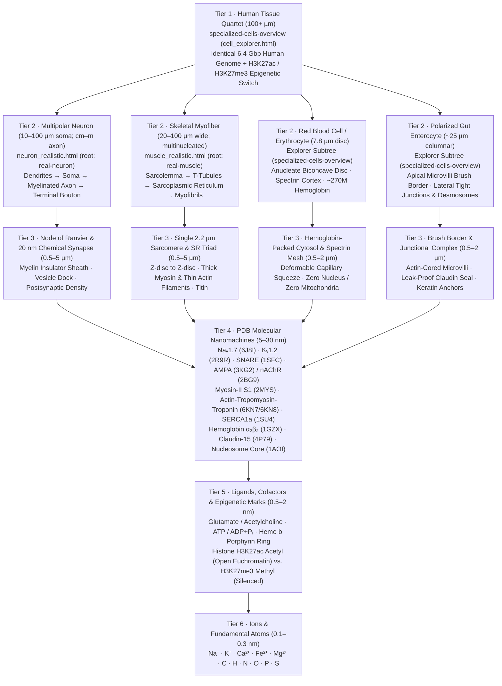

# 17 — Cell Differentiation & Specialized Human Cells (Same DNA, Different Jobs)

**Iteration:** `17` (Comparative 4-Cell Differentiation Stage, Standalone Realistic WebGL2 Neuron & Chemical Synapse + Skeletal Muscle Sarcomere Models, Comparative Erythrocyte & Polarized Enterocyte Explorer Subtrees, Epigenetic Chromatin-Bookmark Toggle, Bilingual 3-Persona Guided Tours & Sharded GPU `.opus` Narration in `EN` & `ES`)  
**Status:** 📋 **Planned**  
**Parent Index:** [`roadmap/README.md`](./README.md)  
**Previous Step:** [`16-bioenergetics-photosynthesis-respiration-and-membrane-transport.md`](./16-bioenergetics-photosynthesis-respiration-and-membrane-transport.md)  
**Next Step:** [`18-immune-defense-and-pharmacology-antibiotics-antivirals-vaccines.md`](./18-immune-defense-and-pharmacology-antibiotics-antivirals-vaccines.md)

---

## 1. Executive Summary & Pedagogical Goals

After tracing how a single cell copies and expresses genes ([Phase 15](./15-central-dogma-pipeline-and-molecular-evolution.md)) and harvests energy while moving ions across membranes ([Phase 16](./16-bioenergetics-photosynthesis-respiration-and-membrane-transport.md)), learners reach the central paradox of multicellular life: **every nucleated cell in the human body inherits the exact same diploid `6.4 Gbp` DNA sequence (`46` chromosomes), yet a cortical neuron, a skeletal muscle fiber, a red blood cell, and a gut absorptive cell look, move, and function like completely different machines.**

Textbook diagrams routinely show these four cells on separate chapters, obscuring the unifying molecular rule that produces all of them: **differential gene expression controlled by chromatin accessibility (epigenetics)**. By placing chemical tags onto histone tails inside the nucleus—most famously **`H3K27ac`** (histone H3 lysine-27 acetylation, neutralizing positive tail charges to keep **open euchromatin** readable by transcription factors and RNA Pol II) versus **`H3K27me3`** (lysine-27 trimethylation recruiting Polycomb compaction into **closed heterochromatin**)—each lineage activates only its own `~10–15%` subset of protein-coding genes while locking the other cell types' toolkits away.

**Phase 17** brings cell differentiation to life strictly from **Whole → Tiniest** (`100+ µm` human tissues → `10–100 µm` specialized cells → `0.5–5 µm` synapses, sarcomeres, myelin, hemoglobin cytosol & microvilli → `5–30 nm` PDB nanomachines → `0.5–2 nm` neurotransmitters, ATP, heme & histone marks → `0.1–0.3 nm` ions & atoms) through one comparative Explorer hub and two flagship standalone realistic WebGL2 scenes:

1. **Comparative 4-Cell Differentiation Stage (`specialized-cells-overview` in `cell_explorer.html`):**
   - Four specialized human cells arranged around a shared central **Diploid Human Genome (`6.4 Gbp`)** hub with an interactive **Epigenetic Chromatin-Bookmark Switch (`H3K27ac` Open vs. `H3K27me3` Silenced)** showing identical DNA loci lighting up or condensing differently in each lineage.
   - Hosts deep-dive Explorer models for the **Anucleate Red Blood Cell (Erythrocyte)**—a `7.8 µm` biconcave disc that ejects its nucleus and mitochondria during maturation so it can pack `~270 million` O₂-binding **hemoglobin** tetramers (`PDB 1GZX`)—and the **Polarized Gut Epithelial Cell (Enterocyte)**, topped with `~3,000` absorptive microvilli and riveted laterally to neighbors by **tight junctions** (`claudin`/`occludin`) and **desmosomes**.
2. **Flagship Standalone Scene 1 — Multipolar Neuron & Chemical Synapse (`neuron_realistic.html`, `root: 'real-neuron'`):**
   - Drills from a whole multipolar neuron (**dendrites → soma → myelinated axon → terminal bouton**) down to a propagating **saltatory action potential** wave (`voltage-gated Naᵥ1.7` influx & `Kᵥ1.2` efflux concentrated at unmyelinated **Nodes of Ranvier**) and into the **presynaptic terminal**, where arriving depolarization opens `Caᵥ` channels and `Ca²⁺` triggers **SNARE** four-helix zippering (`VAMP2`, `syntaxin-1A`, `SNAP-25`) to fuse synaptic vesicles and spill neurotransmitters across the `20 nm` synaptic cleft onto postsynaptic ligand-gated receptors (`AMPA` / `nAChR`).
3. **Flagship Standalone Scene 2 — Skeletal Muscle Fiber & Sarcomere (`muscle_realistic.html`, `root: 'real-muscle'`):**
   - Drills from a multinucleated **skeletal myofiber** (syncytium with peripheral nuclei, T-tubules & wrapped **sarcoplasmic reticulum**) down to a myofibril bundle and a single **`2.2 µm` Sarcomere** (`Z-disc` to `Z-disc`, `I-band`, `A-band`, `H-zone`, `M-line`, elastic `titin` springs) running live **sliding-filament contraction**: `Ca²⁺` released from the sarcoplasmic reticulum binds **troponin** (`TnC`) to roll **tropomyosin** off actin grooves, exposing binding sites for **myosin-II** cross-bridge `ATP` power strokes before `SERCA1a` pumps `Ca²⁺` back for relaxation.

---

## 2. Whole-to-Tiniest Drill-Down Architecture

Every model in Phase 17 follows the repo's strict **Whole → Tiniest** zoom ladder so learners can trace a macroscopic human ability (a thought, a heartbeat-fed oxygen delivery, a muscle lift, or nutrient absorption) all the way down to single covalent marks and atomic ions without losing spatial context.

### 4 Specialized Human Cells Specification Sheet

| Feature | Multipolar Neuron (`real-neuron`) | Skeletal Muscle Fiber (`real-muscle`) | Red Blood Cell / Erythrocyte | Polarized Gut Enterocyte |
| :--- | :--- | :--- | :--- | :--- |
| **Scene / Delivery** | Standalone WebGL2 (`neuron_realistic.html`) + Explorer Subtree | Standalone WebGL2 (`muscle_realistic.html`) + Explorer Subtree | Comparative Stage (`specialized-cells-overview`) + Explorer Subtree | Comparative Stage (`specialized-cells-overview`) + Explorer Subtree |
| **Cell Dimensions** | Soma `15–50 µm`; axon `0.5–15 µm` wide, up to `1 m` long; synaptic cleft `~20 nm` | Fiber `20–100 µm` diameter, mm–cm long; single sarcomere `2.2 µm` (`1.6 µm` contracted) | Biconcave disc `~7.8 µm` diameter × `2.0 µm` rim × `0.8 µm` center (`~90 fL`) | Columnar cell `~25 µm` tall × `8–10 µm` wide; `~3,000` microvilli (`1 µm × 100 nm`) |
| **Nuclear & Epigenetic State** | Single euchromatin-rich nucleus (`6.4 Gbp`); `H3K27ac` active on `SCN9A`, `SYT1`, `SNAP25`; `H3K27me3` on `MYH1`, `HBB` | Multinucleated syncytium (hundreds of peripheral nuclei, `6.4 Gbp` each); `H3K27ac` on `MYH1`, `ACTA1`, `TNNT3`, `RYR1`; `H3K27me3` on `SYT1`, `HBB` | **Anucleate** (erythroblast opens `HBA1`/`HBB` via `H3K27ac`, synthesizes hemoglobin, then **ejects nucleus & mitochondria** to maximize O₂ space) | Single basal nucleus (`6.4 Gbp`); `H3K27ac` on `SLC5A1` (`SGLT1`), `CLDN15`, `VIL1` (villin); `H3K27me3` on `SCN9A`, `MYH1`, `HBB` |
| **Primary Physiological Job** | Rapid long-distance electrical signaling & unidirectional chemical neurotransmission | Voluntary mechanical force generation via ATP-powered filament sliding | Reversible O₂ delivery (lungs → tissues) & CO₂ buffering through `3–5 µm` capillaries | Selective nutrient uptake across the intestinal lumen while blocking pathogen/toxin leaks |
| **Signature Subcellular Structure** | Myelin sheath + **Nodes of Ranvier** (`1–2 µm` gaps) + vesicle-loaded terminal bouton | Repeating **`2.2 µm` Sarcomeres** (`Z-disc` to `Z-disc`) wrapped in T-tubule / SR triads | Hemoglobin-saturated cytosol (`~330 mg/mL`) supported by a flexible **spectrin–ankyrin** cortex | Apical **microvilli brush border** + lateral **tight junctions** & **desmosomes** |
| **Key PDB Nanomachines** | `Naᵥ1.7` (`6J8I`), `Kᵥ1.2` (`2R9R`), neuronal `SNARE` complex (`1SFC`), `AMPA GluA2` (`3KG2`), `nAChR` (`2BG9`), Nucleosome (`1AOI`) | `Myosin-II` S1 head (`2MYS`), `F-Actin`–`Tropomyosin`–`Troponin` blocked/open (`6KN7` / `6KN8`), `SERCA1a` `Ca²⁺` pump (`1SU4`), Nucleosome (`1AOI`) | Oxy-**Hemoglobin** `α₂β₂` tetramer (`1GZX`, `~270 million` copies/cell; `4` heme sites each) | `Claudin-15` tight-junction strand (`4P79`), `Na⁺/glucose` symporter (`SGLT1`), desmosomal cadherins, actin-bundling villin, Nucleosome (`1AOI`) |
| **Atomic / Ionic Currency** | `Na⁺` influx, `K⁺` efflux, `Ca²⁺` vesicle trigger, `C/H/N/O` neurotransmitters, `ATP` for `Na⁺/K⁺` pump | `Ca²⁺` troponin switch, `Mg²⁺·ATP → ADP + Pᵢ` power stroke, `H⁺`/`P` phosphate release | `Fe²⁺` in protoporphyrin IX heme ring reversibly binding `O₂` (`~1.08 billion` O₂/cell) | `Na⁺` gradient driving `SGLT1` glucose uptake, `Ca²⁺`-stabilized cadherins, `ATP` at basolateral `Na⁺/K⁺` pump |

### Whole → Tiniest 6-Tier Resolution Mapping

| Scale Tier | Physical Span | Realistic Scene / Explorer Mapping | What the Learner Directly Observes |
| :--- | :--- | :--- | :--- |
| **Tier 1 · Tissue Quartet** | `100–500 µm` | `specialized-cells-overview` (`cell_explorer.html`) | Four human cell types beside one shared `6.4 Gbp` human genome hub with live `H3K27ac` / `H3K27me3` switching |
| **Tier 2 · Whole Specialized Cell** | `7.8–100 µm` | `neuron_realistic.html`, `muscle_realistic.html`, `erythrocyte`, `enterocyte` | Cell morphology tuned strictly to job: wired cable, contractile rod, deformable O₂ disc, sealed absorptive wall |
| **Tier 3 · Subcellular Machine** | `0.5–5 µm` | Cutaway cameras (`Node of Ranvier`, `Synapse`, `Sarcomere`, `Brush Border`) | Saltatory jump between myelin gaps; `Z-disc` shortening from `2.2 → 1.6 µm`; tight-junction paracellular barrier |
| **Tier 4 · PDB Complex** | `5–30 nm` | Coarse-grained PDB surfaces (`tools/embed_structures.py`) | `Naᵥ1.7`, `Kᵥ1.2`, `SNARE` 4-helix bundle, `Myosin-II` S1 + `Troponin`/`Tropomyosin`, `Hemoglobin` (`1GZX`), `Claudin-15`, `Nucleosome` (`1AOI`) |
| **Tier 5 · Small Molecule / Tag** | `0.5–2 nm` | Zoomed molecular Explorer nodes & particle animations | Neurotransmitter (`Glutamate`/`ACh`), `ATP`/`ADP`, `Heme b` porphyrin ring, `Lys27` acetyl (`-COCH₃`) vs. trimethyl (`-N(CH₃)₃⁺`) marks |
| **Tier 6 · Ions & Atoms** | `0.1–0.3 nm` | Atomic leaf nodes (`Na⁺`, `K⁺`, `Ca²⁺`, `Fe²⁺`, `Mg²⁺`, `C`, `H`, `N`, `O`, `P`) | Ionic charge gating channel pores, `Ca²⁺` flexing `TnC`, `Fe²⁺` coordinating `O₂`, and atomic composition shared across all life |

---

## 3. Interactive Guided Tour / Tutorial Spec

Phase 17 ships two full-length standalone Guided Tours—[`src/tours/neuron.ts`](../src/tours/neuron.ts) (`root: 'real-neuron'`) and [`src/tours/muscle.ts`](../src/tours/muscle.ts) (`root: 'real-muscle'`)—plus concise comparative cues for `specialized-cells-overview`, all sharing multi-persona scripts in [`src/tours/personas_specialized_cells.ts`](../src/tours/personas_specialized_cells.ts).

### Tour Script & Persona Invariants (`AGENTS.md` Rule 8)
- **3 Personas × 2 Languages (`EN` & `ES`):**
  - `pop` (`Everyday Guide` — active in `Simple` & `Story` lenses),
  - `blueprint` (`Systems Engineer` — active in `Blueprint` lens),
  - `scientific` (`Molecular Biologist` — active in `Scientific` lens).
- **Character Ceiling & Highlight Parity:** Every cue across all 6 variants (`EN`/`ES` × `pop`/`blueprint`/`scientific`) MUST stay **`<= 110` plain characters** (excluding `[[...|part]]` syntax) and preserve **100% identical `[[label|part]]` 3D mesh highlight targets**.
- **Strict Analogy Restraint (`AGENTS.md` Rule 8):**
  - Keep **`> 95%`** of `Everyday Guide` (`pop`) cues and Explorer descriptions direct, concrete, and distraction-free. Zero analogies on intros, dimensions, UI directions, camera cutaways, simple shapes, or rapid-fire recaps.
  - Permit **exact `2–3` purposeful analogies per tour ONLY** (~1 every `1.5–2.5` minutes), reserved exclusively for genuinely counterintuitive molecular mechanisms:

#### Tour A — `src/tours/neuron.ts` (`root: 'real-neuron'`, `5` Chapters, `~48` Cues, Exact `3` Analogies)
1. **`ch0` · Same DNA, Wired for Speed (`~9` cues):** Whole multipolar neuron cutaway into the soma nucleus showing `6.4 Gbp` DNA with `H3K27ac` opening neuronal genes (`SCN9A`, `SYT1`) while `H3K27me3` silences muscle and hemoglobin genes.
   - *Approved Analogy #1 (`ch0`, `pop` only):* **Epigenetic bookmarks** keeping the neuron chapters of the same `6.4 Gbp` DNA manual open while locking muscle and blood chapters shut.
2. **`ch1` · Dendrites & Action Potential Ignition (`~9` cues):** Signal integration from dendritic spines down to the axon hillock where depolarization crosses threshold (`-55 mV`).
3. **`ch2` · Myelin & Saltatory Nodes of Ranvier (`~10` cues):** Animated action potential leaping between myelinated segments; zoom into an exposed Node of Ranvier (`Naᵥ1.7` `6J8I` influx, `Kᵥ1.2` `2R9R` efflux, `Na⁺/K⁺` ATPase reset).
   - *Approved Analogy #2 (`ch2`, `pop` only):* Myelin insulation letting the electrical wave hop between Nodes of Ranvier like an express train skipping local stops to save time and `ATP`.
4. **`ch3` · Presynaptic `Ca²⁺` Surge & SNARE Vesicle Fusion (`~11` cues):** Depolarization opens terminal `Caᵥ` channels; `Ca²⁺` binds synaptotagmin so `SNARE` helices (`1SFC`) pull vesicle and terminal membranes together and fuse them.
   - *Approved Analogy #3 (`ch3`, `pop` only):* Complementary SNARE proteins locking together like a mechanical zipper until the vesicle membrane merges and spills neurotransmitters.
5. **`ch4` · Crossing the `20 nm` Cleft & Postsynaptic Reception (`~9` cues):** Neurotransmitters diffuse across the `20 nm` cleft to open postsynaptic ligand-gated channels (`AMPA` `3KG2` / `nAChR` `2BG9`), converting chemical code back into an electrical impulse—and handing off to **`Next in Course → Skeletal Muscle Sarcomere`**.

#### Tour B — `src/tours/muscle.ts` (`root: 'real-muscle'`, `5` Chapters, `~48` Cues, Exact `3` Analogies)
1. **`ch0` · Same DNA, Built to Pull (`~9` cues):** Whole multinucleated skeletal myofiber; peripheral nucleus cutaway showing `H3K27ac` activating `MYH1`, `ACTA1`, and `TNNT3` while `H3K27me3` shuts down synaptic and hemoglobin programs.
   - *Approved Analogy #1 (`ch0`, `pop` only):* **Epigenetic bookmarks** opening the contractile chapters of the exact same DNA manual that built the neuron.
2. **`ch1` · From Myofiber to a Single `2.2 µm` Sarcomere (`~9` cues):** Zoom from sarcolemma and T-tubules down through myofibril cylinders to one repeating `Z-disc`-to-`Z-disc` sarcomere (`I-band`, `A-band`, `M-line`, `titin`).
3. **`ch2` · The `Ca²⁺` Trigger: Troponin & Tropomyosin (`~10` cues):** T-tubule signal opens sarcoplasmic reticulum `RyR1` channels; `Ca²⁺` floods the sarcomere and binds **troponin** (`6KN7` → `6KN8`), rotating **tropomyosin** off actin's myosin-binding sites.
   - *Approved Analogy #2 (`ch2`, `pop` only):* Tropomyosin acting as a sliding safety cover over actin tracks until `Ca²⁺` twists troponin and rolls the cover aside.
4. **`ch3` · Myosin-II Cross-Bridge Power Stroke (`~11` cues):** `Myosin-II` S1 heads (`2MYS`) bind actin, release `Pᵢ` and `ADP` to pivot and slide thin filaments inward, then bind fresh `ATP` to detach and re-cock.
   - *Approved Analogy #3 (`ch3`, `pop` only):* Staggered myosin heads grabbing, pulling, and resetting along actin like a tug-of-war crew pulling hand-over-hand without letting the rope slip back.
5. **`ch4` · `SERCA1a` Relaxation & Tissue Comparison (`~9` cues):** `SERCA1a` (`1SU4`) spends `ATP` to pump `Ca²⁺` back into the sarcoplasmic reticulum, letting tropomyosin re-block actin and elastic `titin` restore the `2.2 µm` length; contrasts the contractile muscle program against the `hemoglobin`-packed erythrocyte and sealed gut enterocyte, handing off to **`Next in Course → Phase 18 · Immune Defense & Pharmacology`**.

### Representative Bilingual 3-Persona Cue Parity Samples (Verified `<= 110` Plain Chars)

| Cue Type | Persona | `EN` Cue (with `[[label\|part]]` highlights) | `ES` Cue (with identical `[[label\|part]]` targets) |
| :--- | :--- | :--- | :--- |
| **Direct Prose (`> 95%` of tour)** (`neuron` · `ch2`) | `pop` | `At each [[Node of Ranvier\|node-ranvier]], [[Na⁺ channels\|nav-channel]] open and recharge the voltage pulse.` *(74 chars)* | `En cada [[nodo de Ranvier\|node-ranvier]], los [[canales de Na⁺\|nav-channel]] se abren y recargan el impulso.` *(75 chars)* |
| | `blueprint` | `Exposed [[Node of Ranvier\|node-ranvier]] patches cluster [[Naᵥ1.7 channels\|nav-channel]] to boost signal gain.` *(77 chars)* | `Cada [[nodo de Ranvier\|node-ranvier]] agrupa [[canales Naᵥ1.7\|nav-channel]] para amplificar la señal eléctrica.` *(78 chars)* |
| | `scientific` | `At [[Nodes of Ranvier\|node-ranvier]], dense [[Naᵥ1.7 channels\|nav-channel]] drive rapid inward Na⁺ depolarization.` *(81 chars)* | `En los [[nodos de Ranvier\|node-ranvier]], [[canales Naᵥ1.7\|nav-channel]] activan la despolarización por Na⁺.` *(75 chars)* |
| **Purposeful Analogy (`2–3` / tour)** (`muscle` · `ch3`) | `pop` | `Staggered [[myosin heads\|myosin-head]] pull [[actin\|f-actin]] hand-over-hand like a tug-of-war crew.` *(72 chars)* | `Las [[cabezas de miosina\|myosin-head]] tiran de la [[actina\|f-actin]] alternando manos como en tira y afloja.` *(81 chars)* |
| | `blueprint` | `Asynchronous [[myosin-II motors\|myosin-head]] cycle on [[F-actin\|f-actin]] so force stays continuous.` *(73 chars)* | `Los [[motores de miosina-II\|myosin-head]] ciclan fuera de fase sobre [[F-actina\|f-actin]] sin perder tensión.` *(81 chars)* |
| | `scientific` | `Asynchronous [[myosin-II S1 heads\|myosin-head]] hydrolyze ATP to ratchet [[F-actin\|f-actin]] toward the M-line.` *(83 chars)* | `Las [[cabezas S1 de miosina-II\|myosin-head]] hidrolizan ATP para deslizar la [[F-actina\|f-actin]] al centro.` *(80 chars)* |

---

## 4. Implementation Steps & File Plan

### Step 1: Comparative 4-Cell Differentiation Stage & Explorer Subtrees (`src/pages/cell_explorer.ts`)
- Add `NODES['specialized-cells-overview']` (`buildSpecializedCellsOverview`) in [`src/pages/cell_explorer.ts`](../src/pages/cell_explorer.ts) presenting the **4 Specialized Human Cells** (Multipolar Neuron, Skeletal Myofiber, Red Blood Cell, Polarized Gut Enterocyte) arranged on four pedestals around a central **Diploid Human Genome (`6.4 Gbp`)** chromatin pedestal:
  - Include an interactive **Epigenetic Program Switch (`H3K27ac` Open Euchromatin vs. `H3K27me3` Closed Heterochromatin)** that highlights active lineage genes (`SCN9A`/`SYT1`, `MYH1`/`ACTA1`, `HBA1`/`HBB` pre-enucleation, `SLC5A1`/`CLDN15`) with glowing green acetylation marks while condensing inactive loci into purple trimethylated heterochromatin.
  - Build full zoomable Explorer subtrees (`~30` new nodes) for:
    - **Red Blood Cell (`erythrocyte`):** `biconcave-erythrocyte` → `spectrin-ankyrin-cortex` & `hemoglobin-pack` → `hemoglobin-tetramer` (`PDB 1GZX`) → `heme-b-porphyrin` → `fe2-oxygen-complex` (`Fe²⁺`, `O₂`).
    - **Polarized Gut Enterocyte (`enterocyte`):** `polarized-enterocyte` → `apical-brush-border` (`microvilli` + `sglt1-symporter`), `lateral-tight-junction` (`claudin-15`, `PDB 4P79`), `lateral-desmosome` (`desmoglein` + keratin filaments), and `basolateral-na-k-atpase`.
    - **Epigenetic Chromatin Control (`epigenetic-chromatin`):** `chromatin-territories` → `nucleosome-core` (`PDB 1AOI`) → `h3k27ac-euchromatin` (open acetylated tail) vs. `h3k27me3-heterochromatin` (closed trimethylated tail) → `acetyl-group` / `methyl-group` → `C, H, N, O` atoms.
    - **Neuron & Muscle Molecular Child Nodes:** Zoomable Explorer sub-nodes linked from `real-neuron` (`node-ranvier`, `nav17-channel`, `kv12-channel`, `snare-complex`, `synaptic-cleft`, `ampa-receptor`, `neurotransmitter-ligand`) and `real-muscle` (`sarcomere-unit`, `sr-triad`, `troponin-tropomyosin`, `myosin-ii-motor`, `serca1a-pump`, `ca2-ion`).
- Register the Phase 17 stage in `MENU_GROUPS` (in [`src/pages/cell_explorer.ts`](../src/pages/cell_explorer.ts)) and append `specialized-cells-overview → real-neuron → real-muscle` into `COURSE_SEQUENCE` in [`src/core/progress_service.ts`](../src/core/progress_service.ts) right after Phase 16 and directly before Phase 18, preserving 100% backward compatibility for all existing URL hash deep links.

### Step 2: Two Standalone Realistic WebGL2 Pages & Embedded PDB Meshes (`src/pages/` & `tools/`)
- Use [`tools/embed_structures.py`](../tools/embed_structures.py) to fetch, coarse-grain, and embed single-line PDB surface data (`1GZX`, `1AOI`, `6J8I`, `2R9R`, `1SFC`, `3KG2`, `2BG9`, `2MYS`, `6KN7`, `6KN8`, `1SU4`, `4P79`) following `AGENTS.md` Rules 1–4.
- Create two standalone HTML + TypeScript WebGL2 pages implementing the full `postMessage` tour protocol (`track`, `fly`, `free`, `blink`, `ghost`, `set`, `arrived`, `focusOf`), seeded deterministic RNG streams, and `window.__cell` debug hooks (`shot`, `step`, `sites`, `procs`, `flows`, `org`, `pointsOf`, `focusOf`, `flyTo`, `ghost`, `blink`):
  1. **`neuron_realistic.html` + `src/pages/neuron_realistic.ts` (`root: 'real-neuron'`):**
     - `22` inspectable parts spanning dendrites, soma with cutaway epigenetic nucleus (`H3K27ac` euchromatin loops), axon hillock, stacked Schwann/oligodendrocyte myelin sheaths, exposed **Nodes of Ranvier** (`Naᵥ1.7` + `Kᵥ1.2` + `Na⁺/K⁺` ATPase), axonal microtubule transport tracks, and a zoomed **`20 nm` chemical synapse** inset (`Caᵥ` channels, synaptic vesicles, `SNARE` `1SFC` zippering, neurotransmitter diffusion particles, postsynaptic `AMPA`/`nAChR` receptors).
     - Live simulation: propagating depolarization pulse leaping node-to-node (`Na⁺` in / `K⁺` out particles), triggering presynaptic `Ca²⁺` sparks, `SNARE` fusion events, and postsynaptic receptor opening counted in `window.__cell.procs`.
  2. **`muscle_realistic.html` + `src/pages/muscle_realistic.ts` (`root: 'real-muscle'`):**
     - `22` inspectable parts spanning multinucleated myofiber cutaway (peripheral `H3K27ac` nuclei, sarcolemma, T-tubules, wrapped sarcoplasmic reticulum with `RyR1` & `SERCA1a` `1SU4`), cylindrical myofibril bundle, and a true-scale **`2.2 µm` Sarcomere** (`Z-disc` α-actinin lattice, `I-band`, `A-band`, `H-zone`, `M-line`, elastic `titin` coils, thick `Myosin-II` `2MYS` filaments, thin `F-actin`–`tropomyosin`–`troponin` `6KN7`/`6KN8` filaments).
     - Live simulation + interactive **Relaxed (`2.2 µm`) ↔ Contracted (`1.6 µm`)** contraction controller: `Ca²⁺` flood binds troponin, rolls tropomyosin off actin sites, drives asynchronous `Myosin-II` ATP cross-bridge strokes drawing `Z-discs` inward, then resets via `SERCA1a` `Ca²⁺` reuptake.
- Register `neuron_realistic.html` and `muscle_realistic.html` in `HTML_PAGES`, `sitemap.xml`, `esbuild` page bundles, `README.md`, and dedicated manuals (`docs/neuron_realistic_manual.md`, `docs/muscle_realistic_manual.md` per `AGENTS.md` Rule 7).

### Step 3: 4-Mode Reading Lenses & Bilingual Localization (`src/content/` & `src/core/locales/`)
- Author [`src/content/lenses_specialized_cells.ts`](../src/content/lenses_specialized_cells.ts) supplying complete `EN` & `ES` `Simple`, `Story`, `Blueprint`, and `Scientific` lenses for every Phase 17 Explorer node and realistic 3D hover part, preserving `100%` `[[Label|nodeId]]` supply-chain links and `> 95%` direct prose.
- Extend [`src/core/locales/es_nodes.ts`](../src/core/locales/es_nodes.ts), [`src/core/locales/es_tours.ts`](../src/core/locales/es_tours.ts), and [`src/core/locales/es_phrases.ts`](../src/core/locales/es_phrases.ts) with 100% Spanish localization for all new nodes, 3D tags, anchors, simulation recipes, molecule labels, and tour UI labels.

### Step 4: Guided Tour Modules (`src/tours/`)
- Create [`src/tours/neuron.ts`](../src/tours/neuron.ts), [`src/tours/muscle.ts`](../src/tours/muscle.ts), and [`src/tours/personas_specialized_cells.ts`](../src/tours/personas_specialized_cells.ts) (covering `real-neuron`, `real-muscle`, and `specialized-cells-overview` cues across `EN`/`ES` × `pop`/`blueprint`/`scientific`), and wire them into [`src/tours/index.ts`](../src/tours/index.ts).

### Step 5: Sharded `< 48 MB` GPU `.opus` Audio Packaging (`Makefile`, `Dockerfile`, `.github/workflows/deploy.yml`)
- Export the updated cue and lens manifest (`npm run export:cues`) and synthesize all Phase 17 Tour (`EN` `v1`/`v2`/`v3`; `ES` `latam` + `spain/{blueprint,scientific}`) and Explorer Lens `.opus` clips offline on RTX GPU via `GPT-SoVITS` and `F5-Spanish` using Public-Domain (`CC0`) studio voices in `tools/voices/`.
- Package Phase 17 audio into dedicated `< 48 MB` shards (`audio_phase17_en.tar.gz`, `audio_phase17_es.tar.gz`) wired cleanly into `Makefile`, `Dockerfile`, and `.github/workflows/deploy.yml`.

---

## 5. Verification Gates (`tests/verify_all.ts` & Visual Check)

1. **TypeScript Build & Static Asset Integrity (`make typecheck && make build`):**
   - Zero TypeScript errors across `src/pages/neuron_realistic.ts`, `src/pages/muscle_realistic.ts`, `src/pages/cell_explorer.ts`, `src/tours/`, `src/content/lenses_specialized_cells.ts`, and `src/core/locales/`; clean `esbuild` output in `dist/`; `neuron_realistic.html` and `muscle_realistic.html` registered in `HTML_PAGES` and `sitemap.xml`.
2. **Headless Chrome WebGL2 E2E & Live Simulation Telemetry (`make test`):**
   - Renders `cell_explorer.html#specialized-cells-overview`, `neuron_realistic.html`, and `muscle_realistic.html` in headless Chrome WebGL2 with **`0` console/page errors**.
   - Asserts 100% declared interactive parts, camera presets (`focusOf`/`flyTo`), `postMessage` handshake inside embedded iframes, and `30 s` simulated metabolism/physics stepping (`window.__cell.step`):
     - `neuron_realistic`: verifies non-zero saltatory action potential cycles, `Na⁺`/`K⁺` node events, and `Ca²⁺`-triggered `SNARE` vesicle exocytosis counts.
     - `muscle_realistic`: verifies `Z-disc` shortening (`2.2 µm → ~1.6 µm`) during `Ca²⁺` elevation, non-zero `Myosin-II` `ATP` power-stroke counts, and `SERCA1a`-driven relaxation back to `2.2 µm`.
     - `specialized-cells-overview`: verifies the `H3K27ac` / `H3K27me3` epigenetic toggle visibly updates chromatin highlights and all 4 cell pedestals drill smoothly into their child subtrees.
3. **Multi-Persona Tour & Analogy-Restraint Automated Gate (`AGENTS.md` Rule 8):**
   - Asserts every cue in `src/tours/neuron.ts`, `src/tours/muscle.ts`, and `src/tours/personas_specialized_cells.ts` across `EN` & `ES` (`pop`, `blueprint`, `scientific`) stays `<= 110` plain characters, preserves 100% `[[label|part]]` highlight parity, maintains `> 95%` direct prose, and stays strictly within **`2–3` complex-concept analogies per tour**.
4. **4-Mode Explorer Lenses, Supply-Chain Links & `.opus` Shard Checks:**
   - Asserts 100% `[[Label|nodeId]]` resolution, 4-mode distinctness (`Simple` / `Story` / `Blueprint` / `Scientific`) in `EN` & `ES`, valid `OggS` `.opus` headers for every new Tour cue and Explorer node across all `5` studio voices, and strict **`< 48 MB`** archive sizes for `audio_phase17_en.tar.gz` and `audio_phase17_es.tar.gz`.
5. **Visual Eye-Check (`AGENTS.md` Rule 6):**
   - Serve locally with `python3 tools/serve.py "$(pwd)" 8765`, capture screenshots of every camera view and physiological state via `window.__cell.shot(...)` (whole neuron, Node of Ranvier close-up, `20 nm` synaptic cleft SNARE fusion; whole myofiber, relaxed vs. contracted `2.2 µm` sarcomere, troponin–tropomyosin close-up; 4-cell differentiation stage with `H3K27ac`/`H3K27me3` states; erythrocyte hemoglobin `1GZX` pack; enterocyte brush border + tight junctions), verify every Explorer tag renders unobstructed, confirm smooth render frame times, and inspect all images with our own eyes before sign-off.
