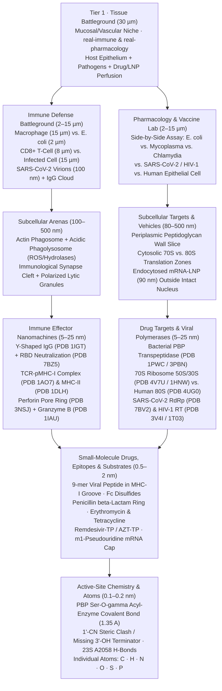

# 18 — Immune Defense & Applied Medicine: Antibiotics, Antivirals & Vaccines

**Iteration:** `18` (Capstone Immune Defense Battleground & Targeted Pharmacology / mRNA-LNP Vaccine WebGL2 Labs, Whole-to-Tiniest Molecular Cascade, 3-Persona Guided Tours & GPU `.opus` Narration in `EN` & `ES`)  
**Status:** ✅ **Completed**  
**Parent Index:** [`roadmap/README.md`](./README.md)  
**Previous Step:** [`17-specialized-human-cells-and-cell-differentiation.md`](./17-specialized-human-cells-and-cell-differentiation.md)  
**Next Step:** *(Curriculum Capstone — End of Intro Biology Track)*

---

## 1. Executive Summary & Pedagogical Goals

Across `Stages 0–4` and `Phases 09–17`, learners built a complete structural understanding of free-living bacteria (**Stage 1 · *E. coli***), compartmentalized human cells (**Stage 2 · Animal Cell**), wall-less and intracellular minimal bacteria (**Stage 3 · *Mycoplasma*, *Chlamydia*, *Rickettsia***), and acellular genetic hijackers (**Stage 4 · SARS-CoV-2, HIV-1**). Yet introductory biology courses routinely treat **immunology** and **pharmacology** as separate memorized word lists instead of the direct mechanical consequence of structural cell biology.

**Phase 18** serves as the practical **Curriculum Capstone** of `learn-biology` (`https://learn.bexonia.com`), directly reusing our existing pathogen and human-cell 3D models to show—strictly from **Whole (`30 µm`) → Tiniest (`0.1 nm` atoms)**—how human defenses distinguish *self* from *non-self*, and how modern medicines exploit exact structural differences between bacterial, viral, and human nanomachines:

- **Why antibiotics are useless against viruses:** Viruses carry **zero peptidoglycan cell walls** and **zero `70S` ribosomes**, so β-lactams and bacterial ribosome blockers have no molecular target on SARS-CoV-2 or HIV-1.
- **Why one antibiotic does not fit every bacterium:** Penicillin destroys *E. coli* by halting peptidoglycan cross-linking, yet has **zero effect** on wall-less ***Mycoplasma*** (`Stage 3`)—whereas **macrolides** and **tetracyclines** silence *E. coli*, *Mycoplasma*, and intracellular *Chlamydia* alike because all three translate proteins on bacterial **`70S` ribosomes**, leaving human **`80S` ribosomes** intact.
- **How direct-acting antivirals block replication selectively:** Nucleoside triphosphate analogs mimic RNA/DNA building blocks and preferentially stall viral **RdRp** or **HIV-1 Reverse Transcriptase** while sparing host nuclear polymerases.
- **How mRNA-LNP vaccines train adaptive immunity safely:** Ionizable lipid nanoparticles deliver transient spike-encoding mRNA straight to cytosolic **`80S` ribosomes**—visibly outside the intact **nuclear envelope**, never entering the nucleus or modifying chromosomal DNA—so cells display viral antigens on **MHC** and forge durable B-cell and T-cell memory before host `RNases` recycle the message.

Phase 18 ships **two capstone standalone realistic WebGL2 experiences, unified Explorer drill-down subtrees, two bilingual 3-persona Guided Tours, and sharded `< 48 MB` GPU `.opus` audio archives**:

1. **Immune Defense Battleground (`immune_defense_realistic.html`, `root: 'real-immune'`):**
   - **Innate Immunity (Macrophage Phagocytosis & MHC-II Presentation):** A patrolling human **Macrophage (`~15 µm`)** senses bacterial lipopolysaccharide (`LPS`) / opsonized *E. coli*, extends Arp2/3-branched **F-actin pseudopods** to seal the bacterium inside a **phagosome**, and fuses it with acidic **lysosomes** (`V-ATPase` `H⁺` pumps to `pH ~4.5–5.0`, **NADPH oxidase `NOX2` reactive oxygen burst** `O₂ → O₂•⁻ → H₂O₂ → HOCl`, plus cathepsin and lysozyme hydrolases). Digested bacterial peptide fragments are loaded onto **MHC Class II (`MHC-II`, PDB `1DLH`)** and exported to the plasma membrane to recruit CD4⁺ Helper T-cells.
   - **Adaptive Humoral Immunity (IgG Spike Neutralization):** B-cell-secreted Y-shaped **IgG antibodies (`PDB 1IGT`)** lock their variable `Fab` tips onto exposed **SARS-CoV-2 Spike Receptor-Binding Domains (`RBDs`, PDB `7BZ5` / `6VXX`)**, sterically preventing virion docking onto host **ACE2 (`PDB 6M0J`)** while exposing `Fc` stems that flag neutralized virions for macrophage phagocytosis (opsonization).
   - **Adaptive Cellular Immunity (Cytotoxic CD8⁺ T-Cell & Immunological Synapse):** A **Cytotoxic CD8⁺ T-Cell (`~8 µm`)** forms a tight **immunological synapse** by docking its **T-Cell Receptor (`TCR`)** onto a virus-infected human epithelial cell's **MHC Class I (`MHC-I`, PDB `1AO7`)** presenting an endogenous `8–10` amino-acid viral peptide. Recognition polarizes lytic granules to the synapse, firing **perforin (`PDB 3NSJ`)** transmembrane pores (`~16–20 nm`) and delivering **granzyme B (`PDB 1IAU`)** serine proteases that cleave pro-caspase-3 to trigger orderly **apoptosis** before viral progeny can burst free.

2. **Targeted Pharmacology & Vaccine Mechanism Lab (`pharmacology_lab.html`, `root: 'real-pharmacology'`):**
   - **β-Lactam Antibiotic (`Penicillin G` / `Amoxicillin`):** Diffuses through *E. coli* outer membrane porins (`OmpF`/`OmpC`) into the periplasm, where its strained 4-membered **β-lactam ring** mimics the natural `D-Ala–D-Ala` peptidoglycan stem and forms a stable **covalent acyl-enzyme ester bond** with the catalytic **active-site serine** of bacterial **PBP transpeptidase (`PDB 1PWC`, `3PBN`)**. Cross-linking halts while remodeling autolysins continue nicking the mesh, causing *E. coli* to rupture osmotically (`~2–5 atm` turgor). A live side-by-side bench comparator demonstrates **zero lysis** on wall-less ***Mycoplasma genitalium***, acellular **SARS-CoV-2 / HIV-1**, and human cells.
   - **Ribosome-Selective Antibiotic (`Macrolide` & `Tetracycline`):** Exploits atomic pocket differences between bacterial **`70S` ribosomes** (`50S + 30S`, `23S`/`16S` rRNA) and human cytosolic **`80S` ribosomes (`PDB 4UG0`)**. **Erythromycin / Azithromycin (`PDB 4V7U`)** plugs the **`50S` nascent polypeptide exit tunnel** (`23S` rRNA `A2058` pocket), while **Tetracycline (`PDB 1HNW`)** occupies the **`30S` `A`-site decoding center** (`16S` rRNA) to block incoming `aminoacyl-tRNA`. Effective against *E. coli*, wall-less *Mycoplasma*, and intracellular *Chlamydia* alike, while leaving human cytosolic `80S` ribosomes running smoothly and showing zero target on viruses.
   - **Direct-Acting Antiviral (`Nucleoside Analog`):** Intracellular host kinases phosphorylate prodrugs into active **nucleoside triphosphates** incorporated preferentially by viral polymerases: **Remdesivir-TP (`PDB 7BV2`)** integrated by SARS-CoV-2 **RdRp (`nsp12–nsp7–nsp8`)** triggers `i+3` delayed chain termination via a `1'-cyano` steric clash (`Ser861`), while **AZT-TP (`PDB 3V4I`)** / **Tenofovir-DP (`PDB 1T03`)** integrated by **HIV-1 Reverse Transcriptase (`p66/p51`)** lacks a `3'-OH` nucleophile for immediate obligate chain termination.
   - **mRNA-LNP Vaccine Mechanism:** An `~80–100 nm` **Lipid Nanoparticle (`LNP`)** (ionizable cationic lipid, DSPC, cholesterol, PEG-lipid) enters by endocytosis, protonates as endosomal pH drops (`pH ~6.0`) to release `N¹`-methylpseudouridine (`m¹Ψ`)-modified, `5'`-capped, `3'`-poly(A) prefusion-stabilized (`2P`) spike mRNA directly into the **cytosol**. Cytosolic **`80S` ribosomes** translate Spike protein while the intact **nuclear envelope** clearly walls off host chromosomal DNA (`zero nuclear import`, `zero genomic integration`). Expressed spike peptides load onto **MHC-I** (and **MHC-II** on antigen-presenting cells) to train neutralizing **B-cell / IgG** and **CD8⁺ / CD4⁺ T-cell memory**, after which host ribonucleases (`RNases`) degrade the mRNA within days.

---

## 2. Whole-to-Tiniest Drill-Down Architecture

Every camera preset, clickable Explorer node, and interactive lab toggle moves continuously down **six logarithmic spatial tiers**—reusing canonical PDB coordinates and existing Stage `1–4` cellular/viral geometries down to active-site covalent bonds and individual atoms:

### Whole → Tiniest Scale Cascade Specification

| Tier | Scale Band | Primary Biological / Medical Structures | Verified PDB / Structural Basis | Visual Focus in WebGL2 |
| :--- | :---: | :--- | :--- | :--- |
| **1 · Tissue Niche** | `~30 µm` | Vascular/mucosal battleground; patrolling macrophage, epithelial monolayer, diffusing antibiotics & LNPs | Composed from existing `Stage 1–4` cell & virion meshes | Wide establishing vista comparing living cells, minimal bacteria, and virions at shared scale |
| **2 · Cellular Actors** | `2 – 15 µm` | Macrophage (`15 µm`), CD8⁺ T-cell (`8 µm`), Human epithelial cell (`15–20 µm`), *E. coli* (`2 µm`), *Chlamydia* inclusion (`4 µm`), *Mycoplasma* (`0.3–0.6 µm`) | Reuse `animal_cell_realistic`, `prokaryote_cell_realistic`, `mycoplasma_realistic`, `chlamydia_realistic` | Phagocytic engulfment, osmotic *E. coli* rupture vs. unharmed *Mycoplasma*, cytosolic vs. nuclear compartments |
| **3 · Subcellular Arenas** | `80 – 500 nm` | Phagolysosome (`~1 µm` / fusion vesicles `200–400 nm`), Immunological synapse (`~500 nm` patch, `15–30 nm` cleft), mRNA-LNP (`80–100 nm`), SARS-CoV-2 / HIV-1 (`100–120 nm`) | Cutaway membranes, Arp2/3 actin mesh, `6VXX`/`6VYB` virions, ionizable LNP bilayer shell | Acidification (`pH 4.5`) & ROS bursts, polarized lytic granule exocytosis, endosomal LNP escape outside intact nucleus |
| **4 · Nanomachines** | `5 – 25 nm` | `IgG` (`14 nm`), `TCR–pMHC-I` (`15 nm`), `MHC-II` (`8 nm`), Perforin pore (`18 nm`), `PBP` (`8 nm`), `70S` (`21 nm`) vs. `80S` (`28 nm`) ribosomes, `RdRp` (`10 nm`), `HIV-1 RT` (`10 nm`) | `1IGT`, `7BZ5`, `6M0J`, `1AO7`, `1DLH`, `3NSJ`, `1IAU`, `1PWC`, `3PBN`, `4V7U`, `1HNW`, `4UG0`, `7BV2`, `3V4I`, `1T03` | Exact steric blocking of RBD–ACE2, peptide docking in MHC grooves, exit-tunnel jamming, polymerase stalling |
| **5 · Small Molecules & Epitopes** | `0.5 – 2 nm` | Penicillin G (`1.1 nm`), Erythromycin (`1.3 nm`), Tetracycline (`1.2 nm`), Remdesivir-TP / AZT-TP (`1.5 nm`), `9`-mer peptide (`2.5 nm`), `D-Ala–D-Ala` (`1.2 nm`), `m¹Ψ` ribonucleotide (`1.0 nm`) | Atomic ligand coordinates extracted from `1PWC`, `4V7U`, `1HNW`, `7BV2`, `3V4I`, `1AO7` | Ball-and-stick pharmacophores docked inside enzyme/rRNA pockets with H-bond & steric clash overlays |
| **6 · Active-Site Bonds & Atoms** | `0.1 – 0.2 nm` | Penicillin β-lactam carbonyl `C=O` → PBP `Ser` `Oγ` covalent ester (`1.35 Å`), missing `3'-OH` on AZT-TP, `1'-CN` clash on RDV-TP, `S` in thiazolidine/disulfides, `P` in triphosphates | Atomic orbital / covalent-bond close-up nodes (`C, H, N, O, S, P`) | Clicking any drug or active site drills cleanly to individual `C, H, N, O, S, P` atoms (`0.1–0.18 nm`) |

### Immune Arms & Drug-Selectivity Matrix (Bacteria vs. *Mycoplasma* vs. Viruses vs. Human Cells)

| Defense Arm / Therapeutic Class | Molecular Target & Verified PDB IDs | Autonomous Bacteria (*E. coli* · Stage 1) | Minimal / Intracellular Bacteria (*Mycoplasma* / *Chlamydia* · Stage 3) | Acellular Viruses (SARS-CoV-2 / HIV-1 · Stage 4) | Human Host Cells (Animal Cell · Stage 2) |
| :--- | :--- | :--- | :--- | :--- | :--- |
| **Innate Macrophage Phagocytosis** | `TLR4`/`FcγR` → F-actin phagosome + `NOX2` ROS + lysosome → `MHC-II` (`1DLH`) | ✅ **Engulfed & Digested**; peptides displayed on `MHC-II` | ⚠️ **Partial / Evaded** (*Chlamydia* blocks fusion via `Inc`/`T3SS`; *Mycoplasma* hides on cilia) | ⚠️ **Clearance of Opsonized Virions** (cannot clear intracellular replication alone) | 🛡️ **Spared** ("self" `CD47` / healthy surface signals inhibit engulfment) |
| **Adaptive Humoral (`IgG` Antibodies)** | `IgG` (`1IGT`) `Fab` blocks Spike `RBD` (`7BZ5`) vs. `ACE2` (`6M0J`); `Fc` opsonizes | ✅ **Opsonized & Complement-Tagged** (surface LPS/OMP epitopes) | ⚠️ **Limited on Intracellular Niche** (effective on extracellular *Mycoplasma* / *Chlamydia* `EB` only) | ✅ **Neutralized Before Entry** (`Fab` caps Spike/Env; blocks receptor docking) | 🛡️ **Spared** (central B-cell tolerance eliminates self-reactive clones) |
| **Adaptive Cellular (`CD8⁺` Cytotoxic T-Cell)** | `TCR–pMHC-I` (`1AO7`) → Perforin pores (`3NSJ`) + Granzyme B (`1IAU`) | ➖ **Extracellular** (typically handled by phagocytes + `MHC-II` / `CD4⁺` help) | ✅ **Targets Infected Host Cells** (clears cytosolic/intracellular *Chlamydia* / *Rickettsia* reservoirs) | ✅ **Eliminates Virus Factories** (lyses infected host cells presenting viral peptides on `MHC-I`) | 🎯 **Infected Self Only** (healthy cells showing self-peptides on `MHC-I` are spared) |
| **β-Lactam Antibiotic (`Penicillin` / `Amoxicillin`)** | Bacterial `PBP` transpeptidase active-site `Ser` (`1PWC`, `3PBN`) | ✅ **Bactericidal Osmotic Lysis** (halts peptidoglycan cross-linking) | ❌ **Zero Effect on *Mycoplasma*** (no cell wall, no PBP); ⚠️ weak/stalled on *Chlamydia* (septal ring only) | ❌ **Zero Effect** (acellular: zero cell wall, zero PBP enzymes) | 🛡️ **Untouched** (animal cells lack peptidoglycan walls & PBPs) |
| **Ribosome-Selective Antibiotic (`Macrolide` / `Tetracycline`)** | Bacterial `70S` ribosome: `50S` exit tunnel (`4V7U`) / `30S` `A`-site (`1HNW`) | ✅ **Stops Protein Synthesis** (jams bacterial `70S` translation) | ✅ **Effective Against Both** (*Mycoplasma* & *Chlamydia* rely on bacterial `70S` ribosomes!) | ❌ **Zero Effect** (viruses have `0` ribosomes; they hijack host `80S` ribosomes) | 🛡️ **Cytosolic `80S` (`4UG0`) Untouched** (`28S`/`18S` rRNA pocket divergence prevents binding) |
| **Direct-Acting Antiviral (`Remdesivir-TP` / `AZT-TP`)** | Viral `RdRp` (`7BV2`) or `HIV-1 RT` (`3V4I`, `1T03`) active site | ❌ **Ineffective** (bacterial `DNA Pol` / `RNAP` reject viral prodrug geometry) | ❌ **Ineffective** (standard bacterial polymerases unaffected) | ✅ **Halts Viral Genome Synthesis** (`i+3` delayed stall in `RdRp`; `3'-OH` obligate stop in `HIV RT`) | 🛡️ **Minimal Off-Target Impact** (host nuclear polymerases discriminate & proofread) |
| **mRNA-LNP Vaccine (Adaptive Priming)** | `LNP` (`90 nm`) → cytosolic `80S` (`4UG0`) → Spike (`6VXX`) → `MHC-I/II` (`1AO7`, `1DLH`) → `IgG` (`1IGT`) | ➖ **Pathogen-Specific Design** (bacterial vaccines target toxoids/polysaccharides or conserved proteins) | ➖ **Pathogen-Specific Design** (antigen-specific; trains immunity only to encoded target) | ✅ **Pre-Trains Neutralizing Memory** (blocks SARS-CoV-2 before severe infection; zero live virus needed) | 🛡️ **Safe & Transient** (mRNA stays cytosolic outside intact nucleus; never edits DNA; degraded by `RNases`) |

---

## 3. Interactive Guided Tour / Tutorial Spec

Phase 18 introduces **two capstone narrated Guided Tours** built on the `TourService` + `postMessage` realistic-page engine, backed by one unified bilingual 3-persona script module:

- [`src/tours/immune_defense.ts`](../src/tours/immune_defense.ts) (`root: 'real-immune'`, `5` chapters, `~54` timed cues, ~5.5 min)
- [`src/tours/pharmacology.ts`](../src/tours/pharmacology.ts) (`root: 'real-pharmacology'`, `5` chapters, `~62` timed cues, ~6.0 min)
- [`src/tours/personas_immune_medicine.ts`](../src/tours/personas_immune_medicine.ts) (`EN` & `ES` × `pop` [`Everyday Guide` · `Simple`/`Story`], `blueprint` [`Systems Engineer`], and `scientific` [`Molecular Biologist`])

### Script Parity & Strict Analogy-Restraint Rules (`AGENTS.md` Rule 8)

1. **Character Budget & Markup Parity:** Every single cue across `EN` and `ES` and across all `3` personas stays strictly **`<= 110` plain characters** (excluding `[[label|part]]` tags) and preserves **100% identical `|part` highlight targets** so 3D mesh blinking stays synchronized regardless of language or active persona.
2. **Strict Analogy Restraint (`> 95%` Direct Prose):** Following `AGENTS.md` Rule 8, `> 95%` of cues—including all introductions, spatial dimensions, camera cutaways, UI prompts, drug names, and chapter recaps—use clean, direct, distraction-free biological prose. Each tour contains **exact `2–3` purposeful analogies ONLY** (~1 every ~2 minutes), strictly earmarked for non-obvious core mechanisms:
   - **`immune_defense.ts` (`2` earmarked analogy cues out of `54` total → `96.3%` direct prose; optional 3rd only if expanded to `>= 62` cues):**
     1. **`MHC-I` internal peptide display (`ch3`):** Explains how surface **MHC-I** acts like an **exterior status window**, continuously displaying chopped snapshots of internal proteins so patrolling CD8⁺ T-cells inspect infection without tearing open healthy cells.
     2. **`IgG` neutralization & opsonization (`ch2`):** Explains how `IgG` `Fab` arms lock onto viral **Spike RBDs** like **fitted caps over key teeth**, preventing the spike from turning the host `ACE2` receptor lock while the `Fc` stem flags macrophages.
   - **`pharmacology.ts` (`3` earmarked analogy cues out of `62` total → `95.2%` direct prose):**
     1. **Penicillin covalent suicide inhibition (`ch1`):** Explains how penicillin's strained β-lactam ring acts as a **decoy structural bolt that welds itself permanently into PBP's active site**, freezing wall repair while internal osmotic pressure bursts *E. coli*.
     2. **Nucleoside analog chain termination (`ch3`):** Explains how Remdesivir-TP and AZT-TP stall viral polymerases like a **defective railroad tie missing the next coupling clasp**, letting `RdRp` or `HIV-1 RT` bolt it in before genome synthesis grinds to a halt.
     3. **`mRNA-LNP` vaccine mechanism (`ch4`):** Explains how vaccine **mRNA** works as a **temporary practice blueprint that dissolves after training**—cytosolic `80S` ribosomes read it to assemble harmless spike antigens that train B-cell and T-cell memory while chromosomal DNA stays locked untouched inside the nuclear envelope and host `RNases` clear the mRNA within days.

### Chapter-by-Chapter Tour Outlines

#### Tour A: `src/tours/immune_defense.ts` (`root: 'real-immune'`)
- **`ch0` — The Tissue Battleground (`30 µm`):** Establishes patrolling human immune cells alongside Stage 1 *E. coli* and Stage 4 SARS-CoV-2 at shared scale; introduces innate vs. adaptive defense.
- **`ch1` — Innate Immunity: Macrophage Phagocytosis & `MHC-II`:** Follows Arp2/3 actin pseudopods engulfing *E. coli*, phagosome-lysosome fusion (`pH ~4.5`, `NOX2` ROS burst, hydrolases), and bacterial peptide export on `MHC-II` (`PDB 1DLH`).
- **`ch2` — Humoral Immunity: `IgG` Antibody Neutralization:** Zooms to `14 nm` Y-shaped `IgG` (`PDB 1IGT`) locking `Fab` tips onto SARS-CoV-2 `Spike RBDs` (`PDB 7BZ5`), blocking `ACE2` (`PDB 6M0J`) docking and exposing `Fc` opsonization stems.
- **`ch3` — Cellular Immunity: `CD8⁺` T-Cell & `MHC-I` Surveillance:** Flies into the `15 nm` immunological synapse cleft, drilling onto the `TCR–pMHC-I` ternary complex (`PDB 1AO7`) reading a `9`-mer viral peptide *(earmarked exterior-status-window analogy)*.
- **`ch4` — Perforin Pores, Granzyme Apoptosis & Atomic Recognition:** Animates `Ca²⁺`-triggered **perforin (`PDB 3NSJ`)** pore assembly and **granzyme B (`PDB 1IAU`)** caspase activation, then zooms to `CDR3`–peptide hydrogen bonds and `C, H, N, O, S` atoms.

#### Tour B: `src/tours/pharmacology.ts` (`root: 'real-pharmacology'`)
- **`ch0` — Selective Toxicity: Exploiting Structural Differences:** Opens the 4-organism assay bench (*E. coli*, *Mycoplasma*, SARS-CoV-2/HIV-1, Human Cell), connecting Stage `1–4` anatomy directly to rational drug design.
- **`ch1` — β-Lactam Antibiotics: Penicillin vs. Peptidoglycan (`PBP`):** Zooms from osmotic *E. coli* lysis down to the `1.35 Å` covalent ester bond between penicillin's β-lactam carbonyl and PBP's catalytic serine (`PDB 1PWC`, `3PBN`), then pans live to untouched wall-less *Mycoplasma* and viruses.
- **`ch2` — Ribosome Selectivity: `70S` vs. `80S` (`Macrolides` & `Tetracyclines`):** Compares bacterial `70S` (`50S` exit tunnel `PDB 4V7U` + `30S` `A`-site `PDB 1HNW`) against human cytosolic `80S` (`PDB 4UG0`), demonstrating why these drugs halt *E. coli*, *Mycoplasma*, and *Chlamydia* while leaving human ribosomes running and viruses unaffected.
- **`ch3` — Direct-Acting Antivirals: Nucleoside Analogs in `RdRp` & `HIV RT`:** Drills into SARS-CoV-2 `RdRp` (`PDB 7BV2`) stalling at `i+3` on Remdesivir-TP and `HIV-1 RT` (`PDB 3V4I`) halting immediately on `3'-OH`-less AZT-TP *(earmarked chain-terminator analogy)*.
- **`ch4` — `mRNA-LNP` Vaccines: Cytosolic Training & Capstone Synthesis:** Tracks an `~90 nm` `LNP` through endosomal escape, shows cytosolic `80S` spike translation strictly outside the intact nuclear envelope *(earmarked practice-blueprint analogy)*, displays `MHC-I/II` memory priming and `RNase` clearance, and finishes at `C, H, N, O, S, P` atoms with the **Curriculum Capstone Complete** summary.

### Representative Cue Parity Examples (`<= 110` Plain Chars, Verbatim `[[label|part]]` Markup)

- **`immune_defense` · Direct Prose (`pop` · `EN: 83` / `ES: 84` plain chars):**
  - `EN:` `The [[macrophage|macrophage]] wraps [[actin pseudopods|pseudopod]] around E. coli to seal it inside a phagosome.`
  - `ES:` `El [[macrófago|macrophage]] rodea a E. coli con [[pseudópodos de actina|pseudopod]] y lo encierra en un fagosoma.`
- **`immune_defense` · Analogy #1 — `MHC-I` Status Window (`pop` · `EN: 97` / `ES: 92` plain chars):**
  - `EN:` `Surface [[MHC-I|mhci]] works like a status window, displaying internal protein pieces for passing [[T-cells|cd8]].`
  - `ES:` `El [[MHC-I|mhci]] actúa como una ventana de estado, mostrando fragmentos internos a los [[linfocitos T|cd8]].`
- **`pharmacology` · Direct Prose (`pop` · `EN: 90` / `ES: 89` plain chars):**
  - `EN:` `[[Penicillin|penicillin]] bonds the active serine of [[PBP|pbp]], stopping cell-wall repair until E. coli bursts.`
  - `ES:` `La [[penicilina|penicillin]] bloquea la serina activa de [[PBP|pbp]] y frena la pared hasta que E. coli estalla.`
- **`pharmacology` · Analogy #3 — `mRNA-LNP` Practice Blueprint (`pop` · `EN: 85` / `ES: 87` plain chars):**
  - `EN:` `Vaccine [[mRNA|vaccine_mrna]] is a practice blueprint for [[80S ribosomes|ribo80]] that dissolves after training.`
  - `ES:` `El [[ARNm|vaccine_mrna]] vacunal es un plano de práctica para [[ribosomas 80S|ribo80]] que se disuelve al terminar.`

---

## 4. Implementation Steps & File Plan

### Step 1: Standalone Realistic WebGL2 Pages & Bundles (`src/pages/`)
- Build two standalone HTML + TypeScript WebGL2 pages implementing the full `postMessage` tour API (`track`, `fly`, `free`, `blink`, `ghost`, `set`, `arrived`, `focusOf`), `window.__cell` debug hooks (`shot`, `step`, `sites`, `procs`, `flows`, `pointsOf`), and live particle/reaction simulations:
  1. [`immune_defense_realistic.html`](../immune_defense_realistic.html) + `src/pages/immune_defense_realistic.ts` (`~22` inspectable parts: `macrophage`, `pseudopod`, `tlr4`, `phagosome`, `lysosome`, `nox2_ros`, `mhcii`, `ecoli_target`, `igg`, `fab`, `fc`, `spike_rbd`, `ace2`, `virion_target`, `cd8`, `synapse`, `tcr`, `mhci`, `peptide9`, `perforin`, `granzyme`, `infected_cell`).
  2. [`pharmacology_lab.html`](../pharmacology_lab.html) + `src/pages/pharmacology_lab.ts` (`~24` inspectable parts: `bench_ecoli`, `bench_myco`, `bench_chlam`, `bench_virus`, `bench_human`, `porin`, `peptidoglycan`, `pbp`, `penicillin`, `ser_bond`, `ribo70`, `exit_tunnel`, `macrolide`, `site_a30`, `tetracycline`, `ribo80`, `rdrp`, `remdesivir`, `hiv_rt`, `azt`, `lnp`, `endosome`, `vaccine_mrna`, `nuclear_barrier`). Includes an interactive **Drug × Target Selectivity Toggle** (`Penicillin` · `Macrolide/Tetracycline` · `Nucleoside Analog` · `mRNA-LNP Vaccine`) animating live outcome states across all four biological tiers simultaneously.
- Register both pages in `STANDALONE_PAGE_PART_KEYS` ([`src/content/registry.ts`](../src/content/registry.ts)), `HTML_PAGES`, `sitemap.xml`, `README.md`, and author manuals (`docs/immune_defense_manual.md`, `docs/pharmacology_lab_manual.md`) per `AGENTS.md` Rule 7. Both TypeScript entrypoints are compiled automatically by `npm run build` (`esbuild src/pages/*.ts`).

### Step 2: Coarse-Grained Real PDB Structures (`tools/`)
- Extend `tools/embed_structures.py` to fetch, coarse-grain, and emit single-line embedded protein/ligand geometry blocks (`AGENTS.md` Rule 4) for `1IGT`, `7BZ5`, `6M0J`, `1AO7`, `1DLH`, `3NSJ`, `1IAU`, `1PWC`, `3PBN`, `4V7U`, `1HNW`, `4UG0`, `7BV2`, `3V4I`, and `1T03`, composing directly alongside existing `6VXX`/`6VYB` Spike and Stage `1–4` cellular primitives (`AGENTS.md` Rule 1: Isolate, then compose).

### Step 3: Explorer Subtrees (`NODES`), Capstone Curriculum Tree & 4-Mode Lenses (`src/content/`)
- Add the **Capstone Curriculum Group** (`Immune Defense & Applied Medicine`) to `MENU_GROUPS` in [`src/pages/cell_explorer.ts`](../src/pages/cell_explorer.ts) exposing `real-immune` and `real-pharmacology`, plus `~28` zoomable Whole → Tiniest child nodes (`macrophage-phagolysosome`, `mhc-ii-presentation`, `igg-antibody-1igt`, `spike-rbd-neutralization`, `cd8-synapse`, `tcr-mhc-i-1ao7`, `perforin-granzyme-apoptosis`, `pbp-penicillin-covalent`, `beta-lactam-ring`, `ribosome-70s-macrolide`, `ribosome-30s-tetracycline`, `ribosome-80s-selectivity`, `rdrp-remdesivir-stall`, `hiv-rt-azt-terminator`, `mrna-lnp-vaccine`, `active-site-covalent-bond`, and atomic `S` / `P` / `C` / `N` / `O` / `H` nodes).
- Author `src/content/lenses_immune_medicine.ts` with complete `EN` & `ES` `Simple`, `Story`, `Blueprint`, and `Scientific` lenses for every new Explorer node and all `~46` standalone 3D hover parts, preserving `100%` `[[Label|nodeId]]` supply-chain cross-links back to *E. coli*, Animal Cell, *Mycoplasma*, *Chlamydia*, SARS-CoV-2, and HIV-1.
- Update [`src/core/locales/es_nodes.ts`](../src/core/locales/es_nodes.ts), [`src/core/locales/es_tours.ts`](../src/core/locales/es_tours.ts), and [`src/core/locales/es_phrases.ts`](../src/core/locales/es_phrases.ts) for 100% bilingual UI, tag, anchor, part, and recipe parity.
- Append `'real-immune'` and `'real-pharmacology'` to `COURSE_SEQUENCE` in [`src/core/progress_service.ts`](../src/core/progress_service.ts) as the final **Curriculum Capstone**, surfacing a Capstone Track Completion badge on `#tCard` once completed.

### Step 4: Guided Tours & Multi-Persona Scripts (`src/tours/`)
- Create `src/tours/immune_defense.ts`, `src/tours/pharmacology.ts`, and `src/tours/personas_immune_medicine.ts`, wiring both tours into [`src/tours/index.ts`](../src/tours/index.ts) and [`src/tours/tour_personas.ts`](../src/tours/tour_personas.ts).

### Step 5: Sharded `< 48 MB` GPU `.opus` Packaging (`Makefile`, `Dockerfile`, `.github/workflows/deploy.yml`)
- Export the updated cue manifest (`make export-cues`) and synthesize all Phase 18 Tour (`EN` `v1`/`v2`/`v3`, `ES` `latam` + `spain/{blueprint,scientific}`) and Explorer Lens `.opus` clips locally on GPU via `GPT-SoVITS` and `F5-Spanish` using Public-Domain (`CC0`) voices in `tools/voices/`.
- Package Phase 18 audio into dedicated `< 48 MB` shards (`audio_phase18_en.tar.gz`, `audio_phase18_es.tar.gz`) wired cleanly into `AUDIO_ARCHIVES`, `BASE_EXCLUDE`, `unpack-audio`, and `pack-audio` in [`Makefile`](../Makefile), [`Dockerfile`](../Dockerfile), and [`.github/workflows/deploy.yml`](../.github/workflows/deploy.yml).

---

## 5. Verification Gates (`tests/verify_all.ts` & Visual Eye-Check)

1. **TypeScript Build & Standalone WebGL2 E2E (`make typecheck && make build && make test`):**
   - Headless Chrome WebGL2 E2E renders `immune_defense_realistic.html` and `pharmacology_lab.html` (both standalone and embedded inside `cell_explorer.html?embed`) with `0` console/page errors, asserting 100% of declared parts in `STANDALONE_PAGE_PART_KEYS`, camera presets, `postMessage` tour hooks, interactive Drug × Organism selectivity matrix states, and live particle flows (`ROS`, `IgG`, `perforin`, `penicillin`, `macrolide`, `RDV-TP`, `LNP-mRNA`).
2. **Multi-Persona Tour & Strict Analogy-Restraint Validation:**
   - Automated unit assertions in `tests/verify_all.ts` verify every cue in `immune_defense.ts` and `pharmacology.ts` across `EN` & `ES` (`pop`, `blueprint`, `scientific`) stays strictly `<= 110` plain chars, preserves 100% `[[...|part]]` highlight parity, and complies with `AGENTS.md` Rule 8 (`> 95%` direct prose and exact `2–3` complex-concept analogies per tour).
3. **Explorer Tree, 4-Mode Lenses, Capstone Completion & `.opus` Integrity:**
   - Asserts 100% `[[Label|nodeId]]` resolution (including backward cross-links into Stages `1–4`), 4-mode lens distinctness, `COURSE_SEQUENCE` capstone completion transitions in `CourseProgressManager`, valid `OggS` `.opus` headers across all 5 voices for every Phase 18 cue and lens, and `< 48 MB` size limits on `audio_phase18_en.tar.gz` and `audio_phase18_es.tar.gz`.
4. **Visual Eye-Check (`AGENTS.md` Rule 6):**
   - Serve locally with `python3 tools/serve.py "$(pwd)" 8765`, render every new view via `__cell.shot(...)` across all six **Whole (`30 µm`) → Tiniest (`0.1 nm`)** depths (confirming visual clarity of phagocytic pseudopods, `IgG`–RBD steric block, `TCR–pMHC-I` synapse, `1.35 Å` β-lactam–Ser bond, `70S` vs. `80S` ribosome pockets, and cytosolic mRNA translation outside the intact nuclear envelope), run 30 simulated seconds to verify reaction/flow counts, time frame rendering, confirm every Explorer tag renders cleanly without overlap, and inspect the browser console for zero errors.
